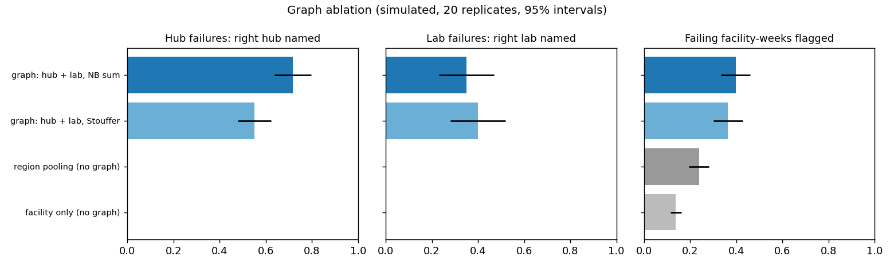
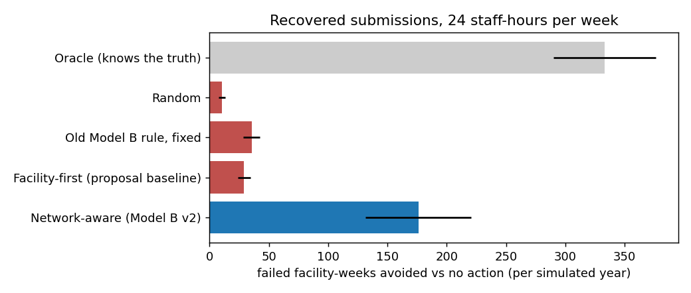
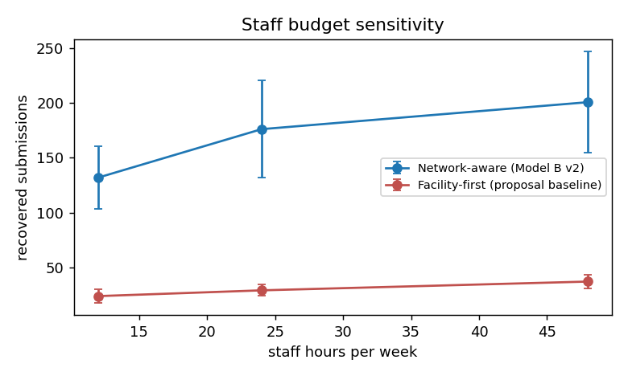

# Steps 3 and 4: reporting network and Model B v2

Generated by `python -m iris_pipeline model-b` · runtime 18.1 min · simulated data is fictional; the last two sections use the real data.

## In plain words

- **The network.** A simulated reporting network of 506 facilities, 70 reporting hubs, 36 labs and 17 RESUs, laid over the real 126 provinces and cities and fed with their real dengue counts. Failures are simulated on top, so the truth is known exactly.
- **Does the graph help detection?** Yes. Knowing which facilities share a hub or lab, IRIS names the right hub in 72% of hub outages and the right lab in 35% of lab failures. Without the graph it can name neither (0%). It also flags 40% of failing facility-weeks instead of 14%, at the cost of more false alarms (2.1% vs 0.4% of normal facility-weeks).
- **Does network-aware planning help?** Yes. With the same 24 staff-hours a week, Model B v2 restores 176 failed facility-weeks per simulated year, against 29 for fixing facilities one by one (the proposal's baseline): 0.14 vs 0.02 per staff-hour. It acts on the shared source first in 84% of shared failures, and shared failures last 2.7 weeks instead of 4.7. An oracle that knows the truth restores 333, so there is room left, mostly in detection.
- **Today's Model B on the real errors.** Among zero reports it is a coin flip (AUC 0.52), as the roadmap found. But 157 of the 158 real 2020 swaps are zeros, and simply being a zero is strong evidence: at the 1% budget its published form catches 28% of them with 4.7% false alerts, more than Model A v2 (9% at 5.5%). Model A v2 still ranks zeros better (AUC 0.66) and is the only one that can see partial reports. This is a lesson for Model A, recorded as a next step; nothing was tuned on 2020.
- **A real 2020 plan.** `plan_real_2020.csv` lists 474 actions over 52 weeks within 24 hours a week, with the evidence for each. They are leads to verify, not proven failures.

## How the simulation was kept honest

- **Separate tuning and test replicates.** Every threshold, the facility correlation and every probability calibrator were set on 5 tuning replicates; all results are on 20 different test replicates. Each replicate draws its own failures and its own facility-level noise.
- **Same luck for every policy.** Failures, noise and whether an action succeeds depend only on the seed, the week and the action (common random numbers), so differences come from the decisions.
- **Detection is Model A v2 itself:** the same count model and options (`recent1+uncertainty`), fitted per facility on the 2 years before the simulated year and updated online from the reports actually received.
- **Action numbers are not ours:** hours, success probabilities and days to effect are copied from the IRIS backend's planner defaults (`backend/iris/optimization/planner.py`); only the peso costs are added.
- **The optimizer is exact:** tests check it against brute force and against the IRIS knapsack.

### Design log

The base year was chosen after two 5-seed trials, both reported here. With tuning and test in different years, the change of year dominated false alarms (tune 2019 → test 2020: facility false-alert rate 5.9%; tune 2018 → test 2019: 7.4%; budget 1%), because the facility models are not refitted during the simulated year. That is Model A's year-shift problem, already measured on real data in session 1, and it would confound the network and planning questions. So tuning and test share base year 2018 and differ in seeds; 2019 and 2020 are run as stress tests below. The summed-count test was also given a correlation term after the first trial showed it over-alarming when facilities were treated as independent.

## Step 3: graph ablation (base year 2018, 20 test replicates, no interventions)

Facility threshold p_low < 0.0105 (best F1 within 1% false alerts on the tuning replicates). Source thresholds at 1% of normal source-weeks. Correlation between facilities behind one source (tuning replicates): hub 0.29, lab 0.18, region 0.19. Means over replicates with 95% intervals.

| metric | facility only (no graph) | region pooling (no graph) | graph: hub + lab, Stouffer | graph: hub + lab, NB sum |
|---|---|---|---|---|
| facility-week recall | 0.139 (0.116–0.161) | 0.239 (0.195–0.282) | 0.365 (0.302–0.427) | 0.398 (0.335–0.461) |
| facility-week false-alert rate | 0.004 (0.003–0.004) | 0.029 (0.027–0.031) | 0.028 (0.026–0.030) | 0.021 (0.020–0.023) |
| facility-week precision | 0.431 (0.380–0.482) | 0.142 (0.120–0.164) | 0.214 (0.178–0.250) | 0.277 (0.234–0.320) |
| source false-alert rate |  | 0.013 (0.011–0.015) | 0.010 (0.010–0.011) | 0.010 (0.009–0.011) |
| isolated events detected | 0.206 (0.181–0.232) | 0.247 (0.214–0.281) | 0.254 (0.224–0.283) | 0.247 (0.220–0.275) |
| isolated source identified | 0.206 (0.181–0.232) | 0.200 (0.173–0.227) | 0.192 (0.169–0.216) | 0.200 (0.176–0.224) |
| isolated weeks to detect | 0.117 (0.022–0.212) | 0.270 (0.080–0.459) | 0.364 (0.159–0.569) | 0.338 (0.179–0.498) |
| hub events detected | 0.508 (0.435–0.582) | 0.600 (0.527–0.673) | 0.633 (0.559–0.708) | 0.758 (0.669–0.848) |
| hub source identified | 0.000 (0.000–0.000) | 0.000 (0.000–0.000) | 0.550 (0.478–0.622) | 0.717 (0.636–0.797) |
| hub weeks to detect | 0.058 (0.000–0.143) | 0.025 (0.000–0.077) | 0.000 (0.000–0.000) | 0.038 (0.000–0.103) |
| lab events detected | 0.300 (0.167–0.433) | 0.333 (0.199–0.467) | 0.467 (0.349–0.584) | 0.483 (0.336–0.631) |
| lab source identified | 0.000 (0.000–0.000) | 0.000 (0.000–0.000) | 0.400 (0.280–0.520) | 0.350 (0.232–0.468) |
| lab weeks to detect | 1.115 (0.000–2.771) | 1.071 (0.000–2.628) | 0.278 (0.000–0.864) | 0.490 (0.000–1.127) |

- *source identified*: the true hub/lab was declared and attributed during the failure; for an isolated failure, the facility was flagged and not blamed on a shared source.
- Without the graph, region pooling can say "something is wrong in this region" but cannot name a hub or lab.

### Stress tests: thresholds from 2018 applied to other years

**Base year 2019** (10 replicates)

| method | facility-week recall | facility-week false-alert rate | source false-alert rate | hub source identified | lab source identified |
|---|---|---|---|---|---|
| facility only (no graph) | 0.314 (0.254–0.375) | 0.050 (0.048–0.052) |  | 0.000 (0.000–0.000) | 0.000 (0.000–0.000) |
| region pooling (no graph) | 0.587 (0.489–0.686) | 0.347 (0.339–0.356) | 0.338 (0.323–0.353) | 0.000 (0.000–0.000) | 0.000 (0.000–0.000) |
| graph: hub + lab, Stouffer | 0.714 (0.631–0.797) | 0.318 (0.313–0.324) | 0.170 (0.166–0.174) | 0.883 (0.785–0.981) | 0.800 (0.677–0.923) |
| graph: hub + lab, NB sum | 0.674 (0.582–0.766) | 0.267 (0.262–0.272) | 0.145 (0.142–0.149) | 0.917 (0.832–1.000) | 0.700 (0.524–0.876) |

**Base year 2020** (10 replicates)

| method | facility-week recall | facility-week false-alert rate | source false-alert rate | hub source identified | lab source identified |
|---|---|---|---|---|---|
| facility only (no graph) | 0.222 (0.166–0.279) | 0.080 (0.077–0.083) |  | 0.000 (0.000–0.000) | 0.000 (0.000–0.000) |
| region pooling (no graph) | 0.893 (0.868–0.919) | 0.779 (0.776–0.782) | 0.764 (0.756–0.772) | 0.000 (0.000–0.000) | 0.000 (0.000–0.000) |
| graph: hub + lab, Stouffer | 0.908 (0.876–0.941) | 0.727 (0.721–0.733) | 0.357 (0.353–0.361) | 0.767 (0.639–0.895) | 1.000 (1.000–1.000) |
| graph: hub + lab, NB sum | 0.879 (0.841–0.918) | 0.650 (0.645–0.656) | 0.324 (0.320–0.328) | 0.883 (0.803–0.964) | 1.000 (1.000–1.000) |

In a year whose dynamics differ from the tuning year, false alarms rise well above budget: the same year-shift problem as Model A on real data. The ranking of methods (graph > region > facility only) holds.

## Step 4: Model B v2, the intervention optimizer (base year 2018, 20 test replicates)

Each week Model B v2 turns Model A's outputs into a plan: priority = probability of a real failure x impact x shared-source coverage, then an integer program picks the actions that restore the most expected reports within the staff hours and budget. Actions: call or visit a facility, fix a hub, fix a lab, call a RESU. Weekly budget: 24 staff-hours and PHP 10,000.

| policy | failed facility-weeks | recovered submissions | recovered per staff-hour | mean weeks to recover (all failures) | mean weeks to recover (shared failures) | shared source acted on first | cases missing from reports | staff hours used |
|---|---|---|---|---|---|---|---|---|
| Network-aware (Model B v2) | 366.15 (327.92–404.38) | 176.10 (131.62–220.58) | 0.14 (0.11–0.18) | 2.96 (2.77–3.14) | 2.71 (2.34–3.07) | 84% (78%–90%) | 2427.95 (1857.63–2998.27) | 1227.35 (1225.94–1228.76) |
| Facility-first (proposal baseline) | 513.10 (458.57–567.63) | 29.15 (24.02–34.28) | 0.02 (0.02–0.03) | 3.29 (3.09–3.49) | 4.68 (4.24–5.12) | 0% (0%–0%) | 3881.40 (3048.22–4714.58) | 1248.00 (1248.00–1248.00) |
| Old Model B rule, fixed | 506.75 (450.69–562.81) | 35.50 (28.53–42.47) | 0.03 (0.02–0.03) | 3.16 (2.96–3.36) | 4.68 (4.24–5.12) | 0% (0%–0%) | 3923.65 (3073.12–4774.18) | 1248.00 (1248.00–1248.00) |
| Random | 531.75 (478.95–584.55) | 10.50 (7.90–13.10) | 0.01 (0.01–0.01) | 3.67 (3.45–3.90) | 4.68 (4.24–5.12) | 0% (0%–0%) | 4227.15 (3350.49–5103.81) | 1248.00 (1248.00–1248.00) |
| Oracle (knows the truth) | 209.25 (178.07–240.43) | 333.00 (289.89–376.11) | 0.72 (0.63–0.81) | 1.47 (1.39–1.55) | 1.60 (1.39–1.81) | 100% (100%–100%) | 1561.95 (1241.48–1882.42) | 462.10 (447.09–477.11) |

### Staff budget sensitivity

| policy | staff hours / week | recovered submissions | recovered per staff-hour | shared source acted on first |
|---|---|---|---|---|
| Network-aware (Model B v2) | 12.000 | 132.00 (103.36–160.64) | 0.22 (0.17–0.27) | 87% (82%–92%) |
| Facility-first (proposal baseline) | 12.000 | 23.90 (17.99–29.81) | 0.04 (0.03–0.05) | 0% (0%–0%) |
| Network-aware (Model B v2) | 24.000 | 176.10 (131.62–220.58) | 0.14 (0.11–0.18) | 84% (78%–90%) |
| Facility-first (proposal baseline) | 24.000 | 29.15 (24.02–34.28) | 0.02 (0.02–0.03) | 0% (0%–0%) |
| Network-aware (Model B v2) | 48.000 | 200.70 (154.53–246.87) | 0.08 (0.06–0.10) | 73% (67%–79%) |
| Facility-first (proposal baseline) | 48.000 | 37.15 (30.92–43.38) | 0.01 (0.01–0.02) | 0% (0%–0%) |

### Action catalogue (from the IRIS backend planner)

| action | IRIS action type | hours | success probability | days to effect | cost (PHP, added) |
|---|---|---|---|---|---|
| call_facility | verify_contact | 1.5 + 0.5 per unit | 0.550 | 1 | 0 |
| visit_facility | technical_support | 4.0 + 2.0 per unit | 0.700 | 3 | 1500 |
| fix_hub | restore_connection | 10.0 + 1.0 per unit | 0.800 | 5 | 3000 |
| fix_lab | validation_review | 2.0 + 1.0 per unit | 0.650 | 2 | 2000 |
| call_resu | verify_contact | 1.5 + 0.5 per unit | 0.550 | 1 | 0 |

## Today's Model B rule on the real data (roadmap step 4.4)

Graded on the real 2020 swaps with the shared 1% budget (thresholds from 2019 normal weeks). The fixed version uses clean data, calendar weeks and absolute percentiles from 2016–2018.

| method | AUC, 2020 swapped zeros vs normal zeros | AUC, 2020 all swaps vs all normal weeks | recall at 1% budget (2020 swaps) | false-alert rate (2020 normal weeks) | recall 95% CI | false-alert rate 95% CI | precision | f1 | weeks to detect | real swaps in 2020 top 100 | can see partial reports (1-3 cases) |
|---|---|---|---|---|---|---|---|---|---|---|---|
| Old Model B, as published (within-date ranks) | 0.517 | 0.905 | 0.285 | 0.047 | 0.160–0.437 | 0.037–0.059 | 0.132 | 0.180 | 0.308 | 10 | no (zeros only) |
| Old Model B, fixed (absolute) | 0.390 | 0.881 | 0.329 | 0.095 | 0.197–0.466 | 0.079–0.111 | 0.079 | 0.128 | 0.000 | 0 | no (zeros only) |
| Model A v2 | 0.656 | 0.790 | 0.089 | 0.055 | 0.010–0.175 | 0.036–0.077 | 0.039 | 0.054 | 0.000 | 1 | yes |

- The **published** rule ranks zeros against other zeros of the same date. That is a coin flip among zeros, but its threshold still lets through mostly zeros, and in 2020 swaps were zeros.
- The **fixed** absolute rule ranks zeros worse (swapped zeros had lower 26-week averages than normal zeros, because they fell in the low COVID-era months) and, with far more zeros in 2020 than in 2019, it flags more normal weeks.
- **Model A v2** ranks zeros best and is the only method that can see a partial report (here, 1 of the 158 swaps had 1–3 cases), but its threshold is very strict in 2020. A zero report carries more signal than v2 gives it after following the low COVID level: a candidate for Model A v3, to be chosen on pre-2020 data.

## A real 2020 plan (demonstration)

Locations play the facilities and each region's RESU plays the hub. Value is in cases likely missing. The region probability comes from `hub_p`, calibrated on 2016–2018 real labels.

- 474 actions over 52 weeks: call_location 403, call_resu 71.
- Hours used per week: median 23.0 of 24.

First rows of `plan_real_2020.csv`:

| week_start | action | target | hours | expected_cases_recovered | reported_cases | expected_cases | p_fail_max | P_region | status |
|---|---|---|---|---|---|---|---|---|---|
| 2020-01-05 | call_resu | RESU-R06 | 5.500 | 769.340 | 0 | 1398.800 | 1.000 | 1.000 | lead to verify |
| 2020-01-05 | call_resu | RESU-NCR | 10.000 | 200.660 | 134 | 575.100 | 0.919 | 0.826 | lead to verify |
| 2020-01-05 | call_resu | RESU-R01 | 4.000 | 111.280 | 13 | 215.300 | 0.919 | 1.000 | lead to verify |
| 2020-01-05 | call_resu | RESU-R12 | 4.500 | 72.960 | 0 | 132.700 | 0.983 | 1.000 | lead to verify |
| 2020-01-12 | call_location | R06-ILOILO | 2.000 | 580.780 | 25 | 1173.700 | 0.919 | 0.000 | lead to verify |
| 2020-01-12 | call_location | R4A-QUEZON | 2.000 | 122.050 | 40 | 281.400 | 0.919 | 0.000 | lead to verify |
| 2020-01-12 | call_resu | RESU-R02 | 4.500 | 117.530 | 30 | 340.100 | 0.488 | 0.688 | lead to verify |
| 2020-01-12 | call_resu | RESU-R09 | 4.000 | 48.470 | 91 | 284.900 | 0.919 | 0.455 | lead to verify |
| 2020-01-12 | call_resu | RESU-R11 | 4.500 | 27.540 | 15 | 102.300 | 0.356 | 0.574 | lead to verify |
| 2020-01-12 | call_location | R4A-LAGUNA | 2.000 | 21.770 | 59 | 170.200 | 0.356 | 0.000 | lead to verify |

## Limits

- The network, its failures and the recovery effects are simulated; no real recovery effect is claimed.
- Action success probabilities and hours are the IRIS team's assumptions, not measured values.
- Facility models are fitted once per simulated year; real deployment would refit every few weeks, which would help in a year of sudden change (see the stress tests).
- Failures are geometric in length and independent of the season. Real outages may cluster (holidays, typhoons).
- The real 2020 plan's region probabilities come from few labelled region-weeks; values near 1.0 mean "very likely", not certainty.
