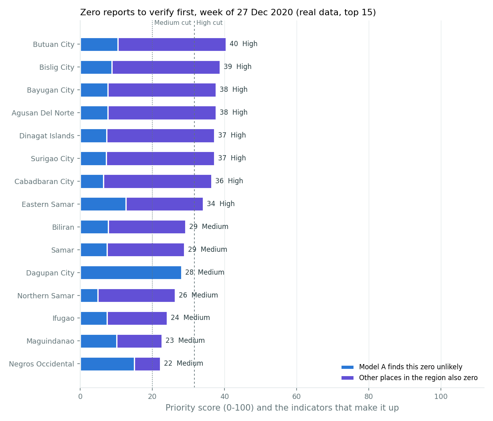
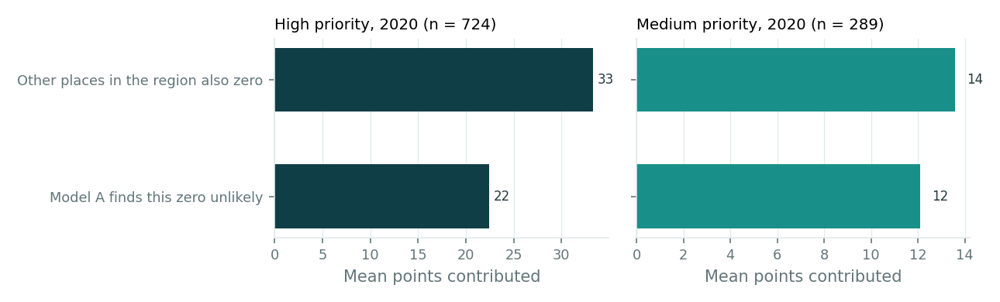
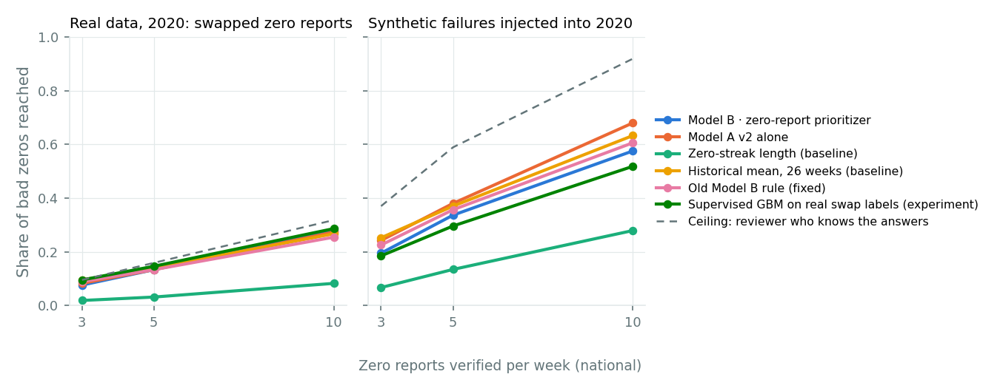
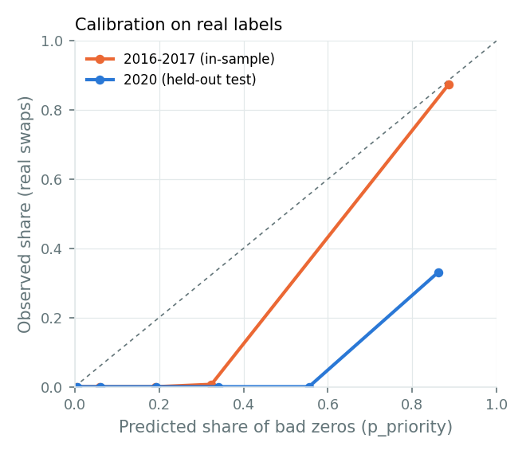
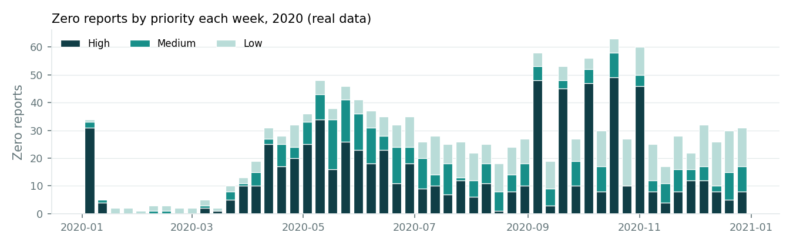

# Model B · zero-report prioritizer (dengue)

Generated by `python -m iris_pipeline zero-priority` · run `20261023T151711Z` · Model A v2 run `20261023T075030Z-73b3e833` · runtime 19 s. Real and synthetic results are reported separately throughout.

## In plain words

- **What it does.** Every explicit zero-case dengue report gets a 0-100 priority score, a High / Medium / Low band, a calibrated share of comparable reports expected to be wrong, the indicators behind the ranking, data warnings and verification steps. Missing reports are kept apart: they are certain gaps for the planner, never treated as zeros.
- **What it learned to use.** Tuning chose 2 indicator(s): *Model A finds this zero unlikely*, *Other places in the region also zero*. Among 3,868 near-equivalent settings the simplest was kept (pre-registered rule).
- **Real data, 2020 (held-out test).** Among 1,367 zero reports, 157 are known swapped reports. Model B's average precision is 0.479, higher than the best simple baseline (Model A v2 alone, 0.170). Checking the top 5 zero reports a week reaches 13.4% of the swaps (best baseline 13.4%). The High band catches 100.0% (95% CI 100.0%–100.0%) while flagging 46.9% of normal zeros.
- **The bands do not transfer to 2020.** The High cut was set so 4.9% of 2019's normal zeros exceed it; 46.9% of 2020's do. During COVID-19, other places in the same region were also zero for 36.0% of normal zeros on average (3.1% in 2019), so the regional indicator lifts many genuine zeros. Use the within-week rank, and re-set the bands on recent data before relying on them.
- **A weekly budget hits a ceiling on these labels.** All 157 real 2020 swaps fall in 5 weeks (up to 34 in one week), so verifying 5 zero reports a week can reach at most 15.9% of them even with perfect knowledge; most methods reach close to that, which is why they tie.
- **Trade-off.** On isolated synthetic failures Model A v2 alone ranks better (0.506 vs 0.294): the regional indicator helps with region-wide errors (swaps, regional gaps) and hurts with isolated ones. Show both: Model B's rank for zero reports, and Model A's p_low for single-place drops.
- **'Normal' is not 'verified correct'.** A zero counts as normal when it is not a known swap. Some 2020 'false alerts' may be real problems nobody labelled (late 2020 has weeks where half the country reported zero).
- **Synthetic failures injected into 2020.** Average precision 0.294 vs 0.506 for the best baseline (Model A v2 alone); High-band recall 68.0%. Regional gaps entered as zero: High-band recall 100.0%.
- **Calibration.** On real 2020 zeros the model predicts 42.7% bad zeros on average; 11.5% were swaps (Brier 0.208). The probability assumes the 2016-2018 share of swapped zeros (23.8%); it is an estimate under that assumption, not a guarantee.
- **Every alert is a lead to verify.** The data has no testing, timeliness or submission records, so IRIS cannot say why a zero happened; a high score means 'check this first', not 'this is a reporting failure'.

## Approach and why it fits the data

- **Data.** HDX/DOH dengue, 126 provinces and cities, weekly 2016-01-10 to 2021-01-10, read through the pipeline's clean table (`surveillance.csv`, checked against the cleaning plan's expected counts). Fields: location, region, week, cases, report status. Explicit zeros and missing weeks are distinct. No testing volume, timeliness, submission status or real neighbour data exists; deaths are not an input.
- **Labels.** There are no verified labels of reporting failures. The only real labels for zero reports are the cleaning plan's swapped cases/deaths rows (2016: 196, 2017: 174 zeros; 2018-2019: none; 2020: 157). They mark one source error, so they are used for tuning and testing, not as a general definition of failure. Synthetic failures come from the pipeline's injection file.
- **Model.** A transparent weighted score, not a black box: no supervised model is deployed, because the available labels cover one error type and the tuning year has none. A gradient-boosting model trained on the real swaps is reported as an experiment.
- **Indicators** (past weeks only, except same-week regional context): Model A finds this zero unlikely, Cases that may be missing, Zeros are unusual for this place, Zeros in a row, Cases in recent weeks, Switching between zero and non-zero, Other places in the region also zero. Each is mapped to 0-1 with fixed, documented anchors (config.ZERO_PRIORITY).
- **Tuning (before 2020 was scored).** Grid of 39,348 settings (history window, minimum history, streak criterion, weights 0/1/2). Objective: mean average precision on synthetic 2019 (284 injected zeros vs 142 real normal zeros) and real 2016-2017 (370 swaps vs 922 normal zeros). Chosen objective 0.969 (best 0.975; equal weights 0.960). Weights: Model A finds this zero unlikely 1, Cases that may be missing 0, Zeros are unusual for this place 0, Zeros in a row 0, Cases in recent weeks 0, Switching between zero and non-zero 0, Other places in the region also zero 1.
  The history window, minimum history, streak criterion only affect indicators with weight 0, so their chosen values (26 weeks, 8 reports, 2 zeros) have no effect on scores.
- **Bands.** High: score above 31.7; Medium: above 20.0. Set so that at most 5% / 25% of real 2019 normal zero reports (142) fall in High / at least Medium. Every compared method gets its own threshold by the same rule.
- **Probability (`p_priority`).** Isotonic regression of the score on the 2019 tuning rows, prior-shifted from the tuning share (66.7%) to the real 2016-2018 share of swapped zeros (23.8%); 200 bootstrap refits give the 90% interval.

## Results

Thresholds were frozen before 2020 was scored. 95% intervals: cluster bootstrap over locations. 'weeks to detect' counts from the first week of an episode (real swaps: location-year; synthetic: injected event).

### Real data · 2020 held-out test · swapped zero reports

1,367 zero reports · 157 positives · 1210 normal · positive share 11.5%. COVID-19 year: genuine drops and reporting interruptions both occurred.

| method | AUC | average precision | recall (High) | precision (High) | false alerts (High) | weeks to detect | recall, top 5/week | precision, top 5/week |
|---|---|---|---|---|---|---|---|---|
| Model B · zero-report prioritizer | 0.920 | 0.479 | 100.0% | 21.7% | 46.9% | 0.00 | 13.4% | 8.9% |
| Model A v2 alone | 0.656 | 0.170 | 38.9% | 23.1% | 16.8% | 0.00 | 13.4% | 8.9% |
| Zero-streak length (baseline) | 0.296 | 0.101 | 3.8% | 2.5% | 19.0% | 1.60 | 3.2% | 2.1% |
| Historical mean, 26 weeks (baseline) | 0.436 | 0.095 | 0.0% | 0.0% | 5.0% | — | 14.0% | 9.3% |
| Old Model B rule (fixed) | 0.390 | 0.087 | 0.0% | 0.0% | 4.2% | — | 13.4% | 8.9% |
| Equal weights (untuned reference) | 0.789 | 0.282 | 65.6% | 27.6% | 22.3% | 0.97 | 13.4% | 8.9% |
| Supervised GBM on real swap labels (experiment) | 0.800 | 0.340 | 94.9% | 26.5% | 34.1% | 0.20 | 14.6% | 9.7% |

### Synthetic · 2020 held-out test · failures injected as zeros

1,710 zero reports · 297 positives · 1210 normal · positive share 19.7%. Injected into real 2020 data; the truth is known exactly.

| method | AUC | average precision | recall (High) | precision (High) | false alerts (High) | weeks to detect | recall, top 5/week | precision, top 5/week |
|---|---|---|---|---|---|---|---|---|
| Model B · zero-report prioritizer | 0.637 | 0.294 | 68.0% | 25.1% | 49.8% | 0.01 | 33.7% | 42.6% |
| Model A v2 alone | 0.808 | 0.506 | 51.2% | 48.7% | 13.2% | 0.01 | 38.0% | 48.1% |
| Zero-streak length (baseline) | 0.284 | 0.165 | 0.7% | 0.7% | 22.4% | 0.00 | 13.5% | 16.0% |
| Historical mean, 26 weeks (baseline) | 0.796 | 0.492 | 25.6% | 59.4% | 4.3% | 0.00 | 37.0% | 47.2% |
| Old Model B rule (fixed) | 0.766 | 0.420 | 16.2% | 48.5% | 4.2% | 0.34 | 35.7% | 45.3% |
| Equal weights (untuned reference) | 0.693 | 0.348 | 48.1% | 35.8% | 21.2% | 0.14 | 35.4% | 44.9% |
| Supervised GBM on real swap labels (experiment) | 0.583 | 0.267 | 24.2% | 16.2% | 30.7% | 0.02 | 29.6% | 38.3% |

### Synthetic · 2020 held-out test · a missing regional week entered as zero

1,710 zero reports · 46 positives · 1210 normal · positive share 3.7%. The real 15 Nov 2020 regional gap, filled with zeros.

| method | AUC | average precision | recall (High) | precision (High) | false alerts (High) | weeks to detect | recall, top 5/week | precision, top 5/week |
|---|---|---|---|---|---|---|---|---|
| Model B · zero-report prioritizer | 0.898 | 0.150 | 100.0% | 7.1% | 49.8% | 0.00 | 10.9% | 3.6% |
| Model A v2 alone | 0.432 | 0.033 | 10.9% | 3.0% | 13.2% | 0.00 | 10.9% | 3.9% |
| Zero-streak length (baseline) | 0.362 | 0.035 | 13.0% | 2.2% | 22.4% | 0.00 | 10.9% | 2.3% |
| Historical mean, 26 weeks (baseline) | 0.354 | 0.026 | 0.0% | 0.0% | 4.3% | — | 10.9% | 3.9% |
| Old Model B rule (fixed) | 0.317 | 0.025 | 0.0% | 0.0% | 4.2% | — | 10.9% | 3.8% |
| Equal weights (untuned reference) | 0.625 | 0.058 | 34.8% | 5.9% | 21.2% | 0.00 | 10.9% | 3.7% |
| Supervised GBM on real swap labels (experiment) | 0.770 | 0.088 | 80.4% | 9.0% | 30.7% | 0.00 | 10.9% | 3.4% |

### Real data · 2016-2017 · in-sample (used for tuning)

1,292 zero reports · 370 positives · 922 normal · positive share 28.6%. Not an independent test.

| method | AUC | average precision | recall (High) | precision (High) | false alerts (High) | weeks to detect | recall, top 5/week | precision, top 5/week |
|---|---|---|---|---|---|---|---|---|
| Model B · zero-report prioritizer | 0.997 | 0.992 | 100.0% | 71.8% | 15.7% | 0.00 | 13.5% | 10.1% |
| Model A v2 alone | 0.932 | 0.865 | 65.7% | 85.0% | 4.7% | 0.10 | 13.2% | 9.9% |
| Zero-streak length (baseline) | 0.243 | 0.277 | 0.0% | 0.0% | 20.5% | — | 4.9% | 3.7% |
| Historical mean, 26 weeks (baseline) | 0.875 | 0.738 | 15.9% | 89.4% | 0.8% | 0.78 | 13.5% | 10.1% |
| Old Model B rule (fixed) | 0.853 | 0.638 | 2.7% | 55.6% | 0.9% | 2.67 | 13.5% | 10.1% |
| Equal weights (untuned reference) | 0.973 | 0.946 | 88.9% | 85.5% | 6.1% | 0.54 | 13.5% | 10.1% |
| Supervised GBM on real swap labels (experiment) | 1.000 | 0.999 | 100.0% | 89.6% | 4.7% | 0.00 | 13.5% | 10.1% |

### Synthetic · 2019 · in-sample (used for tuning)

426 zero reports · 284 positives · 142 normal · positive share 66.7%. Not an independent test.

| method | AUC | average precision | recall (High) | precision (High) | false alerts (High) | weeks to detect | recall, top 5/week | precision, top 5/week |
|---|---|---|---|---|---|---|---|---|
| Model B · zero-report prioritizer | 0.911 | 0.946 | 77.5% | 94.4% | 9.2% | 0.01 | 74.3% | 83.1% |
| Model A v2 alone | 0.933 | 0.963 | 78.2% | 95.7% | 7.0% | 0.00 | 75.4% | 84.3% |
| Zero-streak length (baseline) | 0.424 | 0.638 | 0.0% | 0.0% | 3.5% | — | 58.1% | 65.0% |
| Historical mean, 26 weeks (baseline) | 0.873 | 0.923 | 48.6% | 95.8% | 4.2% | 0.00 | 74.3% | 83.1% |
| Old Model B rule (fixed) | 0.859 | 0.903 | 30.6% | 93.5% | 4.2% | 0.18 | 73.6% | 82.3% |
| Equal weights (untuned reference) | 0.887 | 0.938 | 71.8% | 95.8% | 6.3% | 0.07 | 72.5% | 81.1% |
| Supervised GBM on real swap labels (experiment) | 0.828 | 0.887 | 16.9% | 81.4% | 7.7% | 0.12 | 72.5% | 81.1% |

### Limited investigation budget (real 2020)

| method | top 3/week: recall / precision | top 5/week: recall / precision | top 10/week: recall / precision |
|---|---|---|---|
| Model B · zero-report prioritizer | 7.6% / 8.1% | 13.4% / 8.9% | 28.0% / 9.8% |
| Model A v2 alone | 8.3% / 8.7% | 13.4% / 8.9% | 27.4% / 9.6% |
| Zero-streak length (baseline) | 1.9% / 2.0% | 3.2% / 2.1% | 8.3% / 2.9% |
| Historical mean, 26 weeks (baseline) | 9.6% / 10.1% | 14.0% / 9.3% | 26.8% / 9.4% |
| Old Model B rule (fixed) | 8.9% / 9.4% | 13.4% / 8.9% | 25.5% / 8.9% |
| Equal weights (untuned reference) | 7.6% / 8.1% | 13.4% / 8.9% | 28.7% / 10.1% |
| Supervised GBM on real swap labels (experiment) | 9.6% / 10.1% | 14.6% / 9.7% | 28.7% / 10.1% |
| *Ceiling (knows the answers)* | 9.6% / 10.1% | 15.9% / 10.5% | 31.8% / 11.2% |

### Calibration of p_priority on real labels

**Real 2016-2017 (tuning, in-sample): swapped zeros** · Brier 0.049 · mean predicted 36.8% · observed 28.6%

| p_priority bin | zero reports | mean predicted | observed share |
|---|---|---|---|
| 0.00-0.05 | 311 | 0.4% | 0.0% |
| 0.05-0.10 | 197 | 6.0% | 0.0% |
| 0.10-0.20 | 221 | 19.1% | 0.0% |
| 0.20-0.40 | 141 | 32.4% | 0.7% |
| 0.60-1.00 | 422 | 88.7% | 87.4% |

**Real 2020 (test): swapped zeros** · Brier 0.208 · mean predicted 42.7% · observed 11.5%

| p_priority bin | zero reports | mean predicted | observed share |
|---|---|---|---|
| 0.00-0.05 | 113 | 0.6% | 0.0% |
| 0.05-0.10 | 181 | 6.2% | 0.0% |
| 0.10-0.20 | 284 | 19.3% | 0.0% |
| 0.20-0.40 | 312 | 34.1% | 0.0% |
| 0.40-0.60 | 2 | 55.5% | 0.0% |
| 0.60-1.00 | 475 | 86.1% | 33.1% |

### Supervised experiment (real swap labels only)

Gradient boosting, forward chaining: fit on 2016, hyperparameters chosen on 2017 (average precision 0.995, 48 settings), refit on 2016-2018 (1552 zeros, 370 swaps). Chosen: max_depth 3, learning_rate 0.05, max_iter 100, min_samples_leaf 40, class_weight balanced. It learns the swap pattern only and is not the deployed model; its rows in the tables above are the comparison.

## Sample output for the IRIS dashboard

Week of 2020-12-27 (real data). Full file: `outputs/zero_priority/ranked_alerts_2020.csv` (1,367 zero reports in 2020: High 724, Medium 289, Low 354). Each row also carries data warnings and verification steps.

| rank | location | priority | score | p_priority (90% interval) | data | why |
|---|---|---|---|---|---|---|
| 1 | Butuan City | High | 40.4 | 36.8% (26.7%–76.8%) | Adequate history | Prioritised because 60% of other places in the region also reported zero this week; Model A: a count this low had probability 0.146 if reporting were normal. |
| 2 | Bislig City | High | 38.7 | 36.8% (26.7%–68.8%) | Adequate history | Prioritised because 60% of other places in the region also reported zero this week; Model A: a count this low had probability 0.200 if reporting were normal. |
| 3 | Bayugan City | High | 37.7 | 36.8% (25.2%–62.2%) | Adequate history | Prioritised because 60% of other places in the region also reported zero this week; Model A: a count this low had probability 0.242 if reporting were normal. |
| 4 | Agusan Del Norte | High | 37.7 | 36.8% (25.2%–62.2%) | Adequate history | Prioritised because 60% of other places in the region also reported zero this week; Model A: a count this low had probability 0.244 if reporting were normal. |
| 5 | Dinagat Islands | High | 37.3 | 36.8% (25.2%–62.2%) | Adequate history | Prioritised because 60% of other places in the region also reported zero this week; Model A: a count this low had probability 0.262 if reporting were normal. |
| 6 | Surigao City | High | 37.2 | 36.8% (25.2%–62.2%) | Adequate history | Prioritised because 60% of other places in the region also reported zero this week; Model A: a count this low had probability 0.264 if reporting were normal. |
| 7 | Cabadbaran City | High | 36.4 | 36.8% (25.2%–62.2%) | Adequate history | Prioritised because 60% of other places in the region also reported zero this week; Model A: a count this low had probability 0.308 if reporting were normal. |
| 8 | Eastern Samar | High | 34.1 | 36.8% (21.5%–54.9%) | Adequate history | Prioritised because 43% of other places in the region also reported zero this week; Model A: a count this low had probability 0.097 if reporting were normal. |
| 9 | Biliran | Medium | 29.2 | 23.8% (16.4%–38.5%) | Adequate history | Prioritised because 43% of other places in the region also reported zero this week; Model A: a count this low had probability 0.239 if reporting were normal. |
| 10 | Samar | Medium | 28.8 | 22.0% (15.9%–35.4%) | Adequate history | Prioritised because 43% of other places in the region also reported zero this week; Model A: a count this low had probability 0.255 if reporting were normal. |

Verification steps for rank 1: Confirm with the BUTUAN CITY surveillance officer that zero dengue cases were reported for MW 53 2020, and that the zero is not a blank or late report. | Compare with hospital admissions or laboratory results for the same week. | Ask the RESU whether other provinces' submissions were also affected (possible shared reporting problem). | Check whether consultations genuinely fell (for example during lockdown) before treating this as a reporting problem.

Data warnings for rank 1: No testing, timeliness or submission records in this dataset: the cause of the zero cannot be determined. | COVID-19 period: genuine drops in consultations and reporting interruptions both occurred. | Holiday week: delayed or partial reporting is common.

## Figures

*Ranked zero reports for one week, with each indicator's contribution.*

*Main contributing indicators for High and Medium alerts, 2020.*

*Share of bad zeros reached at each weekly verification budget (real vs synthetic).*

*Calibration of p_priority on real swap labels.*

*Zero reports by priority band each week, 2020.*

## Limitations and assumptions

- No verified labels of reporting failures exist. Swapped cases/deaths rows are real but are one error type; results on them do not show how the model ranks other real failures (for example a facility that stopped reporting but sends zeros).
- The tuning year (2019) has no real bad zeros, so tuning mixes synthetic 2019 failures with real 2016-2017 swaps; 2016-2017 results are in-sample.
- Synthetic failures follow the pipeline's injection design (zero-fill, outage, regional outage); real failures may look different.
- No testing, timeliness or submission metadata: the cause of a zero cannot be determined, and a genuine absence of cases cannot be ruled out.
- Regional context uses region membership only. No real adjacency or reporting-network data exists, so no graph model is used.
- 2020 is a COVID-19 year: consultations genuinely fell, so more zeros are real and false alerts are expected to be higher.
- p_priority assumes the 2016-2018 share of swapped zeros; if the true share differs, the probabilities shift (the ranking does not).
- Province/city weekly counts only; facility-level problems that do not change a province's total are invisible.

## Integration with Model A and the planner

- **Input contract.** Model B reads Model A v2's `scores_v2.csv` (dengue rows, `report_status`, `cases`, `expected`, `p_low`, `region_id`, `hub_id`) plus the shared calendar and locations. `api.prepare_history()` maps the contract to the indicator frame; `api.rank_alerts()` returns the ranked list.
- **Candidates.** Explicit zeros (`report_status = reported`, `cases = 0`). Missing weeks are returned as 'Missing report (not ranked)'.
- **Order of steps.** Model A scores a week → Model B ranks that week's zero reports → the Model B v2 planner can use `p_priority` for zero rows when choosing `call_location` actions (the planner code is unchanged here).
- **History.** Ranking a week needs that location's previous two years of Model A scores for the full set of indicators.
- **Re-tuning.** Re-run `python -m iris_pipeline zero-priority` after Model A changes; `model.json` holds every learned value as plain JSON.
