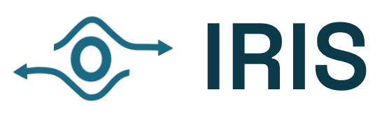
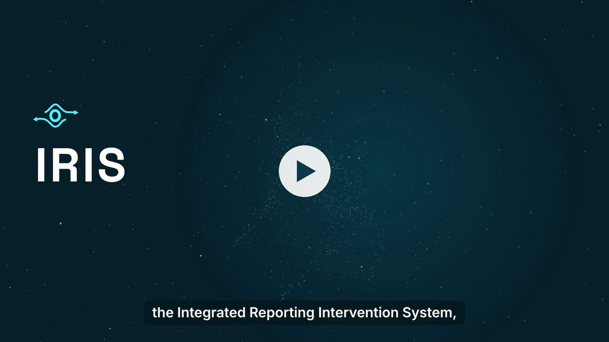
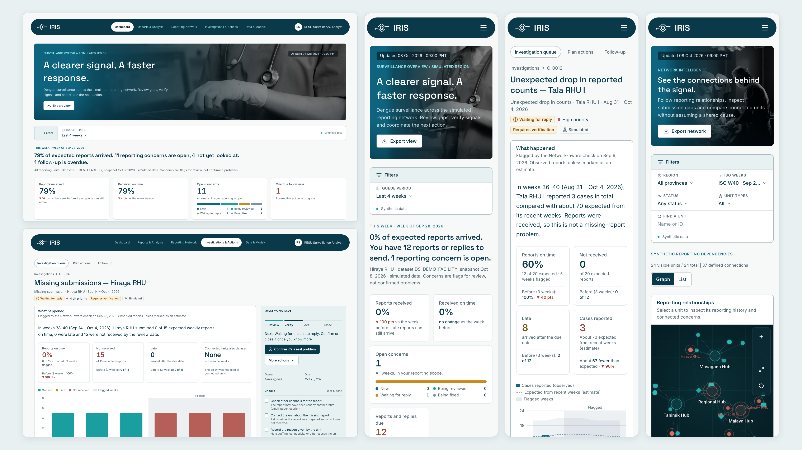
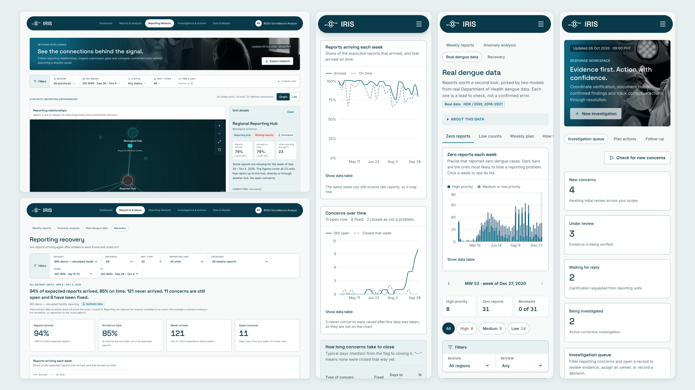
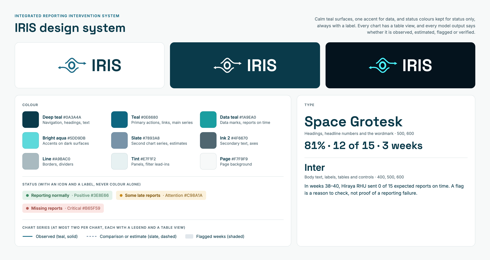
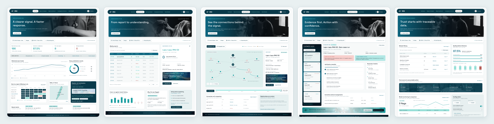

<p align="center">
  <picture>
    <source media="(prefers-color-scheme: dark)" srcset="docs/brand/iris-logo-dark.png">
    
  </picture>
</p>

<h1 align="center">Integrated Reporting Intervention System</h1>

<p align="center"><em>See the connections. Restore what matters.</em></p>

<p align="center">
  <a href="LICENSE"></a>
  
  
</p>

IRIS is a decision-support prototype for public-health reporting networks. It helps Regional Epidemiology and Surveillance Units (RESUs), provincial coordinators and Rural Health Units (RHUs) notice when weekly disease reports go missing or look wrong, check whether several problems share one cause, decide what to fix first with limited staff time, and see whether reporting recovers.

**Team Nex · PJDSC 2026**

## Demo video

[](docs/media/IRIS-demo.mp4)

*Click the image to watch the 3-minute demo ([`docs/media/IRIS-demo.mp4`](docs/media/IRIS-demo.mp4)).*

> **IRIS is a research prototype, not an official Department of Health system.** It is not endorsed by any government agency, does not connect to any government system, and has not been validated in real-world use. The app's demo data is **simulated**: provinces, facilities, people and relationships are fictional, and no patient information is used. The one exception is the read-only *Real dengue data* page, which shows model outputs on public HDX / DOH dengue counts.

## Screens





## Design



The interface is built for people without a data background:

- **One question per screen, one next step per concern.** Each concern shows a four-step progress bar (Review → Verify → Act → Close) with a single main button; everything else sits in *More actions*.
- **Numbers come with a comparison.** Headline figures show the change from the week before, and concerns compare the flagged weeks with the weeks before them.
- **Honest labels.** Every value says whether it is *observed*, a *model estimate*, a *flag* or *verified* by a person. Simulated data is marked wherever it appears.
- **Colour has one job each.** Teal for data, slate for comparisons and estimates, and green, amber and red only for status, always with an icon and a label. Every chart has a table view.
- **Plain words.** *Arrived* and *On time* rather than completeness and timeliness; dates written as dates.

The concept mockups the app was built from, one per section ([`docs/design/`](docs/design)):



Logo files: [`docs/brand/`](docs/brand) (marks in dark teal, bright teal and white, and the lockups used above). Rebuild the brand images with `node scripts/build-brand.mjs` from `frontend/`.

## What it does

**Flag → investigate → verify → plan actions → follow up → check recovery.**

| Section | Question it answers | What you can do |
|---|---|---|
| **Dashboard** | What needs attention this week? | A one-sentence summary, four headline numbers with week-on-week change, the 12-week reporting trend, the top concern, and a work queue table with status tabs. RHU staff also see the reports they still need to send. |
| **Reports & Analysis** | What arrived, what is missing, and is reporting recovering? | Weekly reports (missing reports listed too), anomaly analysis, the *Real dengue data* page (Model A flags and Model B priorities on real data, with human review of each lead), and recovery before / during / after each corrective action. |
| **Reporting Network** | What might be connected? | A rotating graph of units, hubs and labs, coloured by reporting status, with a unit panel (arrival rates against the status cutoffs, connections, weekly history, concerns) and a list view. |
| **Investigations & Actions** | Why was this flagged, and what do we do? | Each concern compares the flagged weeks with the weeks before, shows what is known next to what is not yet known, and gives one next step with a checklist. Plan actions under a staff-hour budget, then track them to an outcome. |
| **Data & Models** | Can I trust the data and the methods? | Datasets with provenance, CSV import with validation, detection runs, and a synthetic evaluation of the detection methods. |

A detector output is always a **flag**, never a finding. Closing a concern needs a person to verify it and attach evidence.

## Quick start

Requirements: Python 3.11+ with [uv](https://docs.astral.sh/uv/), Node.js 20+ and npm.

```bash
# Backend (FastAPI + SQLite): http://127.0.0.1:8000
cd backend
uv sync
uv run uvicorn iris.main:app --port 8000

# Frontend (React + Vite): http://localhost:5180, proxies /api to :8000
cd frontend
npm install
npm run dev
```

Open **http://localhost:5180**. On first start the backend creates `backend/iris.db` and seeds it: it simulates the network and its reports, runs detection, plays a demo storyline and runs one evaluation (about 3 seconds).

Switch demo users from the account menu at the top right:

| Demo user | Role | Try this |
|---|---|---|
| RESU Surveillance Analyst (default) | RESU analyst | Everything: network, detection runs, evaluation, approving plans |
| Malaya Provincial Coordinator | Provincial coordinator | The Kalinaw shared-connection investigation (C-0010) and its follow-up |
| Hiraya RHU Encoder | RHU staff | Send missing reports and answer a clarification request (C-0014) |
| Data Manager | Administrator | CSV import, unit metadata, system activity |

Reset the demo data from *Settings*. Human reviews on the *Real dengue data* page are kept across resets.

## Repository layout

```
backend/    FastAPI app: simulation, detection, planning, evaluation, recovery, API (Python, uv)
frontend/   React 19 + TypeScript + Vite app, unit tests and browser QA scripts
models/     Model A and Model B: data cleaning, notebooks, and the tested pipeline the app reads
docs/       User guide, screenshots, demo video, proposal and design notes
```

## Data science

IRIS has two models, built and tested in [`models/`](models/README.md) on real Philippine surveillance data, plus a simulated reporting network for what the real data cannot show. Every number below comes from the pipeline's saved outputs ([`RESULTS.md`](models/pipeline/outputs/results/RESULTS.md)).

```
clean data  →  Model A: is this count suspiciously low?  →  Model B: what should staff check or fix first?  →  IRIS app
```

### Data and labels

- **Real data.** HDX / DOH Epidemic-prone Disease Case Surveillance: dengue for 126 provinces and cities in 17 regions, weekly, Jan 2016 – Jan 2021 (126 × 262 = 33,012 location-weeks). Model A also uses national weekly counts for 18 EDCS diseases and WHO TB notifications.
- **Cleaning rules.** Standardise names and regions, fill the weekly calendar, label problems. Reported numbers are never overwritten, gaps are never filled, rows are never dropped, and a blank stays blank (never 0). Each cleaning script runs its checks and fails if any do (dengue 72, measles 37, TB 32).
- **Labels found during cleaning.** On 15 Sundays, cases and deaths were swapped for whole regions (581 rows, 527 of them showing 0 cases), and in each affected year a missing regional week followed: a real shared disruption. These are the only real labels of reporting errors; anything else counts as normal, so real error rates are understated.
- **Synthetic data, kept apart.** A reporting network of 506 fictional facilities over the real 126 locations, reporting through provincial hubs to regional units and referring specimens to labs. Each location's real counts are split across its facilities. Failures (isolated, hub and lab outages) are injected so the truth is known exactly. Synthetic results are always reported separately from real ones.

### How the evaluation stays honest

- **Time-ordered split:** train 2016–2018, tune 2019, test 2020. Every week is predicted from earlier weeks only, and a test checks for leakage.
- **Choices made before the test:** model variants and thresholds were chosen on 2016–2019 with a rule written down in advance. The 2020 test year was scored twice, and both runs are kept in a test-run log, including the first one, which had a threshold bug.
- **Uncertainty:** 95% intervals by cluster bootstrap over places; 20 replicates for the simulations.
- **Baselines:** rolling median, EWMA, CUSUM, zero-streak length, and the earlier version of each model.

### Model A — detect

A negative-binomial count model per place, with trend, yearly seasonality and holidays, fitted on past weeks only. A week is flagged when its count is far below the 90% range the model expected. Signals are pooled across a region and across diseases (correlation-adjusted Stouffer) to catch shared problems, and each flag carries `p_fail`, a calibrated chance that the report is wrong.

v2 follows the recent level of reporting and widens its range for model and epidemic-year uncertainty. On the real 2020 test year:

| | False alerts on normal weeks | Real swapped reports caught | False region-wide alerts | Normal weeks inside the 90% range |
|---|---|---|---|---|
| Model A v1 | 12.1% | 49% | 62% | 56% |
| **Model A v2** | **5.5%** | 9% | **9%** | **79%** |
| Best simple baseline | 0.6% | 4% | — | — |

v2 trades recall for far fewer false alarms. Once it has followed the COVID-19 drop in 2020, a zero no longer looks unusual, so it catches fewer of the real swaps. Neither version holds the 1% alert budget through 2020. On simulated failures injected into 2020, v2 ranks failures better than v1 (AUC 0.85 vs 0.77).

### Model B — decide

**Zero-report prioritizer.** Every zero-case dengue report gets a 0–100 priority score, a High / Medium / Low band, a calibrated chance of being wrong, the indicators behind it and steps to verify it. It is a transparent weighted score rather than a black box, because the real labels cover only one kind of error. Tuning over 39,348 settings, before 2020 was scored, kept two indicators: *Model A finds this zero unlikely* and *other places in the region are also zero*. Missing reports are kept apart and never treated as zeros.

| Real 2020 test: 1,367 zero reports, 157 known swaps | Average precision | AUC |
|---|---|---|
| **Zero-report prioritizer** | **0.48** | **0.92** |
| Model A v2 alone | 0.17 | 0.66 |
| Earlier Model B rule | 0.09 | 0.39 |

The regional indicator helps with region-wide errors and hurts with isolated ones: on isolated synthetic failures, Model A alone ranks better (0.51 vs 0.29). IRIS therefore shows both, Model B's rank for zero reports and Model A's flag for single-place drops. Bands set on 2019 do not transfer to the COVID year, so the within-week rank is the signal to use until they are re-set on recent data.

**Network-aware planner.** Each week an integer program (solved exactly with HiGHS) picks the corrective actions with the most expected value for the staff hours and money available. A facility can be credited only once, so fixing a shared hub or lab beats visiting its facilities one by one. In simulation, with 24 staff-hours a week:

| Policy (20 replicates) | Failed reports recovered per year | Weeks to recover a shared failure |
|---|---|---|
| **Network-aware (Model B)** | **176** (132–221) | **2.7** |
| Facility-first (proposal baseline) | 29 (24–34) | 4.7 |
| Random | 11 (8–13) | 4.7 |
| Oracle that knows the truth | 333 (290–376) | 1.6 |

With the graph, the right hub is named in 72% of simulated hub outages; without it, in none.

### What did not work, and what it means

- Model A v2 met 1 of its 4 pre-set targets. Missed targets are reported as missed, and nothing was re-tuned on 2020.
- 2020 contains the COVID-19 drop, a shift larger than anything in 2016–2019, and no version holds its alert budget through it.
- The network, its failures and recovery effects are simulated. Action hours and success rates are planning assumptions.
- **Every alert is a lead for a person to verify, not a confirmed error.** In the app, each model output says whether it is observed, an estimate or a flag, and closing a lead needs a reason and the evidence checked.

### From the models to the app

The pipeline writes validated JSON files (`models/pipeline/outputs/contract/*.json`, each with a JSON Schema). The backend serves them read-only on the *Real dengue data* page and re-reads them when they change; human reviews of each lead are stored separately and never change the model outputs.

The simulated demo uses the backend's own detection methods (`backend/iris/detection/`) on the fictional network:

- **Statistical threshold:** robust z-score of the week's *delay share* (½ × late + not received, over expected) against the unit's previous 8 weeks.
- **Time-series (EWMA):** a smoothed delay share compared with the same baseline.
- **Network-aware:** the threshold score plus support from connected units delayed in the same weeks. A unit is flagged only if it has some delay of its own; concerns at several units on one hub or shared resource are merged into a *possible shared problem*.
- **All methods** also flag incomplete records and unexpected drops in counts. A count drop is never presented as proof of under-reporting.

The demo planner (`backend/iris/optimization/`) uses an exact budget-constrained knapsack and compares it with a priority-first baseline. Its benefits are illustrative assumptions, editable in the app.

## Data

- **Simulated facility reporting** (`DS-DEMO-FACILITY`): 26 weekly periods (Apr 6 – Oct 4, 2026) for 20 reporting units and 4 hubs in three fictional provinces, seven reporting categories with explicit schedules, and ten injected scenarios. Each concern can show its simulation answer key. Generated by `backend/iris/data/simulate.py` with a fixed seed.
- **Simulated provincial aggregates** (`DS-DEMO-PROVINCIAL`): totals without facilities, schedules or timestamps, to show how IRIS behaves when arrival rates cannot be calculated.
- **Real dengue data:** HDX / DOH Epidemic-prone Disease Case Surveillance, dengue by province and city, weekly, 2016–2021. Only the pipeline's outputs are read; the raw files are not in git (see [`models/README.md`](models/README.md)).
- **Imported CSVs** keep the origin the importer declares (real, synthetic or unknown). IRIS does not verify it.

## Tests

```bash
cd backend && uv run pytest                 # simulation, detection, planner, recovery, API workflows, real-data models
cd frontend && npm test                     # unit tests (vitest)
cd frontend && npm run typecheck && npm run build
cd models/pipeline && python -m pytest -q   # pipeline; tests that need the cleaned data skip without it

# Browser checks, with both servers running (one-time: npx playwright install chromium)
cd frontend && npm run qa:e2e               # resets the demo, then clicks through the main workflows
cd frontend && npm run qa:responsive -- http://localhost:5180 ./qa-screenshots   # 320–1440 px, four roles
```

## Documentation

- [User guide (PDF)](docs/IRIS-User-Guide.pdf): screen-by-screen guide for staff and reviewers (source: `docs/user-guide.html`).
- [What is built (PDF)](docs/IRIS-What-Is-Built.pdf): an inventory of every screen with screenshots.
- [Design audit](docs/IRIS_DESIGN_AUDIT.md): design decisions, tokens and the rules the interface follows.
- [Project proposal (PDF)](docs/PJDSC26_Nex_Proposal.pdf) and the [model review and roadmap](models/IRIS_MODEL_REVIEW_AND_ROADMAP.md).

Rebuild the documents from `frontend/` with both servers running: `node scripts/capture-docs.mjs` then `node scripts/build-user-guide.mjs` (user guide), `node scripts/build-inventory.mjs` (inventory), `node scripts/build-snapshots.mjs` (screen collages).

## Limitations

- **Prototype only.** Thresholds, scores and planning assumptions are tuned on simulated data; model results on real data are leads to verify, not confirmed errors.
- **No real authentication.** The demo user selector sends a user ID header. The server checks that role's permissions on every action, but anyone can pick any role.
- **Local storage.** Data lives in a local SQLite file (`backend/iris.db`; set `IRIS_DB_PATH` or `IRIS_DATABASE_URL` to change it). Staged CSV uploads are held in memory until imported.
- **Association, not causation.** Before/after recovery comparisons show what changed, not why. Seeded outcomes are simulated and labelled as such.
- **Light theme only**, sized for demo data volumes rather than national ones.

## License

[MIT](LICENSE) for the source code. Third-party data and documents keep their own terms: see each dataset's README under `models/data/`.
