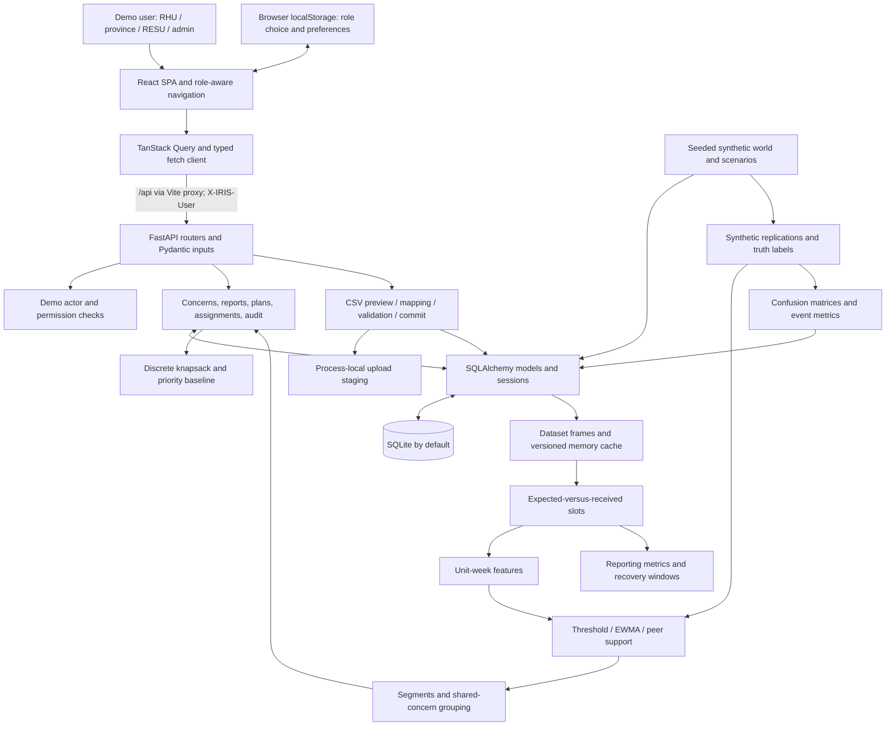
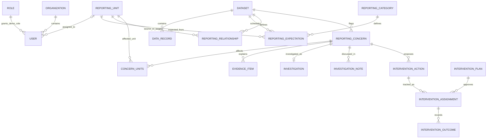

# IRIS Current Development Status Report

**Generated:** 2026-10-15 (Asia/Manila)  
**Repository assessed:** `C:\Users\ANDA\Projects\IRIS`  
**Repository identified by user:** https://github.com/FerosC101/IRIS  
**Reviewed branch:** `main`  
**Reviewed commit:** `7d2e6f7431695c8494fd20122e6bf7f2558a4049`  
**Commit date:** 2026-10-15 10:27:22 +08:00  
**Commit subject:** Add IRIS reporting surveillance prototype  
**Assessment scope:** Current local source, dependency manifests and locks, tests, scripts, and safe local execution. Assessment and documentation only; no application code, configuration, dependencies, or project database changed.

## 1. Executive Summary

IRIS (Integrated Reporting Intervention System) is a substantial **public-health reporting-network research prototype**. Its implemented workflow is to identify irregular reporting, inspect evidence, investigate and verify concerns, select corrective actions within a staff-hours budget, track interventions, and compare subsequent reporting. It is not a patient diagnosis system, operational government integration, or validated disease prediction system. This distinction is supported by the actual detection inputs and outputs, not just the README (`backend/iris/detection/features.py:22`, `backend/iris/detection/methods.py:170`, `backend/iris/services/concerns.py:123`).

The backend contains working statistical and graph-informed algorithms: robust threshold detection, EWMA, connected-peer support, Poisson count-drop checks, shared-concern grouping, exact discrete budget optimization, synthetic experiment evaluation, and recovery statistics. **No trained predictive model, training workflow, GNN, LLM, or disease-risk forecasting implementation was found.** Scikit-learn is used for confusion matrices, not model training (`backend/iris/evaluation/runner.py:20`).

**Execution evidence:** all **40 backend tests passed in 59.58 seconds** using the existing Python virtual environment and an isolated temporary test database. These include FastAPI lifespan initialization and API workflows through TestClient. The React frontend is present and wired to the API, but `frontend/node_modules` is absent. An attempted frontend test run failed because `vitest` was unavailable. Frontend startup, type checking, production build, browser behavior, and full browser-to-backend integration remain **not verified** in this assessment.

The strongest immediate concerns are demo-only identity resolution, a reset endpoint that drops all application tables, inconsistent object-level access checks, imported datasets lacking reporting schedules and network ingestion, and fixed simulation dates throughout analytics. Additional executed probes reproduced a fractional-budget optimization defect, a zero-F1 reporting defect, and SQLite foreign-key enforcement being off. These findings do not negate the passing tests; they show gaps outside the existing test cases.

**Baseline conclusion:** usable and tested backend research prototype with a substantial unverified frontend; not ready for sensitive real data or production deployment. A percentage-complete estimate would be misleading because no formal product acceptance criteria or approved production scope was found.

**Evidence conventions and limitations**

- **Fact/static:** observed directly in the reviewed files. Source references use repository-relative `path:line`; line numbers refer to the commit above, not generated or installed files.
- **Executed:** observed in a command or test run during this assessment. Passing tests establish their asserted behavior only.
- **Inference/risk:** a consequence inferred from source; it is not presented as a reproduced failure unless explicitly marked executed.
- **Recommendation:** proposed development work, not an existing requirement or implemented feature.
- The local repository is the primary source of truth. GitHub remote freshness, package-registry availability, dependency CVEs, real-world model validity, load capacity, accessibility compliance, and production infrastructure were not externally verified. No network downloads or installations were attempted.
- Temporary test databases were created outside the repository by the existing fixture. No normal application database was initialized or reset. Python bytecode and pytest cache writing were disabled for verification. No browser QA was run against a project database.

## 2. Project Overview

**Purpose and intended users.** IRIS supports reporting operations for simulated RESU surveillance analysts, provincial coordinators, RHU reporting staff, and administrators/data managers. Users inspect missing or late submissions, incomplete records, unusual drops in reported counts, and possible disruptions shared by connected units. Users can distinguish observed evidence, explanations requiring verification, reviewer confirmation, and simulation answer keys (`backend/iris/services/context.py:19`, `backend/iris/models/workflow.py:18`, `backend/iris/services/concern_builder.py:217`).

**Existing capabilities**

- Work queue, outstanding RHU submissions, concern search/filter/pagination and detail workspaces.
- Review, confirm, dismiss, clarify/respond, assign, note, resolve and reopen investigations, with reasons and audit events.
- CSV preview, mapping, validation, provenance declaration, confirmation, import history and imported-dataset deletion.
- Data explorer with expected-but-not-received rows, reported/zero/blank distinctions, trends, quality summaries and record history.
- Defined reporting-network graph and unit details, plus a frontend list alternative.
- Template-generated interventions, optimized-versus-priority planning, draft plans, approval/rejection, assignments, completion evidence and outcomes.
- Completeness/timeliness, concern flow, resolution duration and before/during/after reporting comparisons.
- Reproducible synthetic simulation and comparative detection evaluation.
- Demo role selection, display preferences, help, administrative unit metadata and activity log.

Sources: routers in `backend/iris/api/`, services in `backend/iris/services/`, UI routing in `frontend/src/app/App.tsx:38`, and typed API calls in `frontend/src/services/api.ts:10`. Section 11 separates source presence from validation.

**Scope uncertainty.** The README explicitly frames this as a prototype. It does not establish a requirement for neural models, patient-level records, live DOH connectivity, or production authentication today. Such capabilities should not be inferred from the project name or the phrase “Model evaluation.” Any expansion into real operational surveillance needs an explicit scope decision.

## 3. Repository and Git Status

| Item | Observed result |
|---|---|
| Local working directory | `C:\Users\ANDA\Projects\IRIS` |
| Branch | `main` |
| HEAD | `7d2e6f7431695c8494fd20122e6bf7f2558a4049` |
| Latest commit | `Add IRIS reporting surveillance prototype` |
| Commit timestamp | `2026-10-15T10:27:22+08:00` |
| Initial working tree | Clean: `git status --short` returned no changes |
| Changes authorized for this audit | Only this Markdown file and its new `docs/` parent |
| Installed local artifacts | Ignored `backend/.venv/` exists; `frontend/node_modules/` absent |
| Existing project database | `backend/iris.db` absent during initial listing; not created by this audit |
| Repository instructions | No repository `AGENTS.md` found by the discovery scan |
| Remote synchronization | Not fetched or compared; local commit is the assessed baseline |

`.gitignore:1` excludes the backend environment/database, Python caches, frontend dependencies/builds/screenshots, and TypeScript build info. A clean Git status does not prove those ignored artifacts are absent; filesystem checks were also used. No commits or pushes were made.

## 4. Technology Stack

| Layer | Actual dependencies and role | Evidence |
|---|---|---|
| Backend runtime | Python >=3.11; local version selector requests 3.13 | `backend/pyproject.toml:5`, `backend/.python-version:1` |
| HTTP API | FastAPI, Uvicorn; multipart upload support | `backend/pyproject.toml:6`, `backend/iris/main.py:23` |
| Validation | Pydantic v2 request models, Field bounds and Literal values | `backend/iris/schemas/__init__.py:8` |
| Persistence | SQLAlchemy ORM, SQLite default, environment-selected database URL | `backend/iris/db.py:17` |
| Data/statistics | pandas, NumPy, SciPy Poisson CDF, statsmodels Wilson intervals | `backend/iris/detection/methods.py:29`, `backend/iris/services/recovery.py:16` |
| Graphs | NetworkX topology/aggregation and simulated world; Cytoscape browser rendering | `backend/iris/services/network.py:5`, `frontend/src/features/network/NetworkGraph.tsx:1` |
| Evaluation | scikit-learn confusion matrix, custom aggregate metrics | `backend/iris/evaluation/runner.py:20` |
| Web application | React 19, React DOM, TypeScript 5.9, React Router 7 | `frontend/package.json:24`, `frontend/src/app/App.tsx:3` |
| State and forms | TanStack Query 5; React Hook Form 7, Zod 4, resolvers 5 | `frontend/package.json:19`, `frontend/src/features/data-management/ImportWizard.tsx:23` |
| UI and visuals | Tailwind 4, Radix dialogs/tabs, Recharts 3, Lucide icons, Inter and IBM Plex Mono fonts, clsx/CVA/tailwind-merge | `frontend/package.json:16`, `frontend/src/index.css:1` |
| Frontend build/test | Vite 8, React/Tailwind Vite plugins, Vitest 5, jsdom, Testing Library | `frontend/vite.config.ts:7`, `frontend/package.json:38` |
| Browser checks | Playwright and @playwright/test | `frontend/scripts/e2e-workflow.mjs:6`, `frontend/scripts/check-responsive.mjs:5` |
| Backend testing | pytest, httpx and FastAPI TestClient | `backend/pyproject.toml:21`, `backend/tests/conftest.py:9` |
| Reproducibility | `backend/uv.lock`, `frontend/package-lock.json`; manifests contain version ranges | Both lockfiles and manifests |

**Observed installed backend versions:** Python 3.13.16, FastAPI 0.143.0, Uvicorn 0.54.0, Pydantic 2.14.1, SQLAlchemy 2.1.4, pandas 3.0.6, NumPy 2.5.4, SciPy 1.18.1, statsmodels 0.15.0, NetworkX 3.7, scikit-learn 1.9.1, pytest 9.1.1, httpx 0.28.1. These came from installed package metadata, not assumptions based on lower bounds. Exact environment-to-lockfile equivalence was not verified with a dependency sync.

**Observed local tooling:** Node v22.14.0 and npm 10.9.2. `uv` was not found on the current PATH, although the existing environment metadata indicates it was created using uv. The system `python` is a different installation (3.14.3); tests used the project environment explicitly.

**Node requirement nuance:** README's “Node 20+” is too broad for the locked development stack. The lock records Vite 8.3.4 requiring `^20.19.0 || >=22.12.0`, Vitest 5.0.4 requiring `^22.12.0 || ^24.0.0 || >=26.0.0`, and jsdom 29.1.1 requiring `^20.19.0 || ^22.13.0 || >=24.0.0`. The available Node 22.14.0 satisfies these examples. See package entries at `frontend/package-lock.json:2410`, `:3524`, and its `node_modules/vitest` entry. No missing direct Python module was found in the import-availability probe; this is not a vulnerability audit.

## 5. Project Directory Structure

The following inventories all tracked application/component directories and filenames at the reviewed commit. `.git/` internals and installed `.venv/` contents are intentionally excluded; neither is project source. The requested `docs/` file is the only added repository artifact.

```text
IRIS/
  .gitignore                      Generated/local artifact exclusions
  README.md                       Prototype scope, startup, workflows, limitations
  docs/
    IRIS_PROJECT_STATUS_REPORT.md  This audit baseline (new)
  backend/
    .python-version               Python 3.13 selection
    pyproject.toml                Runtime/dev dependencies, pytest configuration
    uv.lock                       Python dependency lock
    .venv/                        Existing ignored local environment
    iris/
      __init__.py
      main.py                     FastAPI, CORS, lifespan and router registration
      config.py                   Demo dates, IDs, seed, upload and due-date rules
      db.py                       Engine, sessions, create/drop metadata
      api/
        __init__.py
        meta.py                   Metadata and demo controls
        concerns.py               Queue, concerns, transitions, detection, reports
        data.py                   Datasets, records, CSV, network, units, audit
        interventions.py          Candidate actions, plans, assignments, outcomes
        analytics.py              Recovery and evaluation runs
      schemas/
        __init__.py               All Pydantic request schemas
      models/
        __init__.py               Registers ORM tables
        core.py                   Organizations, roles, users, units, edges, audit
        data.py                   Datasets, expectations, records, import logs
        workflow.py               Concerns, evidence, investigations, notes, join
        interventions.py          Actions, plans, assignments, outcomes, experiments
      services/
        __init__.py
        audit.py                  Activity event creation
        clock.py                  Current PHT timestamps
        concern_builder.py        Detection flags to grouped concerns/evidence
        concerns.py               Concern scope and workflow rules
        context.py                Demo actor resolution and permissions
        datasets.py               ORM to frames, slots, detection, memory caches
        explorer.py               Table, filtering, trends, quality, record detail
        imports.py                CSV staging, parsing, validation, persistence
        interventions.py          Templates, planning and intervention lifecycle
        network.py                Defined graph, statuses and unit histories
        overview.py               Queue, counters, summaries and RHU tasks
        recovery.py               Reporting metrics, intervals and comparison windows
        reports.py                Submission, correction and RHU outstanding tasks
        slots.py                  Shared expected-versus-received calculation
      data/
        __init__.py
        world.py                  Fictional topology, categories and schedules
        simulate.py               Seeded records, scenarios and truth labels
        seed.py                   ORM seed, scripted storyline and demo reset
      detection/
        __init__.py
        features.py               Unit-week feature construction
        methods.py                Threshold, EWMA, network, incomplete/count channels
      optimization/
        __init__.py
        planner.py                Costs, benefits, knapsack and priority baseline
      evaluation/
        __init__.py
        runner.py                 Synthetic replications, metrics and comparisons
    tests/
      conftest.py                 Temporary DB and TestClient fixtures
      test_api.py                 17 API tests
      test_detection.py           7 detection tests
      test_evaluation.py          2 evaluation tests
      test_metrics.py             4 reporting-slot tests
      test_planner.py             5 planning tests
      test_simulation.py          5 simulator tests
  frontend/
    index.html                    Browser entry document
    package.json                  Packages and scripts
    package-lock.json             npm lockfile
    tsconfig.json                 TypeScript project references
    tsconfig.app.json             Strict frontend compilation
    tsconfig.node.json            Tooling compilation
    vite.config.ts                React/Tailwind plugins, proxy, Vitest settings
    public/favicon.svg
    scripts/
      e2e-workflow.mjs             Browser workflows; resets target DB
      check-responsive.mjs        Multi-role/width browser checks; optional screenshots
      find-overflow.mjs           Browser overflow diagnosis
    src/
      main.tsx                    React root
      index.css                   Design tokens and global/accessibility styles
      vite-env.d.ts               Vite type declarations
      app/
        App.tsx                   Providers, lazy pages, router and query defaults
        NotFound.tsx              Unknown route view
      components/
        layout/
          AppShell.tsx, DemoBanner.tsx, Logo.tsx, RoleSelector.tsx,
          RouteGuard.tsx, Sidebar.tsx
        data-display/
          DataTable.tsx, FilterBar.tsx, PageHeader.tsx, badges.tsx, charts.tsx
        ui/
          badge.tsx, button.tsx, dialog.tsx, form.tsx, menu.tsx,
          pagination.tsx, panel.tsx, states.tsx, tabs.tsx
      features/
        overview/
          OverviewPage.tsx, QueueTable.tsx, SubmitReportDialog.tsx, GettingStarted.tsx
        investigations/
          InvestigationsPage.tsx, InvestigationPage.tsx, ActionDialogs.tsx,
          EvidenceSections.tsx, WeekStrip.tsx
        network/
          NetworkPage.tsx, NetworkGraph.tsx, NodeDetails.tsx
        data-explorer/
          DataExplorerPage.tsx, RecordSheet.tsx
        data-management/
          DataManagementPage.tsx, DatasetPage.tsx, ImportWizard.tsx, ResetDemo.tsx
        interventions/
          PlannerPage.tsx, PlanSheet.tsx, FollowUpPage.tsx
        recovery/RecoveryPage.tsx
        evaluation/EvaluationPage.tsx
        settings/SettingsPage.tsx, HelpPage.tsx
      hooks/
        useSession.tsx, usePreferences.tsx, useToast.tsx, useMediaQuery.ts
      lib/
        format.ts, labels.ts, navigation.ts, utils.ts
      services/
        client.ts                 Fetch, demo identity, errors and query strings
        api.ts                    Typed API endpoint calls
      types/api.ts                Manually maintained response/domain types
      test/
        setup.ts, client.test.ts, components.test.tsx, lib.test.ts
```

No tracked CI workflow, container definition, database migration directory, model artifact directory, real dataset file, notebook, deployment manifest, or additional requirements/specification document was found in `git ls-files`.

## 6. Current System Architecture

### 6.1 Application composition and data flow

IRIS is a React single-page application plus a synchronous-service FastAPI backend and SQLAlchemy database. Analytics execute on the backend. It is a modular monolith, with no separate training service, event broker, queue worker or streaming pipeline found.



**Normal request:** a feature component calls `api.ts`; `client.ts` builds `/api/...` and sends the selected demo user header. Vite proxies requests to `127.0.0.1:8000`. A router resolves an actor and database session, validates input and calls service logic. Services update ORM entities or derive frames/statistics and return JSON. Query invalidation refreshes relevant UI state (`frontend/src/services/client.ts:75`, `frontend/vite.config.ts:10`, `backend/iris/db.py:31`, `frontend/src/features/investigations/InvestigationPage.tsx:86`).

**Startup:** FastAPI lifespan calls `ensure_seeded()`, which creates tables and seeds only if the facility demo dataset is missing. Seeding builds the world, simulated records, expectations, relationships, concerns, scripted reviewer/intervention history and a 20-replication evaluation. This is automatic database mutation on a normal first launch (`backend/iris/main.py:17`, `backend/iris/data/seed.py:75`, `:361`). The audit used the existing test fixture's temporary database instead.

### 6.2 Major responsibilities and dependencies

| Component | Responsibility and interactions | Primary source |
|---|---|---|
| API composition | Installs five routers, CORS and ValueError-to-422 handling | `backend/iris/main.py:23` |
| Actor context | Loads a demo user, maps role permissions; shared by API/services | `backend/iris/services/context.py:26`, `:67` |
| Data services | Load records/expectations and cache frames; feed explorer, graph, recovery and detection | `backend/iris/services/datasets.py:47` |
| Slot engine | Expands weekly/monthly schedules, left-joins records, calculates shared metrics | `backend/iris/services/slots.py:42`, `:73`, `:108` |
| Detection and evidence | Calculates flags, groups time segments and connected disruptions, persists evidence snapshots | `backend/iris/detection/methods.py:170`, `backend/iris/services/concern_builder.py:217` |
| Human workflow | Enforces reasons/transitions, notes, ownership and audit events | `backend/iris/services/concerns.py:160` |
| Intervention service | Templates create candidates; optimizer compares plans; approval creates follow-ups | `backend/iris/services/interventions.py:76`, `:153`, `:204`, `:242` |
| Evaluation | Re-simulates labelled data, applies all methods and persists summaries via API | `backend/iris/evaluation/runner.py:68`, `backend/iris/api/analytics.py:51` |
| SPA shell | Session metadata, role-aware navigation, responsive shell and lazy page loading | `frontend/src/app/App.tsx:38`, `frontend/src/components/layout/AppShell.tsx:47` |

### 6.3 Security and external boundaries

The identity header is **not authentication**. Missing and unknown IDs fall back to the default RESU analyst. Role permissions and some unit/province restrictions are implemented, but enforcement is not uniform across endpoints. A hidden UI route is not an API security boundary (`backend/iris/services/context.py:45`, `:67`; `frontend/src/lib/navigation.ts:32`). See findings C1, C2 and H1.

CORS allows the two local frontend origins. No secret/API-key configuration, OAuth provider, government API integration, email/SMS integration, cloud object storage, model endpoint or external inference dependency was found in application source. Lockfile download URLs are dependency metadata, not runtime integrations. A custom SQLAlchemy database URL is supported in configuration, but non-SQLite drivers and portability were not verified (`backend/iris/db.py:17`, `backend/iris/main.py:26`).

## 7. Backend Implementation Status

### 7.1 API inventory

All paths below are prefixed by `/api` through `backend/iris/main.py:29`. `:line` references identify router decorators. Unless noted, “actor” means demo user resolution, not authenticated identity. HTTP success on a subset of routes is covered by the backend tests; complete endpoint and permission coverage is not claimed.

| Router / source | Methods and paths | Main behavior and enforcement |
|---|---|---|
| `main.py:33` | GET `/health` | Constant status response; no DB readiness query |
| `api/meta.py:23` | GET `/meta` | Actor permissions, users, roles, units, categories, periods and labels |
| `api/meta.py:47`, `:60` | GET `/demo/scenarios`; POST `/demo/reset` | Lists simulation scenarios; reset is available to every demo role |
| `api/concerns.py:39`, `:45`, `:90` | GET `/overview`; GET `/concerns`; GET `/concerns/{concern_id}` | Queue/list/detail; concern list/detail scope RHU and province |
| `api/concerns.py:127`–`:184` | POST `/concerns/{concern_id}/review`, `/confirm`, `/dismiss`, `/clarify`, `/respond`, `/assign`, `/notes`, `/resolve`, `/reopen` | Services enforce action permissions, reasons and state restrictions |
| `api/concerns.py:190` | POST `/detection/run` | Method enum and optional dataset ID; requires `detection.run`; requires expectations |
| `api/concerns.py:198`, `:203` | GET `/tasks`; POST `/reports` | Outstanding work; report/correction service requires `report.submit` and own-unit scope for RHU |
| `api/data.py:31`, `:36`, `:52` | GET `/datasets`; GET/DELETE `/datasets/{dataset_id}` | Metadata/detail; delete requires `datasets.manage`, refuses demo dataset deletion |
| `api/data.py:73`, `:86` | GET `/datasets/{dataset_id}/records`; GET `/datasets/{dataset_id}/records/{record_id}` | Filtered records and detail; list scopes RHU; individual record detail lacks equivalent actor scope |
| `api/data.py:91`, `:104`, `:113` | GET `/datasets/{dataset_id}/trends`, `/quality`, `/filters` | Trends/quality scope RHU; filter metadata is dataset-wide |
| `api/data.py:124` | GET `/categories` | Reporting categories; no actor dependency |
| `api/data.py:131`, `:137`, `:143` | POST `/imports/preview`, `/imports/validate`, `/imports/commit` | Permission-gated CSV stages, provenance and confirmed persistence |
| `api/data.py:150`, `:156` | DELETE `/imports/{token}`; GET `/imports` | Cancel token and history; missing ownership/role checks noted in H1/H4 |
| `api/data.py:166`, `:175`, `:182` | GET `/network`, `/network/units/{unit_id}`, `/units` | Graph requires `network.view`; detail/list enforcement should be reviewed alongside graph scope |
| `api/data.py:189`, `:207` | PATCH `/units/{unit_id}`; GET `/audit` | `units.manage` and `audit.view` checks respectively |
| `api/interventions.py:18`, `:28` | GET `/actions`; POST `/plans/compare` | Candidate generation and plan comparison; commits candidate synchronization |
| `api/interventions.py:54`, `:60`, `:68`, `:77` | GET/POST `/plans`; GET `/plans/{plan_id}`; POST `/plans/{plan_id}/decision` | Save requires `plan.create`; decide requires `plan.decide`; object-level province checks incomplete |
| `api/interventions.py:110`, `:132`, `:140`, `:150` | GET `/assignments`; GET/PATCH `/assignments/{assignment_id}`; POST `/assignments/{assignment_id}/outcomes` | List scoped; detail/update/outcome enforcement inconsistent |
| `api/analytics.py:19` | GET `/recovery` | `recovery.view`; accepts dataset and scope filters |
| `api/analytics.py:36`, `:42`, `:51` | GET/POST `/experiments`; GET `/experiments/{run_id}` | Run requires `experiment.run`; reads do not enforce declared `evaluation.view` permission |

FastAPI also exposes its framework-generated API schema/docs by default because `FastAPI(...)` does not disable them (`backend/iris/main.py:23`). No handwritten response schemas or versioned API prefix beyond `/api` were found; most handlers return dictionaries, while the frontend maintains response types independently.

### 7.2 Workflow semantics

Concerns have separate **status** and **verification** fields. Confirmation creates reviewer evidence and usually moves a concern into investigation; assignment can open an investigation without changing verification. Dismissal closes it with a reason; resolution records a summary; reopening returns it to review (`backend/iris/services/concerns.py:172`, `:188`, `:227`, `:267`, `:280`). Do not treat “in investigation” as synonymous with “confirmed.”

Assignments use explicit transitions: approved → in progress → completed → closed, with cancellation and selected return paths. Completion needs evidence, closing needs an outcome, and cancelling needs a reason. “Verified” is a reviewer-entered outcome label, not algorithmic proof (`backend/iris/services/interventions.py:288`, `:297`, `:343`).

GET concern detail and GET candidate actions call synchronization and commit candidate changes. These reads are therefore not purely read-only (`backend/iris/api/concerns.py:96`, `backend/iris/api/interventions.py:20`). This affects transaction expectations and future cache/proxy behavior.

## 8. Frontend Implementation Status

The UI is a React SPA with lazy-loaded secondary pages. TanStack Query handles requests, cache and refreshes; fetch builds errors from FastAPI responses. Session choice and preferences use localStorage; session switching clears the query cache. RouteGuard uses navigation role definitions (`frontend/src/app/App.tsx:16`, `:63`; `frontend/src/hooks/useSession.tsx:24`; `frontend/src/hooks/usePreferences.tsx:25`).

**All UI entries in this section are source-inspected, not browser-validated during this audit.** They are connected components rather than static screenshot mockups, but rendering and interactions still need execution checks.

| Route | Components and user interaction | API relationships |
|---|---|---|
| `/` | `overview/OverviewPage.tsx`, `QueueTable.tsx`, `GettingStarted.tsx`, `SubmitReportDialog.tsx`: work queue, filter chips, RHU tasks and submission form | overview, tasks, reports |
| `/investigations` | `InvestigationsPage.tsx:20`, `:60`: concern filters and selectable detection method | concerns, detection/run |
| `/investigations/:id` | `InvestigationPage.tsx:73`, `ActionDialogs.tsx`, `EvidenceSections.tsx`, `WeekStrip.tsx`: progress, evidence, timeline, notes, reasons and actions | concern detail and nine transition endpoints |
| `/network` | `NetworkPage.tsx:65`, `NetworkGraph.tsx`, `NodeDetails.tsx`: Cytoscape graph/list, node selection, unit/status/province/week filters and zoom | network and unit detail; requests default demo dataset |
| `/data` | `DataExplorerPage.tsx:224`, `RecordSheet.tsx:13`: dataset selection, records, trends, quality, metadata, paging and inspection | datasets, filters, records, trends, quality |
| `/data/import` | `ImportWizard.tsx:71`: upload, mapping, validation, provenance form and confirmation | imports preview/validate/commit/cancel |
| `/data-management` | `DataManagementPage.tsx`: datasets/import history, admin unit editing, activity and scenario controls | datasets, imports, units, audit, demo controls |
| `/data-management/:id` | `DatasetPage.tsx:18`: provenance/dictionary/quality and conditional deletion | dataset detail/delete |
| `/planner` | `PlannerPage.tsx:122`, `PlanSheet.tsx:19`: budget, exclusions, assumptions, comparison, draft save and approval/rejection | actions, plans/compare, plans and decision |
| `/follow-up` | `FollowUpPage.tsx:154`, `AssignmentSheet:50`: filter actions, track stage, evidence, notes, outcome and close | assignments, patches and outcomes |
| `/recovery` | `RecoveryPage.tsx:51`: dataset/scope/date selection, metrics, trends and before/after windows | recovery |
| `/evaluation` | `EvaluationPage.tsx:144`: historical runs, 3–60 replications, seed input and comparative results | experiments list/detail/create |
| `/settings` | `SettingsPage.tsx:13`: role and display preferences; demo reset | localStorage and reset API |
| `/help` | `HelpPage.tsx:23`: glossary, labels, metrics/methods and limitations | session metadata and static explanations |
| `*` | `app/NotFound.tsx` | No domain operation |

Navigation grants RHU access to Home, Concerns, Track actions, Data, Settings and Help; planning is for coordinators/analysts; evaluation and data sources are for analysts/admin. Admin is not an unrestricted workflow superuser in the UI (`frontend/src/lib/navigation.ts:17`). `/data/import` inherits `/data` access, so an RHU can reach the import route even though the API rejects importing; the existing frontend navigation test explicitly expects this (`frontend/src/test/lib.test.ts:27`).

Reusable table/filter/chart components include keyboard activation, text status labels, data-table chart alternatives and loading/error/empty states. The shell has mobile navigation and a skip link; preferences include larger text, reduced motion and stronger focus. These are implementation facts, not an accessibility certification (`frontend/src/components/data-display/DataTable.tsx`, `charts.tsx:50`, `frontend/src/components/layout/AppShell.tsx:47`).

The UI duplicates some domain labels and validation rules from the backend, and API response types are manually maintained (`frontend/src/types/api.ts:1`, `frontend/src/lib/labels.ts:1`, `frontend/src/features/overview/SubmitReportDialog.tsx:14`). There is no generated contract or API response runtime validation in the fetch wrapper. A successful non-JSON response is returned as a string cast to the expected type (`frontend/src/services/client.ts:96`).

## 9. Database and Data Management

### 9.1 Database initialization and schema

SQLite is the default store at `backend/iris.db`. `IRIS_DB_PATH` changes its path and `IRIS_DATABASE_URL` overrides the full URL. SQLAlchemy creates metadata automatically; there is **no migration implementation found**. Changing the URL does not itself install a database driver, validate another SQL dialect, or provide schema migration (`backend/iris/db.py:17`, `:38`).

There are **20 ORM entity tables plus `concern_units`**, a many-to-many join table:

| Model(s) | Key structure and relationships | Source |
|---|---|---|
| Role, Organization, User | User references role, organization, optional reporting unit; organization parent is self-referential | `models/core.py:11`, `:19`, `:30` |
| ReportingCategory | Category code, description and frequency | `models/core.py:41` |
| ReportingUnit | Unit type, province/municipality, organization, active/sentinel flags, layout and simulated flag | `models/core.py:50` |
| ReportingRelationship | Dataset, source/target unit FKs, edge type and description | `models/core.py:68` |
| AuditEvent | Actor identifiers, entity/action, timestamp, summary and JSON details | `models/core.py:80` |
| Dataset | Provenance, designation, coverage, capability flags, dictionary, mapping and limitations | `models/data.py:11` |
| ReportingExpectation | Dataset + unit + category schedule, frequency and date interval | `models/data.py:38` |
| DataRecord | Dataset + optional unit/category/area, period, numeric value/status, due/received, completeness, revision and note; dataset/period index | `models/data.py:52` |
| ImportRecord | Optional dataset, filename, actor/time, status, row count and JSON errors/warnings | `models/data.py:75` |
| ReportingConcern | Dataset, type/severity/status/verification, period/week indices, primary unit, province, assigned user, score, detection snapshot | `models/workflow.py:18` |
| concern_units | Composite PK concern/unit; associates multiple affected units | `models/workflow.py:10` |
| EvidenceItem | Many per concern; typed evidence plus text/data/reviewer | `models/workflow.py:62` |
| Investigation | Unique concern FK, owner, status and open/close dates | `models/workflow.py:76` |
| InvestigationNote | Many per concern; author, type, content and timestamp | `models/workflow.py:87` |
| InterventionAction | Concern FK, type, unit IDs, priority, dependencies and expected weekly reports | `models/interventions.py:11` |
| InterventionPlan | JSON action IDs and assumptions, budget/benefit totals, decision fields and draft/approved/rejected status | `models/interventions.py:31` |
| InterventionAssignment | Plan/action FKs, target unit IDs, responsible person/role, due/follow-up, status, evidence and notes | `models/interventions.py:52` |
| InterventionOutcome | Assignment FK, outcome verification/source, summary and recorder/time | `models/interventions.py:74` |
| ExperimentRun | Configuration/results JSON, status, creator/time, duration and error | `models/interventions.py:88` |

Paths in this table are relative to `backend/iris/`. Some associations are JSON lists or plain strings, not relational FKs: plan action IDs, action dependencies, assignment target units, and several audit/creator identifiers. Database enforcement is consequently weaker than the conceptual model suggests.



This is a conceptual relationship diagram, not a claim that every field or multiplicity has a DB constraint. For example, optional unit references and JSON associations require application validation.

### 9.2 Data sources and semantics

**Executed simulator inventory:** the default seed generated 24 units (14 RHUs, four hospitals, two laboratories, four hubs), 37 relationships, seven categories, 91 schedule rows, 1,945 received records, 520 unit-week truth-label rows and ten scenarios. Counts refer to `simulate(...)` before the seed storyline and are not a persistent live database snapshot. Hubs do not submit category reports (`backend/iris/data/world.py:64`, `:84`, `:119`, `:181`; `backend/iris/data/simulate.py:159`).

The facility demo uses seed 20260412, 26 weeks from April 6 through October 4, 2026, and snapshot October 8, 2026 at 09:00. It includes weekly disease categories, sentinel-only ILI, laboratory confirmations and monthly consultation summaries. The provincial demo aggregates dengue/leptospirosis and intentionally blanks about 4% of cells; it has no schedules, unit identities or timestamps (`backend/iris/config.py:17`, `backend/iris/data/seed.py:99`, `:113`, `:148`). No real surveillance dataset is bundled.

**Missing report versus missing value:** an expected report with no received record becomes a `not_received` slot; an explicitly blank received value stays `blank`; an explicit zero stays `zero`. Completeness is received expected submissions divided by expected submissions, and timeliness uses on-time expected submissions divided by the same denominator. Timeliness is not the proportion of received reports on time, except for the separately named imported-record fallback metric (`backend/iris/services/slots.py:73`, `:108`, `backend/iris/services/recovery.py:85`).

CSV import accepts UTF-8 CSV-like comma/semicolon/tab input, limits content to 5 MB and parsed rows to 50,000, suggests column mappings, validates date formats/counts/unit IDs/duplicates, and persists row errors and provenance. Required mapped fields are period start and value. Category, area, unit, period end and timestamps are optional (`backend/iris/services/imports.py:27`, `:87`, `:169`). Duplicate “keep last” is explicit and blank counts are not imputed to zero.

**Important ingestion gap:** commit always creates `has_expectations=False`; it creates records, not reporting schedules, network edges, new reporting units or a normalized category catalog. Metadata flags `has_units` and `has_timestamps` reflect column mapping presence, not complete valid coverage of every row. Imported data can be explored, but current imports cannot support schedule-based detection/completeness without another provisioning mechanism (`backend/iris/services/imports.py:312`, `:323`; `backend/iris/services/concerns.py:127`).

**Integrity observations:** source defines FKs but no SQLite foreign-key connection hook. An executed `PRAGMA foreign_keys` probe returned `0`. No unique unit/category/period record constraint is defined; slot construction silently keeps the last duplicate. Row count metadata is initialized/imported but report submission does not update it. See section 12 for impact and priorities.

## 10. AI and Data Engineering Assessment

The algorithms below are real executable implementations. Their input data, defaults and demonstrated outcomes are synthetic. A simulated input does not mean the algorithm is mocked; a real algorithm does not mean its real-world effectiveness is established.

### 10.1 Capability inventory

| Capability | Purpose / inputs | Actual implementation and outputs | Current state / limitations / sources |
|---|---|---|---|
| Synthetic world and dataset generation | Fixed or random scenarios, topology, reliability, volumes, seed and week horizon | NumPy random draws, seasonal Poisson counts, on-time/late/missing probabilities, incomplete fields, scenario labels; outputs records/expectations/labels | Implemented and tested; simulated only, no epidemiological calibration. `data/world.py:84`, `data/simulate.py:101`, `:111`, `:159` |
| CSV ingestion and validation | Uploaded bytes, mapping, date format, duplicate option, provenance | pandas CSV parsing and explicit per-column checks; staged preview/validation then Dataset/DataRecord/ImportRecord | Implemented and API-tested; temporary process memory, no schedule/network ingestion or source verification. `services/imports.py:87`, `:169`, `:280` |
| Expected-slot preprocessing | Schedule rows and stored received reports | Weekly/monthly schedule expansion, left join, last-duplicate selection, due-time classification | Implemented and tested; dates/due rules coupled to demo configuration. `services/slots.py:42`, `:73` |
| Feature engineering | Weekly slots and case-category set, snapshot/grace | Per-unit/week expected, on-time, late, missing, incomplete, received share, counts and delay deficit | Implemented; missingness is retained, not ML-imputed. Monthly reports excluded from detection. `detection/features.py:22` |
| Robust threshold | Unit-week deficit history | Trailing median and 1.4826 × MAD, minimum scale 0.15, previous eight rows/weeks, minimum six observations; fixed fallback median 0.05; robust z-score | Implemented and tested; fixed fallback is not a learned network baseline. Threshold ≥3 and deficit ≥0.3. `detection/methods.py:42`, `:68`, `:179` |
| EWMA temporal detector | Same deficit series/baseline | Recursive EWMA lambda 0.5; standardized by baseline scale × sqrt(lambda/(2-lambda)); flags EWMA z≥3 and EWMA≥0.3 | Implemented and tested; no trained forecasting model, seasonality fit or drift handling. `detection/methods.py:109`, `:184` |
| Network-aware detector | Own evidence and explicit reports-through/shared-resource edges | Robust z + 3 × largest eligible peer-group delayed fraction; flag score≥4.5 with own deficit≥0.25; peers require z≥2 and deficit≥0.25 | Implemented and tested; graph heuristic, no GNN or learned edge propagation. Specimen referrals intentionally excluded. `detection/methods.py:143`, `:170`, `:202` |
| Incomplete-record detection | Received reports and value/fields-complete status | A record is incomplete if blank or fields_complete<0.8; flags unit-week incomplete share≥0.5 | Implemented rule shared by all methods; depends on field-completeness data availability. `detection/features.py:39`, `detection/methods.py:137` |
| Count-drop statistical channel | Recent fully received, complete reporting counts | Poisson lower-tail CDF versus prior per-report mean × current report count; excludes earlier flagged drops, needs ≥4 valid history rows, current received share≥0.75 and expected count≥4; p<0.001 | Implemented and tested; aggregate counts across case categories, not disease-specific risk prediction or proof of under-reporting. `detection/methods.py:86` |
| Temporal concern segmentation | Flagged unit-week rows | Consecutive same-channel segments; channel precedence delay, then incomplete, then count | Implemented; simultaneous channels reduced to a principal concern channel. `services/concern_builder.py:56`, `:64` |
| Shared-cause grouping | Overlapping delay segments and explicit peer groups | Union-find groups shared-resource units and sufficiently affected hub groups; shared resources count as one independent signal for hub threshold | Implemented; half of independent hub members with minimum two signals; overlap can join chains of segments. Not causal identification. `services/concern_builder.py:82`, `:97` |
| Severity and decision support | Concern type, affected units/weeks/missingness | Handwritten severity rules, templated evidence, review instructions and suggested action templates | Implemented rules and text; not learned classification or generated LLM advice. `services/concern_builder.py:161`, `:217`; `services/concerns.py:310`; `services/interventions.py:25` |
| Budget optimization | Candidate actions, dependencies, staff-hours, success assumptions, horizon | Enumerates feasible action subsets per concern, multiple-choice knapsack dynamic programming, priority-first baseline and explanation strings | Implemented/tested on discrete inputs; fractional-budget defect reproduced. Benefits are additive assumptions, not estimated treatment effects. `optimization/planner.py:79`, `:91`, `:102`, `:131` |
| Recovery analysis | Slots, completed interventions and concern dates | Completeness/timeliness, resolution summaries, four-week before/after windows and Wilson 95% intervals | Implemented; API read tested, detailed statistical/UI interpretation not exhaustively verified. Association only, snapshot-bound, no causal estimator. `services/recovery.py:27`, `:57`, `:71` |
| Synthetic evaluation | Replication count, seed, week count, DetectionParams | Re-simulates each replication, identical data for all methods, confusion matrices, precision/recall/F1/FPR, event hit/delay, scenario/severity recalls, false-alarm context and network comparison | Implemented and reproducibility-tested; no real-data holdout or training. `evaluation/runner.py:31`, `:44`, `:68` |
| Training, validation split and model artifacts | Real or labelled training data | Not Found in Repository | **Not Implemented.** No estimator fitting, checkpoint, training pipeline, model registry or serving version found. `evaluation/runner.py` runs configured detectors directly |
| Disease incidence prediction / outbreak classification / clinical risk | Disease histories or patient data | Not Found in Repository | **Not Implemented.** Outbreak is a simulated negative context for reporting-failure detection, not a prediction target. `data/simulate.py:25`, `evaluation/runner.py:1` |
| Streaming/production ETL and external surveillance ingestion | Operational data sources | Not Found in Repository | **Not Implemented.** Current ingestion is local simulation and manual CSV; no live connector or scheduler found |

Paths in this table are relative to `backend/iris/`.

### 10.2 Planning assumptions and operational meaning

`cost_actions()` uses base hours + hours per unit × unit count, rounded to a 0.5-hour grid. Expected benefit is expected weekly reports × planning horizon × assumed success probability. Defaults include five action types and a four-week horizon; user overrides are saved with plans (`optimization/planner.py:23`, `:39`, `:79`).

The exactness claim is limited to the discretized cost/benefit objective and intra-concern dependency subsets. It does not establish real-world benefit, causal attribution, staff availability scheduling, travel feasibility or a global minimum-time intervention schedule. Multiple actions benefiting the same units can add overlapping benefits. Group enumeration grows exponentially in actions per concern, although the current templates are small.

The optimizer can round capacity **up**: with one 1-hour action and budget 0.8 hours, it selected the action. `save_plan()` separately refuses a plan above the original budget, so comparison may recommend a plan that cannot be saved. The existing brute-force tests cover grid-compatible budgets, explaining why this escaped the suite (`optimization/planner.py:110`, `services/interventions.py:225`, `backend/tests/test_planner.py:39`).

### 10.3 Evaluation interpretation and missing requirements

Defaults are 20 replications, base seed 7100 and 26 weeks. The HTTP schema permits 3–60 replications and seeds 0–10,000,000. Replication scenarios include hub/shared-resource/isolated/incomplete/count-drop disruptions plus holiday and outbreak contexts. Ground truth is synthetic unit-week disruption labels; event metrics group by replication/scenario/unit, so a single shared outbreak/disruption affecting five units produces five unit-level episodes, not one system-level event (`evaluation/runner.py:31`, `:108`; `schemas/__init__.py:129`).

No run metrics are invented in this report. The passing evaluation tests validate reproducibility, comparable denominators and selected ranges, not superiority of one detector. The UI's “network effect” contrasts detectors with different cutoffs/minimum deficits, so it is not a clean same-threshold ablation; change is attributable to the combined method configuration (`detection/methods.py:42`, `evaluation/runner.py:191`, `frontend/src/features/evaluation/EvaluationPage.tsx:68`). Shared attribution metrics use peer-support≥0.5, rather than scoring the actual `group_shared()` persisted concern output (`evaluation/runner.py:160`).

Missing for validated use: agreed target/label definitions, independently reviewed real data if authorized, reliable unit/category identity, explicit schedule/edge provenance, dataset/time-version tracking, temporal/site holdouts, sensitivity and threshold analysis, uncertainty across replications, alert burden/delay assessment, and end-to-end grouping evaluation. These are recommendations for a future operational validation scope, not evidence that a specific ML architecture is required. If learned models are proposed, define their objective and compare them against these existing transparent baselines first.

## 11. Complete Feature Status Matrix

Only the requested classifications are used. **IMPLEMENTED** means present in source; it does not imply every behavior is validated. Evidence in “Existing Implementation” states executed coverage where available. UI behavior without execution is **NOT VERIFIED**. Synthetic inputs and hardcoded assumptions are marked separately from the algorithms that process them.

| Feature / Component | Current Status | Existing Implementation | Missing Requirements | Source File |
|---|---|---|---|---|
| Backend application/lifespan | IMPLEMENTED | TestClient startup and major-route checks passed | Socket/server process and deployment checks | `backend/iris/main.py:17`, `backend/tests/test_api.py:6` |
| Database table creation and demo initialization | IMPLEMENTED | Executed by test lifespan on temporary DB | Migrations and non-demo provisioning | `backend/iris/db.py:38`, `backend/iris/data/seed.py:361` |
| Default demonstration datasets/topology | PLACEHOLDER / MOCK | Seeded simulation; deterministic tests passed | Real-source onboarding if approved | `backend/iris/data/world.py:84`, `backend/iris/data/simulate.py:159` |
| Scripted reviewer/intervention storyline | PLACEHOLDER / MOCK | Calls real service functions with fictional events | Real reviewer actions and evidence | `backend/iris/data/seed.py:230` |
| Demo identity/role selector | PLACEHOLDER / MOCK | Header-selected user and fallback; UI selector source | Authenticated server identity | `backend/iris/services/context.py:67`, `frontend/src/components/layout/RoleSelector.tsx:11` |
| Real authentication/session security | NOT IMPLEMENTED | No corresponding implementation found | Identity provider/session lifecycle | `backend/iris/services/context.py:1` |
| Permission and organization scope | PARTIALLY IMPLEMENTED | Tested concern denial cases and import/run checks | Consistent object-level checks across APIs | `backend/iris/services/context.py:26`, `backend/iris/api/interventions.py:132` |
| Overview backend/work queue | IMPLEMENTED | Major route returns 200 in suite | Filter semantics beyond current coverage | `backend/iris/services/overview.py:46` |
| Home UI and RHU submission dialog | NOT VERIFIED | Real query/mutation/form source | Browser execution and interaction checks | `frontend/src/features/overview/OverviewPage.tsx`, `SubmitReportDialog.tsx:27` |
| Concern list/detail backend | IMPLEMENTED | Route and scoped concern checks passed | Exhaustive paging/filter/access tests | `backend/iris/api/concerns.py:45`, `:90` |
| Concern review/confirm/dismiss/assign/resolve | IMPLEMENTED | Workflow and reason tests passed | Full transition edge coverage | `backend/iris/services/concerns.py:160` |
| Clarification request/response | IMPLEMENTED | Seeded clarification reply tested | More cross-role/state cases | `backend/iris/services/concerns.py:203`, `:216` |
| Reopening concerns | NOT VERIFIED | Service and endpoint present | Dedicated reopening assertions | `backend/iris/services/concerns.py:280` |
| Concern UI, timeline/evidence/actions | NOT VERIFIED | API-connected components present | Browser validation | `frontend/src/features/investigations/InvestigationPage.tsx:73` |
| Report submission/correction backend | IMPLEMENTED | Own-unit, missing/zero and revision tests passed | Schedule interval/metadata edge validation | `backend/iris/services/reports.py:51` |
| Audit event persistence/log endpoint | IMPLEMENTED | Workflow activity assertions and route check passed | Scope consistency, retention/immutability policy | `backend/iris/services/audit.py`, `backend/iris/api/data.py:207` |
| CSV preview/mapping/validation/import | IMPLEMENTED | File/row validation and successful import tested | Ownership, expiry, resource bounds and wider edge cases | `backend/iris/services/imports.py:87`, `:169`, `:280` |
| Durable upload staging | NOT IMPLEMENTED | Process-local dictionary only | Persistent expiring upload store if needed | `backend/iris/services/imports.py:71` |
| Imported dataset provenance | IMPLEMENTED | Declaration required and persisted; API-tested | Independent source verification is absent | `backend/iris/services/imports.py:285` |
| Unit/category/schedule/network ingestion | PARTIALLY IMPLEMENTED | Existing unit IDs checked; only data rows imported | Create/manage schedules, edges and new catalog entries | `backend/iris/services/imports.py:237`, `:323` |
| Imported data detection end-to-end | PARTIALLY IMPLEMENTED | Detection accepts dataset ID but imports lack schedules | Provision expectations/edges; generalize dates and labels | `backend/iris/services/concerns.py:123`, `backend/iris/services/imports.py:323` |
| Imported dataset deletion | NOT VERIFIED | Permission and demo-protection logic exists | Functional deletion/reference-integrity tests | `backend/iris/api/data.py:52` |
| Record explorer/filters backend | IMPLEMENTED | Search/unit/status/paging assertions passed | Wider mixed dataset coverage | `backend/iris/services/explorer.py:94` |
| Trend/quality/record-detail analytics | NOT VERIFIED | Implemented functions and API handlers | Dedicated assertions for all result shapes and scopes | `backend/iris/services/explorer.py:111`, `:130`, `:159` |
| Explorer/import/data-management UI | NOT VERIFIED | Dataset-aware views and wizard connected | Vitest/build/browser runs | `frontend/src/features/data-explorer/DataExplorerPage.tsx:224`, `frontend/src/features/data-management/ImportWizard.tsx:71` |
| Unit metadata editing backend | IMPLEMENTED | Admin success and analyst denial tested | Behavior for changed schedule/sentinel semantics | `backend/iris/api/data.py:189` |
| Network backend and unit history | IMPLEMENTED | Node/edge integrity and hub history tested | Reporting-only aggregation consistency | `backend/iris/services/network.py:36`, `:81` |
| Cytoscape graph/list UI | NOT VERIFIED | Filters, selection and graph controls source | Browser rendering, keyboard/mobile checks | `frontend/src/features/network/NetworkPage.tsx:65` |
| Slot metrics and weekly/monthly due dates | IMPLEMENTED | Four metric tests passed | Arbitrary dataset calendars/time zones | `backend/iris/services/slots.py:42`, `:108` |
| Threshold/EWMA/network detection | IMPLEMENTED | Detection assertions and evaluation runs passed | Real-data validation and configuration/versioning | `backend/iris/detection/methods.py:170` |
| Incomplete/count-drop checks | IMPLEMENTED | Count-channel tests and simulated evaluation | Multiple-testing/seasonality validation | `backend/iris/detection/methods.py:86`, `:137` |
| Grouped concerns/typed evidence | IMPLEMENTED | Seeding/API suite exercises generated concerns | Dedicated overlapping/grouping correctness tests | `backend/iris/services/concern_builder.py:97`, `:217` |
| Candidate intervention recommendations | IMPLEMENTED | Templates feed tested compare/save workflow | Empirical effectiveness and safety validation | `backend/iris/services/interventions.py:25`, `:76` |
| Intervention cost/success assumptions | PLACEHOLDER / MOCK | Fixed illustrative defaults, editable/persisted | Evidence-based estimates if used operationally | `backend/iris/optimization/planner.py:23` |
| Budget-constrained optimizer | PARTIALLY IMPLEMENTED | Brute-force/grid tests passed; fractional-budget probe failed | Budget flooring and arbitrary-input regression cases | `backend/iris/optimization/planner.py:102` |
| Priority-first baseline | IMPLEMENTED | Dependency/priority tests passed | Operational baseline validation | `backend/iris/optimization/planner.py:131` |
| Plan save/approval/follow-up creation | IMPLEMENTED | Budget, draft/decision and assignments tested | Province scope, duplicate IDs and concurrency hardening | `backend/iris/services/interventions.py:204`, `:242` |
| Assignment state/evidence/outcome lifecycle | IMPLEMENTED | Completion and close guards tested | Complete authorization/transition tests | `backend/iris/services/interventions.py:297`, `:343` |
| Planner/follow-up UI | NOT VERIFIED | Assumptions, comparisons, sheets and mutations present | Browser workflow execution | `frontend/src/features/interventions/PlannerPage.tsx:122`, `FollowUpPage.tsx:154` |
| Recovery metrics/backend | IMPLEMENTED | Recovery route and missing-schedule behavior tested | Window/filters/CIs need dedicated validation | `backend/iris/services/recovery.py:71` |
| Recovery UI | NOT VERIFIED | Scope filters and result rendering present | Browser verification and provenance text fixes | `frontend/src/features/recovery/RecoveryPage.tsx:51` |
| Synthetic evaluation engine | IMPLEMENTED | Identical denominators/reproducibility and API test passed | Zero-F1 fix, confidence summaries and cleaner ablations | `backend/iris/evaluation/runner.py:44`, `:68` |
| Evaluation UI | NOT VERIFIED | Run/history/metrics components present | Browser verification | `frontend/src/features/evaluation/EvaluationPage.tsx:144` |
| Trained ML model / training / model registry | NOT IMPLEMENTED | Not Found in Repository | Only if justified by agreed scope/data | `backend/iris/detection/methods.py`, `backend/iris/evaluation/runner.py` |
| Disease forecast/clinical risk model/GNN/LLM | NOT IMPLEMENTED | Not Found in Repository | No documented model requirement established | `backend/iris/detection/`, `backend/iris/evaluation/` |
| Display preferences/help/accessibility behaviors | NOT VERIFIED | localStorage, glossary, labels, skip link, motion/focus source | Runtime and accessibility testing | `frontend/src/hooks/usePreferences.tsx:36`, `frontend/src/features/settings/HelpPage.tsx:23` |
| Backend automated tests | IMPLEMENTED | 40/40 executed and passed | Regression areas described in section 12 | `backend/tests/` |
| Frontend automated tests | NOT VERIFIED | 17 source test cases; test command blocked | Install existing declared dependencies and execute | `frontend/src/test/`, `frontend/package.json:10` |
| Browser workflow/responsive scripts | NOT VERIFIED | 11 workflow steps; 28 role/route cases × five widths | Dependencies, browser binary and isolated running servers | `frontend/scripts/e2e-workflow.mjs:1`, `check-responsive.mjs:9` |
| CI/CD, migrations, container/deployment config | NOT IMPLEMENTED | Not Found in tracked Repository | Reproducible secure release process | Tracked tree; `backend/iris/db.py:38`, `frontend/package.json:6` |

## 12. Code Quality and Technical Issues

Priority expresses development/operational impact. **Critical findings concern using this prototype with persistent or sensitive data; this is not a claim that a private fictional demo is an active security incident.** Confirmed source behavior and executed probes are distinguished below. No credential values are reproduced. No embedded credential or external API-key literal was identified in the reviewed application configuration/source; this was not a historical Git secret scan.

| ID / priority | Evidence and finding | Impact / verification |
|---|---|---|
| C1 — Critical | Header is trusted; missing/unknown user resolves to default analyst (`services/context.py:45`, `:67`) | Any client can assume permitted demo identities; absent identity is privileged. Static, explicitly documented prototype limitation. Must be replaced before real-data exposure |
| C2 — Critical | Any demo actor can call reset; `reset()` calls `drop_all()` then recreates metadata (`api/meta.py:60`, `data/seed.py:353`, `db.py:44`) | Reset deletes **all tables**, including imported datasets, reports, audit and decisions, not only synthetic rows. Confirmed source; only temporary test DB resets were executed |
| H1 — High | Detail/list/update scope inconsistent: record detail takes no actor; plan list/detail/decision and save do not restrict province; assignment detail has no target check; outcome recording lacks RHU target check (`api/data.py:86`, `services/explorer.py:111`, `api/interventions.py:54`, `:132`, `services/interventions.py:204`, `:242`, `:343`) | Direct API requests can bypass restrictions implied by filtered lists and UI. Concern checks are stronger than intervention/data checks. Static; not a complete penetration test |
| H2 — High | Foreign-key enforcement absent; DataRecord has only non-unique dataset/period index (`db.py:19`, `models/data.py:52`) | Executed SQLite probe returned `PRAGMA foreign_keys = 0`; orphan/duplicate records possible despite declared FKs. `build_slots()` drops duplicates rather than rejecting (`services/slots.py:94`) |
| H3 — High | Imported datasets have no expectations/relationships provisioning; analytics calendar/snapshot is global (`services/imports.py:312`, `:323`, `services/datasets.py:80`, `:105`, `config.py:20`) | CSV import is not a complete path into surveillance detection. Real-data analytics need explicit dataset calendar, schedules, edges and snapshot semantics |
| H4 — High | Upload dictionary has no expiry/quota/owner enforcement; stored `Staged.by` not used by `_get`, validate/commit/cancel (`services/imports.py:63`, `:71`, `:151`, `:280`, `:352`; `api/data.py:150`) | Guess-resistant tokens do not enforce ownership. Unlimited staged uploads retain memory until process exit; different workers cannot share tokens. Token is popped before outer DB commit, complicating retry after a failed commit |
| H5 — High | Capacity uses `round(budget/0.5)` (`optimization/planner.py:110`) | **Executed:** 0.8-hour budget selects a 1-hour action. Can recommend an over-budget plan subsequently rejected by save. Current tests omit non-grid budgets |
| H6 — High | Cache invalidation increments versions without removing old entries; cache is process-local and detection key omits params (`services/datasets.py:22`, `:27`, `:97`) | Old frames accumulate after mutations; other workers remain stale; different detection parameters can reuse wrong results. Static risk; no load/multiworker test |
| M1 — Medium | `_binary_metrics` tests truthiness of precision/recall (`evaluation/runner.py:48`) | **Executed:** TP=0, FP=1, FN=1 returns precision=0, recall=0, F1=None. F1 should be zero for this defined case, so an unsuccessful detector appears unavailable |
| M2 — Medium | `_weekly_expected()` filters units/frequency but not dataset (`services/interventions.py:68`) | Multiple dataset schedules would inflate candidate benefits; currently masked by single scheduled demo dataset. Static forward-compatibility bug |
| M3 — Medium | IDs use count+1 with application-level lookups; plans retain input action list without uniqueness (`services/imports.py:82`, `services/concerns.py:58`, `services/interventions.py:195`, `:204`) | Concurrent requests can choose same IDs; repeated action IDs distort cost or trigger approval conflicts. No concurrency/duplicate-action assertions found |
| M4 — Medium | Monthly submit checks day=1 but not expectation date bounds; generic Float input permits non-finite values unless explicitly rejected (`services/reports.py:66`, `:78`, `:93`; `schemas/__init__.py:43`) | Off-coverage monthly records may be stored and omitted from slots; int conversion of infinity can raise OverflowError. Static; non-finite HTTP payload behavior not executed |
| M5 — Medium | `graph()` builds one DiGraph from all edge types and uses ancestors; `unit_detail()` hub history uses direct reports-through members (`services/network.py:45`, `:59`, `:97`) | Network referral/shared-resource paths can affect hub aggregation while detail uses a different membership definition. Regional hub summaries may disagree. Static; requires targeted fixture assertions |
| M6 — Medium | No Alembic/migration lifecycle; `create_all()` is initialization only (`db.py:38`) | Schema changes cannot be safely evolved by rerunning startup. Existing DBs may require manual migration; not addressed by dependency locks |
| M7 — Medium | Per-request evaluation is synchronous; many endpoints load all rows then filter/paginate in memory (`api/analytics.py:61`, `api/concerns.py:73`, `api/data.py:218`, `services/explorer.py:95`) | CPU/memory/request occupancy grows with data; no queue, rate limit or load testing. Current demo performance is not a scale guarantee |
| M8 — Medium | Simulation labels and dates assumed outside simulator: Concern.simulated defaults true; builder always adds simulation prose; recovery frontend always appends simulated label (`models/workflow.py:54`, `services/concern_builder.py:225`, `frontend/src/features/recovery/RecoveryPage.tsx:93`) | Future real-data detection could be mislabeled. Must derive provenance/snapshot from dataset before extending import capabilities |
| M9 — Medium | Recovery no-schedule timestamp fallback skips scope/date filtering; before/after target uses full slots rather than filtered slots (`services/recovery.py:85`, `:158`) | Returned comparisons can differ from selected scope, especially once imported datasets contain timestamps. Static; scope-specific tests needed |
| M10 — Medium | Detection “network effect” changes thresholds as well as peer input; shared attribution metric is a proxy, not grouping evaluation (`detection/methods.py:42`, `evaluation/runner.py:160`, `:191`) | Wording can overstate causal benefit of network information or accuracy of presented shared-concern grouping. No real-data performance claim supported |
| M11 — Medium | Seed concerns are backdated to first flagged week's due time +16h, while features use later review cutoffs and grouping includes future weeks (`data/seed.py:171`, `detection/features.py:31`) | Demo historical concern timestamps do not represent a strictly online detection history. Evaluation delay in weeks also omits due-date/grace reporting latency |
| M12 — Medium | UnitPatch minimum length is applied before service strips whitespace; report correction updates value/status but not fields_complete; Dataset.row_count not maintained on report insertion (`schemas/__init__.py:52`, `api/data.py:200`, `services/reports.py:105`) | A whitespace unit name can become empty; corrections to incomplete records can leave inconsistent metadata; dataset row count becomes stale. Static |
| M13 — Medium | Dependency setup incomplete locally; README's Node version broad; no engine field at package root (`frontend/package.json:1`, lock entries; README Quick start) | Frontend cannot currently be tested/run here until existing packages are installed. No evidence of an inherent lockfile resolution failure; npm registry availability untested |
| L1 — Low | Domain labels/response shapes/validation maintained in two languages (`frontend/src/types/api.ts`, `frontend/src/lib/labels.ts`, `backend/iris/schemas/__init__.py`) | Contract drift risk; backend min source length and UI min length already differ. No generated API contract found |
| L2 — Low | `related()` contains a no-op conditional branch (`services/concerns.py:360`); no TODO/FIXME/NotImplemented marker found in application scan | No nearby-unit behavior for that branch. Do not infer whole unfinished modules from a `pass`; `db.Base` pass is normal |
| L3 — Low | health returns constant ok; no DB readiness check; most responses untyped dict; blanket ValueError handler exposes text (`main.py:33`, `:38`) | Limited diagnostics and contract checking. Error redaction/structured operational logging should be designed for deployment |
| L4 — Low | Browser scripts use fixed demo concern/assignment IDs (`frontend/scripts/e2e-workflow.mjs:29`, `check-responsive.mjs:11`) | Changes to scenario/detection ordering can break scripts independently of intended functionality |

Backend paths in the table are relative to `backend/iris/` unless explicitly prefixed. Severity for C1/C2 is conditional on operational use; for isolated demo use they remain intentional controls but must be clearly contained.

**Maintainability strengths:** clear API/service/algorithm separation, shared slot definitions, typed request bounds, explicit uncertainty/provenance labels, deterministic seeds, dependency locks, useful backend tests, frontend error states and semantic controls. Business algorithms were not found duplicated in frontend code; presentation labels, input validation and filter behavior are duplicated in places.

**Test/documentation gaps:** no dedicated tests found for full object-level scope matrix, malicious/non-finite input, arbitrary fractional budgets, concurrent IDs/approval, cache eviction/multiworker behavior, grouping overlap, detailed recovery windows, all-missing timestamp columns, database migrations, backup/restore or production deployment. No CI configuration or coverage threshold was found. “No test found” is not proof the related implementation fails.

## 13. Testing and Execution Status

### 13.1 Checks actually performed

| Check | Actual result | Meaning / limits |
|---|---|---|
| Git status, branch, commit, tracked tree | Clean initial working tree; commit/branch recorded in section 3 | Local baseline only; no remote fetch |
| Installed tools/modules | Project Python 3.13.16 and all probed backend modules found; Node/npm available; uv absent from PATH | No dependency installation or version sync performed |
| Backend automated suite | **40 passed in 59.58s**, exit 0 | Includes app lifespan, temporary SQLite, simulation, detection, metrics, optimizer, evaluation, API workflow/import tests |
| Python syntax parse | **49 files parsed successfully** (42 application modules + seven test files) | AST parse only, no extra compilation artifacts |
| Default simulator | Counts reproduced: 24 units, 37 edges, seven categories, 91 expectations, 1,945 received records, 520 labels, ten scenarios | In-memory simulation, not production DB inspection |
| Fractional-budget probe | Budget 0.8, one cost-1 action: optimizer chose action, cost 1.0 | Reproduced H5; separate from passing existing suite |
| Zero-F1 probe | Truth [true,false], predictions [false,true]: precision/recall 0.0, F1 None | Reproduced M1 |
| SQLite enforcement probe | In-memory engine `PRAGMA foreign_keys` returned 0 | Reproduced H2 for current connection setup |
| Frontend test attempt | `npm test -- --no-cache` exited 1: `vitest` not recognized | `node_modules` absent. npm also warned cache=false was invalid; no frontend test executed |
| Frontend typecheck/build/dev server | Not run: dependency directory absent | No claim of successful compilation or startup |
| Browser E2E/responsive checks | Not run | Missing project dependencies/browser setup; E2E resets its target database |
| Production DB/socket-level integration | Not run | No normal project DB created; no HTTP socket or browser-to-server verification |

The test command was run from `backend/`:

```powershell
$env:PYTHONDONTWRITEBYTECODE = '1'
Remove-Item Env:IRIS_DATABASE_URL -ErrorAction SilentlyContinue
& .venv/Scripts/python.exe -B -m pytest -p no:cacheprovider -q
```

Removing the database URL affected only the child shell process, not application configuration or persistent environment. This matters because `backend/tests/conftest.py:5` sets a temporary `IRIS_DB_PATH`, while `IRIS_DATABASE_URL` would take precedence. The suite's `fresh` fixture resets that temporary test DB, not a real/project database (`backend/tests/conftest.py:20`). Additional direct probes used `IRIS_DATABASE_URL=sqlite:///:memory:`.

The initial Windows ripgrep command using wildcard filenames as explicit paths produced path errors for some frontend groups. It was repeated using directory paths and `-g` filters. Larger source outputs sometimes required targeted follow-up reads due to output truncation. These did not stop the assessment. npm's missing-executable failure remains the material execution blocker.

### 13.2 Existing tests and readiness

| Test file | Cases / focus | Executed |
|---|---|---|
| `backend/tests/test_api.py:6` | 17: major routes, concern workflows, roles, clarification, reports, filters, recovery availability, planning, imports, experiments, graph and metadata | Yes, passed |
| `backend/tests/test_detection.py:20` | 7: missingness, history, own evidence, peer support, edge eligibility and count channel | Yes, passed |
| `backend/tests/test_evaluation.py:4` | 2: comparable data/metric denominators and reproducibility | Yes, passed |
| `backend/tests/test_metrics.py:22` | 4: completeness/timeliness, due filtering, monthly periods, empty metric handling | Yes, passed |
| `backend/tests/test_planner.py:39` | 5: brute-force optimum, budget monotonicity, baseline, dependencies and assumptions | Yes, passed |
| `backend/tests/test_simulation.py:8` | 5: deterministic records, labels, snapshot, blank/zero and topology | Yes, passed |
| `frontend/src/test/lib.test.ts:9` | Formatting, navigation and schemas | No |
| `frontend/src/test/client.test.ts:1` | Header/API error/network behavior with mocked fetch | No |
| `frontend/src/test/components.test.tsx:21` | Badges, table sorting/keyboard, filters and queue | No |

Frontend source contains 17 `it(...)` cases across three files. Backend tests exercise real service/SQLite behavior; frontend fetch mocks do not verify live integration.

The E2E script has 11 workflow steps and posts `/api/demo/reset` before interactions. The responsive script has 28 role/route entries over five widths (140 page checks), with optional screenshot writes. These are available scripts, not executed evidence (`frontend/scripts/e2e-workflow.mjs:1`, `:28`; `check-responsive.mjs:9`).

### 13.3 Installation, configuration and execution reference

These are **reference commands, not actions performed by this audit**. After approving dependency setup, use the committed lockfiles. Do not point tests or browser reset scripts at a valuable database.

| Requirement | Current baseline / configuration |
|---|---|
| Backend interpreter | Python >=3.11; `.python-version` selects 3.13. Existing `.venv/Scripts/python.exe` is usable |
| Backend dependency setup | README uses `uv sync`; uv not currently on PATH. Existing installed environment was sufficient for this assessment |
| Backend launch | From `backend`: `.venv/Scripts/python.exe -m uvicorn iris.main:app --port 8000`; first lifespan creates/seeds selected database |
| DB location | Default `backend/iris.db`; `IRIS_DB_PATH` path override; `IRIS_DATABASE_URL` takes precedence. Set externally before process start; no `.env` loader found |
| Frontend dependency setup | From `frontend`: `npm ci` is the recommended lockfile-based next setup step; README says `npm install`. Neither was run |
| Frontend launch | `npm run dev`; configured port 5180 and `/api` proxy to `127.0.0.1:8000` |
| Browser URL | `http://localhost:5180`; alternate direct origins require reviewing backend CORS |
| Frontend verification | `npm test`, `npm run typecheck`, `npm run build` after dependencies exist |
| Browser tests | Existing running frontend/backend plus installed declared Playwright package and compatible Chromium binary |
| Build serving | Vite build produces assets; no production reverse proxy/static hosting configuration found. Preview is not proof `/api` routing exists in production |
| Optional DB backend | Environment URL supported, driver/setup/migration/compatibility must be validated separately |

**Readiness verdict:** backend startup and integrated services verified through in-process TestClient only. Frontend source integration is substantial but local execution blocked by missing installed packages. End-to-end running system and production readiness are **not verified**.

## 14. Development Gaps and Missing Features

### 14.1 Existing versus incomplete scope

**Present and tested within prototype scope:** simulated generation; expected slots; three configured detectors; several workflow/permission guards; report submission/correction; manual CSV data import; optimization on grid-compatible examples; plan/assignment lifecycle; synthetic evaluation; major API read routes. These are a useful baseline to preserve, not modules that need wholesale replacement.

**Partially implemented:** comprehensive authorization, general imported-data detection, arbitrary budget feasibility, dataset-aware schedules/calendars/provenance labels, durable staging/cache coherence and database integrity enforcement. Recovery and grouping are present but their less common cases lack focused assertions. Frontend source completion cannot be equated with verified feature completion.

**Documented but not operationally present:** README accurately discloses no real authentication, simulated data, memory staging and no real-world validation. It does not promise a deployed government connector or trained ML pipeline. Its setup/test instructions are present, but frontend readiness here and broad “Node 20+” compatibility remain unproven/overbroad. The package title “Model evaluation” describes detector comparison, not a trained model lifecycle.

**Not Found in Repository:** formal product acceptance specification, real operational data source, reporting schedule/relationship management for imports, real authentication, live government connectors, model training/artifacts, migrations, CI/CD, release/deployment infrastructure, backup/restore procedures, monitoring or load-test configuration. These absences define potential future work, not automatically mandatory product features.

### 14.2 Prerequisites for further AI work

1. Agree whether the target is reporting failure detection, disease incidence estimation, or another task. Current source supports reporting disruption detection; an outbreak forecast would be new scope.
2. Establish authorized data ownership and unit/category/schedule/edge identifiers, including missing reports as distinct from missing values.
3. Make snapshot, reporting calendar and provenance dataset-specific; preserve raw import lineage and a versioned analytic input snapshot.
4. Define labels and independent review protocols. Simulation truth is useful for tests but insufficient for validating operational surveillance.
5. Define temporal/site evaluation, allowable alert burden, delay interpretation and success criteria before choosing learned models.
6. Preserve threshold/EWMA/network rules as reproducible baselines; fix evaluation interpretation and edge-case metrics first.

Backend/frontend integration needs an explicit dataset context beyond explorer/recovery: current Home, RHU tasks, report submission and network/detection UI primarily target the demo. API request/response schemas should remain aligned, and read/detail/write scope must agree. Testing/deployment needs isolated browser fixtures, dependency reproducibility, continuous checks, migrations, secure identity and deployment-specific API routing.

## 15. Prioritized Development Roadmap

All items are recommendations. They do not authorize source changes under this assessment. Dependencies identify ordering; completion criteria are concrete review targets. No effort estimate is asserted without an agreed team/scope.

### Priority 1 — Critical Fixes and Development Readiness

| Task | Why needed | Priority | Related files | Dependencies | Expected output / completion criteria |
|---|---|---|---|---|---|
| P1.1 Establish reproducible local frontend/backend verification | Frontend dependencies absent; interpreter/PATH differences can mislead setup | P1 | `frontend/package*.json`, `frontend/vite.config.ts`, `backend/pyproject.toml`, `.python-version`, README | Permission for future dependency setup; compatible existing runtimes | Locked dependencies installed, exact versions recorded, frontend test/typecheck/build pass, local server/browser smoke demonstrated |
| P1.2 Contain demo reset and separate data lifecycles | Reset currently drops imported and demo data alike | P1 | `api/meta.py:60`, `data/seed.py:353`, `db.py:44`, `frontend/.../ResetDemo.tsx` | Decide supported demo/operational mode; P1.1 test environment | Explicit demo-only reset, no unintended persistent/imported-data deletion, negative tests, documented isolated QA database |
| P1.3 Design authenticated identity and consistent scope | Header impersonation plus direct-object gaps block sensitive data | P1 | `services/context.py`, `api/data.py`, `api/interventions.py`, `api/analytics.py`, `services/interventions.py` | Confirm whether real-data deployment is in scope; identity choice | Server-verified identity if operational; no privileged fallback; table-driven read/detail/write role/unit/province tests |
| P1.4 Fix budget/F1 edge cases and add regression coverage | Reproduced errors affect recommendations and evaluation | P1 | `optimization/planner.py:110`, `evaluation/runner.py:48`, `tests/test_planner.py`, `tests/test_evaluation.py` | Existing backend suite | Arbitrary budgets never exceeded; save accepts recommended feasible plans; zero defined F1 reported as 0; tests pass |
| P1.5 Enforce DB invariants with a migration plan | FKs currently off, duplicate/orphan risk, create_all insufficient | P1 | `db.py`, `models/data.py`, `models/interventions.py`, `services/reports.py` | Analyze current DB data if later supplied; P1.2 safeguards | Migration tooling/baseline; tested FKs/unique constraints and cascade policies; no data-loss migration |

### Priority 2 — Core System Completion

| Task | Why needed | Priority | Related files | Dependencies | Expected output / completion criteria |
|---|---|---|---|---|---|
| P2.1 Define explicit dataset context across workflows | UI and services often default to demo; imported records cannot become a full workflow | P2 | `services/overview.py:46`, `services/reports.py:51`, `services/concerns.py:123`, `frontend/src/services/api.ts` | Agreed imported-data scope; P1.3 | Dataset selection consistently propagated to queue/detection/network/planning/reporting; no cross-dataset benefit counts |
| P2.2 Complete schedule/relationship/catalog provisioning | Expected submissions and peers are prerequisites for existing detection | P2 | `services/imports.py`, `models/core.py`, `models/data.py`, data-management UI | P1.5, P2.1; authoritative schedule/edge definitions | Validated import/admin path for units/categories/schedules/edges; imported dataset passes full detection workflow |
| P2.3 Harden ingestion staging and metadata validation | Owner/quota/expiry and retry gaps; off-calendar/non-finite records risk | P2 | `services/imports.py`, `api/data.py`, `services/reports.py`, `schemas/__init__.py` | P1.3, P1.5 | Ownership enforced, bounded TTL/quota or durable staging, commit retry behavior defined; finite/count/date checks and row-count consistency tested |
| P2.4 Repair cache lifecycle and read-side writes | Growing old versions and worker staleness; GET creates candidates | P2 | `services/datasets.py`, `api/concerns.py:96`, `api/interventions.py:18` | Supported process/worker model agreed | Parameter-aware bounded cache, transaction-safe invalidation, cross-worker strategy or explicit single-worker constraint; GET behavior documented/tested |
| P2.5 Align graph/recovery/filter semantics and UI provenance | Aggregate membership and filtered comparison discrepancies can mislead reviewers | P2 | `services/network.py`, `services/recovery.py`, `frontend/src/features/recovery/RecoveryPage.tsx`, `services/concern_builder.py` | P2.1, P2.2 | Reporting-only hub aggregation and detail agree; selected scope honored; dataset-derived provenance labels |

### Priority 3 — Data and AI Engineering

| Task | Why needed | Priority | Related files | Dependencies | Expected output / completion criteria |
|---|---|---|---|---|---|
| P3.1 Make analytical calendar/snapshot/lineage explicit per dataset | Hardcoded simulation dates prevent reusable operational analysis | P3 | `config.py`, `models/data.py`, `services/slots.py`, `services/datasets.py`, `detection/features.py` | P2.1–P2.3 | Versioned dataset snapshots and due/calendar rules; synthetic reproducibility retained; non-demo date fixture works |
| P3.2 Specify target labels and validation dataset | No independently validated operational labels/data | P3 | `data/simulate.py`, `evaluation/runner.py`, dataset metadata | Stakeholder scope and authorized data; P1.3 | Label protocol, provenance/quality report, temporal/site validation split and approved success criteria |
| P3.3 Improve detector evaluation and shared-group attribution | Current comparison changes thresholds and scores a grouping proxy | P3 | `detection/methods.py`, `services/concern_builder.py`, `evaluation/runner.py` | P1.4, P3.2 | Controlled network/no-network ablation, grouping-level metrics, uncertainty across seeds/sites, alert burden and reporting-latency results |
| P3.4 Validate and de-duplicate intervention benefit assumptions | Current additive success estimates are illustrative | P3 | `optimization/planner.py:23`, `services/interventions.py:68`, `services/recovery.py` | P2.1, operational action/effect definitions | Clearly versioned assumptions, sensitivity report and overlap handling; no unsupported health-impact claim |
| P3.5 Consider learned models only after baseline evidence | Training is absent and no model architecture requirement is established | P3, conditional | `detection/`, `evaluation/`; future training modules only if approved | P3.1–P3.3 and evidence baseline is insufficient | Documented decision to retain baselines or justified model proposal with training/evaluation/artifact/inference contracts |

### Priority 4 — Validation and Testing

| Task | Why needed | Priority | Related files | Dependencies | Expected output / completion criteria |
|---|---|---|---|---|---|
| P4.1 Expand invariant and authorization tests | Existing 40 tests miss reproduced and scoped edge cases | P4, alongside each fix | `backend/tests/`, findings section 12 | Relevant P1/P2 changes | Negative scope/permission, fractional/zero metrics, duplicates, non-finite values, grouping, filters, cache and concurrency assertions |
| P4.2 Execute isolated browser workflows and responsive checks | Entire UI is unverified here; E2E resets data | P4 | `frontend/scripts/*.mjs`, `frontend/src/test/`, `vite.config.ts` | P1.1/P1.2; available browser | Frontend 17 cases, build/typecheck and browser checks executed; 140 route-width checks documented; seeded IDs made less brittle where needed |
| P4.3 Add contract, accessibility and performance checks | Manually typed responses and demo-scale memory analytics | P4 | `frontend/src/types/api.ts`, `client.ts`, API schemas, graph/table/chart components | Stable API contract, representative dataset sizes | Contract drift caught; keyboard/accessibility cases verified; agreed latency/memory budget and measured load results |
| P4.4 Add continuous verification | No tracked CI found | P4 | Future workflow configuration, current manifests/tests | Reproducible P1.1/P4.1–P4.3 | CI runs locked backend/frontend checks and isolated integration tests with clear pass/fail artifacts |

### Priority 5 — Deployment Readiness

| Task | Why needed | Priority | Related files | Dependencies | Expected output / completion criteria |
|---|---|---|---|---|---|
| P5.1 Define deployment topology and reproducible artifacts | Dev proxy alone does not provide production routing | P5 | `main.py`, `db.py`, `frontend/vite.config.ts`, package/uv locks | Approved hosting scope; P1 security safeguards | Documented server/static hosting/API routing, environment contract, reproducible build and startup checks |
| P5.2 Implement operational data protection and recovery | No migration/backup/restore lifecycle found | P5 | Database/models, future operational configuration | P1.5, data sensitivity policy | Tested migration rollback/backup/restore, retention and least-privilege storage; secrets managed outside source |
| P5.3 Add observability and controlled compute | Constant health and synchronous experiments insufficient for operations | P5 | `main.py:33`, `api/analytics.py:51`, `services/audit.py` | Deployment capacity targets and worker/cache design | DB readiness, structured redacted errors/logs, metrics, bounded experiments and demonstrable failure recovery |
| P5.4 Complete release gate and handoff | Synthetic tests do not establish production readiness | P5 | README, this report, future runbooks | All required scope-specific prior criteria | Versioned release, environment reproduction, security/data approval where applicable, validated runbook and known-limitations register |

Backend filenames without a full prefix in roadmap tables refer to `backend/iris/`. These are tasks for later implementation; none was performed as part of this documentation-only request.

## 16. Recommended Immediate Next Steps

1. **Reproduce frontend readiness using the locked dependencies** after authorizing setup, then run its tests, typecheck, build and a browser smoke check. Preserve the passing 40-test backend baseline and explicitly use the project interpreter.
2. **Contain reset and establish the identity/access boundary.** Decide whether IRIS remains a fictional local demo or will process real data; do not carry header impersonation or all-table reset into an operational environment.
3. **Correct the reproduced budget and F1 errors**, with focused regression cases before adding model complexity.
4. **Strengthen database and import invariants**, then provide schedules, unit/category identity, relationship provenance and dataset-specific dates for imported-data detection.
5. **Validate the existing algorithms and full workflow** with agreed labels/criteria and isolated browser tests; add learned AI only if an approved objective and evidence justify it.

These five steps prioritize known blockers and existing capabilities. They do not assume that replacing the current statistical algorithms is necessary.

## 17. Technical References and Relevant Source Files

The following entry points provide the fastest route back to the source. Links are relative to this document; `#L` anchors are useful in repository renderers, and the explicit line numbers remain usable in an editor.

| Topic | Primary references |
|---|---|
| Scope and startup | [README](../README.md), [backend dependencies](../backend/pyproject.toml), [frontend scripts/packages](../frontend/package.json) |
| HTTP application | [main.py:17](../backend/iris/main.py#L17), [config.py:14](../backend/iris/config.py#L14), [db.py:17](../backend/iris/db.py#L17) |
| Identity and permissions | [context.py:26](../backend/iris/services/context.py#L26), [actor fallback:67](../backend/iris/services/context.py#L67), [frontend navigation:17](../frontend/src/lib/navigation.ts#L17) |
| Schema and persistence | [core models](../backend/iris/models/core.py), [data models](../backend/iris/models/data.py), [workflow models](../backend/iris/models/workflow.py), [intervention models](../backend/iris/models/interventions.py), [request schemas](../backend/iris/schemas/__init__.py) |
| Dataset and CSV pipeline | [imports.py:87](../backend/iris/services/imports.py#L87), [validate:169](../backend/iris/services/imports.py#L169), [commit:280](../backend/iris/services/imports.py#L280), [datasets/cache:22](../backend/iris/services/datasets.py#L22), [explorer:94](../backend/iris/services/explorer.py#L94) |
| Simulation and truth labels | [world.py:64](../backend/iris/data/world.py#L64), [simulate.py:159](../backend/iris/data/simulate.py#L159), [demo scenarios:271](../backend/iris/data/simulate.py#L271), [random scenarios:301](../backend/iris/data/simulate.py#L301) |
| Initialization and reset | [seed build:75](../backend/iris/data/seed.py#L75), [storyline:230](../backend/iris/data/seed.py#L230), [reset:353](../backend/iris/data/seed.py#L353), [meta API reset:60](../backend/iris/api/meta.py#L60) |
| Reporting metrics and features | [slots.py:42](../backend/iris/services/slots.py#L42), [summarize:108](../backend/iris/services/slots.py#L108), [features.py:22](../backend/iris/detection/features.py#L22) |
| Statistical/network detection | [DetectionParams:42](../backend/iris/detection/methods.py#L42), [count channel:86](../backend/iris/detection/methods.py#L86), [detect:170](../backend/iris/detection/methods.py#L170), [peer groups:202](../backend/iris/detection/methods.py#L202) |
| Grouping, evidence and review | [group_shared:97](../backend/iris/services/concern_builder.py#L97), [build_specs:217](../backend/iris/services/concern_builder.py#L217), [concern scope:67](../backend/iris/services/concerns.py#L67), [transitions:160](../backend/iris/services/concerns.py#L160) |
| Plans and outcomes | [optimizer:102](../backend/iris/optimization/planner.py#L102), [save_plan:204](../backend/iris/services/interventions.py#L204), [decide_plan:242](../backend/iris/services/interventions.py#L242), [outcomes:343](../backend/iris/services/interventions.py#L343) |
| Evaluation and recovery | [evaluation metrics:44](../backend/iris/evaluation/runner.py#L44), [runner:68](../backend/iris/evaluation/runner.py#L68), [recovery:71](../backend/iris/services/recovery.py#L71), [analytics routes](../backend/iris/api/analytics.py) |
| Frontend entry and contract | [App.tsx:38](../frontend/src/app/App.tsx#L38), [api.ts:10](../frontend/src/services/api.ts#L10), [client.ts:75](../frontend/src/services/client.ts#L75), [response types](../frontend/src/types/api.ts), [Vite proxy](../frontend/vite.config.ts#L10) |
| Tests and QA safety | [temporary DB fixture](../backend/tests/conftest.py#L5), [API tests](../backend/tests/test_api.py), [planner tests](../backend/tests/test_planner.py), [frontend tests](../frontend/src/test), [E2E script](../frontend/scripts/e2e-workflow.mjs), [responsive script](../frontend/scripts/check-responsive.mjs) |

**Maintenance note:** regenerate or update this baseline after meaningful source changes. Preserve the distinction between source presence, test evidence, simulated assumptions and independently validated operational behavior.
