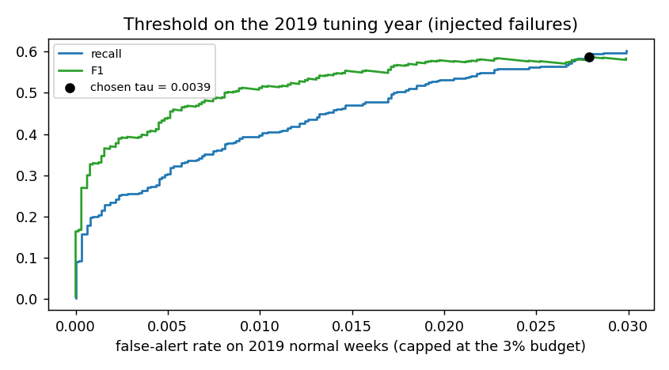
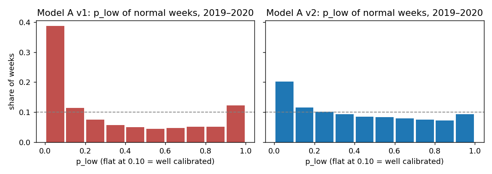
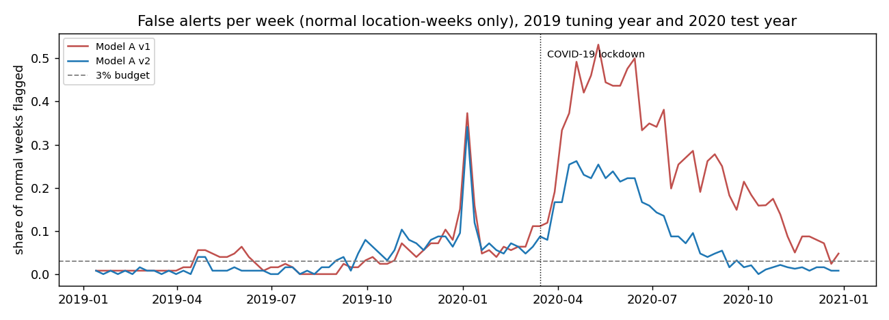
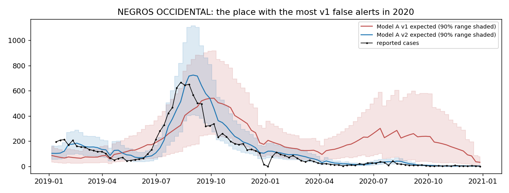
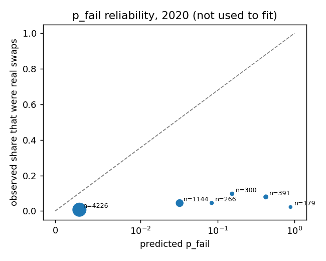
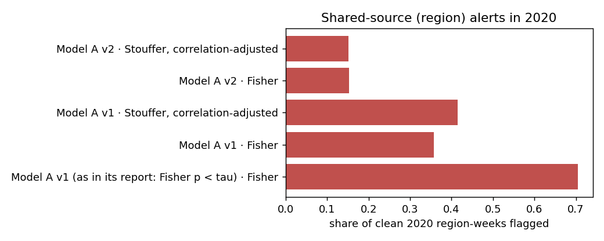

# Model A v2: evaluation report

Run `20261120T062907Z-688195ce` · generated by `python -m iris_pipeline model-a` · runtime 0.1 min · `scores_v2.csv` SHA-256 `6d2aa9258c52bc34…`

## In plain words

- **What Model A does.** For every place and week it predicts how many dengue cases should be reported, from earlier weeks only, and flags weeks that came in far too low. A flag is a lead for staff to check, not a confirmed error.
- **What changed in v2.** (1) It follows the recent level of reporting, so it adjusts after a real drop such as COVID-19 in 2020 instead of flagging it for months. (2) Its 90% ranges also account for uncertainty in the model itself and for some years being bigger epidemics than others. (3) Its threshold was set on 2019 using simulated failures. (4) Every week now carries `p_fail`, a probability that the report is a real failure, and `shortfall`, the cases likely missing. (5) Region-wide evidence is pooled allowing for places that move together.
- **Alert budget 3% (run 3).** The share of normal weeks Model A may flag was raised from 1% to 3% at the team's request, chosen on 2016–2019 only (design log in config.py). It catches more real errors for more false alerts; the 2020 numbers below are a second look at 2020, not an independent test (see the test-run log).
- **False alarms in 2020** (normal weeks wrongly flagged): v1 22.6% → v2 10.1% (budget 3%).
- **Real swapped reports caught in 2020:** v1 77%, v2 32%, best simple baseline 8%. Simulated failures caught in 2020: v1 53%, v2 39%.
- **Region-wide alerts in 2020:** false region alerts went from 71% (v1 as reported) to 15% (v2 with correlation-adjusted pooling), while 58% of the real swap region-weeks are still flagged. Most of that drop comes from giving region alerts their own threshold (v1 with its own region threshold: 36%); v2's model and pooling take it the rest of the way.
- **Roadmap targets met: 2 of 4** (table below). Targets that were missed are reported as missed; nothing was re-tuned on 2020.
- **Bottom line.** v2 is not better than v1 on every count; it is a different trade-off. It cuts false alarms (individual weeks 23% → 10%, regions 71% → 15%) and ranks simulated failures better (AUC 0.77 → 0.85), but it catches far fewer of the real 2020 swaps, because once it has followed the COVID-era low counts a zero no longer looks unusual. Neither version holds the 3% budget through the April–June 2020 drop: a level change that sudden and that large is outside anything in 2016–2019. Use v2's region (hub) evidence for shared failures; treat single-week alerts in a period of sudden real change with caution.

## Roadmap step 2: done-when checklist

| target (roadmap step 2) | Model A v1 | Model A v2 | met |
|---|---|---|---|
| 2020 false-alert rate close to 1% (≤ 2%) | 0.226 | 0.101 | no |
| 2020 recall on real swaps well above the baselines (best baseline 0.076) | 0.772 | 0.323 (CI 0.182–0.457) | yes |
| 85–95% of normal weeks inside the 90% range, 2017–2019 (selection years) | 0.750 | 0.859 | yes |
| 85–95% of normal weeks inside the 90% range, 2020 (test year) | 0.556 | 0.793 | no |

## How the test was kept honest

- **Split:** train 2016–2018 (history only), tune 2019, test 2020. Scores are rolling-origin: each week is predicted from earlier weeks only (`tests/test_no_leakage.py` checks this).
- **Model choice before the test:** 10 variants were compared on 2016–2019 only, with a rule fixed in advance (90% range coverage 85–95% on 2017–2019, then the best 2019 recall on injected failures; since run 3 the score also includes recall on the real 2016–2017 swaps, at the 3% budget). Chosen: **`recent1+uncertainty`**: coverage 0.859 is inside [0.85, 0.95] and it has the best the mean of 2019 injected-failure recall and 2016-2017 real swap recall (0.610) among those that are. The choice was written to `selection.json` before any 2020 metric was computed.
- **Same failures for both versions:** v1's injected failures are re-read from `models/data/synthetic/model_a_injected_failures.csv`, not re-drawn.
- **Faithful port:** v1 re-run inside this package reproduces the published v1 `scores.csv` (`tests/test_v1_reproduces.py`).

### Test-run log

The 2020 test year has been scored 3 times. **Run 1** had an implementation bug in the threshold rule: the 1% false-alert cap was counted on the evaluation copy's normal weeks, whose injected failures widen the model, instead of on the real 2019 stream. The bug is visible on 2019 alone: run 1's tau flagged 1.7% of real 2019 normal weeks, above the stated 1% budget. **Run 2** counts the cap on the real 2019 stream, as the rule says and as v1 does; it is the published v2. **Run 3** raises the alert budget from 1% to 3% of 2019 normal weeks, at the team's request, after run 2's 2020 results had been read. The budget was chosen from a 2016–2019 comparison only (design log in config.py), but 2020 is no longer an independent test for run 3: its 2020 numbers are a second look. Every run's full outputs are kept in `test_runs/`.

| test run | v2 tau | 2020 swaps recall | 2020 false-alert rate | 2020 injected recall | 2020 false-alert rate (eval copy) |
|---|---|---|---|---|---|
| run 1 (cap bug, 1% budget) | 0.00081 | 0.165 | 0.077 | 0.302 | 0.042 |
| run 2 (published v2, 1% budget) | 0.000121 | 0.089 | 0.055 | 0.199 | 0.031 |
| run 3 (this report, 3% budget) | 0.00386 | 0.323 | 0.101 | 0.388 | 0.062 |

### Variants compared on 2016–2019

| candidate | tau_budget_2019 | coverage90_2016 | coverage90_2017 | coverage90_2018 | coverage90_2019 | coverage90_2017_2019 | inj_recall_2019 | inj_far_2019 | inj_f1_2019 | swap_recall_2016 | far_2016 | swap_recall_2017 | far_2017 |
|---|---|---|---|---|---|---|---|---|---|---|---|---|---|
| v1 | 0.0056 | 0.6630 | 0.7868 | 0.7308 | 0.7316 | 0.7496 | 0.5325 | 0.0231 | 0.5703 | 0.5467 | 0.0374 | 0.7626 | 0.0182 |
| v1+uncertainty | 0.0244 | 0.6961 | 0.8165 | 0.7929 | 0.8340 | 0.8143 | 0.5229 | 0.0230 | 0.5636 | 0.6800 | 0.0705 | 0.8434 | 0.0337 |
| recent1 | 0.0012 | 0.6681 | 0.8137 | 0.8549 | 0.8083 | 0.8258 | 0.5663 | 0.0170 | 0.6250 | 0.4222 | 0.0152 | 0.6414 | 0.0103 |
| recent1+uncertainty | 0.0048 | 0.7016 | 0.8494 | 0.8860 | 0.8405 | 0.8588 | 0.6024 | 0.0210 | 0.6321 | 0.5022 | 0.0232 | 0.7323 | 0.0118 |
| recent2+uncertainty | 0.0073 | 0.7029 | 0.8341 | 0.8735 | 0.8336 | 0.8472 | 0.6096 | 0.0191 | 0.6462 | 0.5422 | 0.0308 | 0.7323 | 0.0151 |
| recent1x+uncertainty | 0.0012 | 0.7005 | 0.8273 | 0.8706 | 0.7972 | 0.8319 | 0.4940 | 0.0178 | 0.5640 | 0.3244 | 0.0100 | 0.5960 | 0.0053 |
| recent2x+uncertainty | 0.0027 | 0.7033 | 0.8184 | 0.8611 | 0.7983 | 0.8262 | 0.5229 | 0.0193 | 0.5802 | 0.4622 | 0.0176 | 0.6667 | 0.0089 |
| recent1z+uncertainty | 0.0043 | 0.6982 | 0.8504 | 0.8805 | 0.8439 | 0.8584 | 0.5928 | 0.0198 | 0.6308 | 0.5022 | 0.0217 | 0.6970 | 0.0107 |
| recent2z+uncertainty | 0.0073 | 0.6996 | 0.8339 | 0.8680 | 0.8346 | 0.8456 | 0.6048 | 0.0200 | 0.6387 | 0.5422 | 0.0311 | 0.7222 | 0.0145 |
| covid+uncertainty | 0.0244 | 0.6961 | 0.8165 | 0.7929 | 0.8340 | 0.8143 | 0.5229 | 0.0230 | 0.5636 | 0.6800 | 0.0705 | 0.8434 | 0.0337 |

## 2020 test: headline results

95% intervals are cluster-bootstrap intervals (whole places resampled, 400 draws). Thresholds frozen on 2019.

| failure set | method | positives | recall (95% CI) | false-alert rate (95% CI) | precision | F1 | AUC | weeks to detect |
|---|---|---|---|---|---|---|---|---|
| 2020: real swaps | Model A v1 | 158 | 0.772 (0.655–0.883) | 0.226 (0.195–0.262) | 0.078 | 0.142 | 0.842 | 0.000 |
| 2020: real swaps | Model A v2 | 158 | 0.323 (0.182–0.457) | 0.101 (0.074–0.133) | 0.073 | 0.120 | 0.790 | 0.000 |
| 2020: real swaps | Rolling median | 158 | 0.051 (0.007–0.101) | 0.017 (0.013–0.022) | 0.068 | 0.058 | 0.700 | 0.000 |
| 2020: real swaps | EWMA | 158 | 0.076 (0.034–0.112) | 0.021 (0.018–0.025) | 0.082 | 0.079 | 0.800 | 0.000 |
| 2020: real swaps | CUSUM | 158 | 0.013 (0.000–0.044) | 0.092 (0.062–0.128) | 0.003 | 0.005 | 0.381 | 4.000 |
| 2020: regional gap filled with 0 | Model A v1 | 46 | 0.457 (0.312–0.604) | 0.184 (0.153–0.216) | 0.019 | 0.036 | 0.732 | 0.000 |
| 2020: regional gap filled with 0 | Model A v2 | 46 | 0.087 (0.000–0.178) | 0.062 (0.042–0.085) | 0.011 | 0.019 | 0.697 | 0.000 |
| 2020: regional gap filled with 0 | Rolling median | 46 | 0.000 (0.000–0.000) | 0.012 (0.009–0.016) | 0.000 | 0.000 | 0.574 |  |
| 2020: regional gap filled with 0 | EWMA | 46 | 0.000 (0.000–0.000) | 0.011 (0.008–0.013) | 0.000 | 0.000 | 0.731 |  |
| 2020: regional gap filled with 0 | CUSUM | 46 | 0.022 (0.000–0.070) | 0.085 (0.050–0.119) | 0.002 | 0.004 | 0.260 | 0.000 |
| 2020: injected, all types | Model A v1 | 407 | 0.526 (0.453–0.593) | 0.184 (0.153–0.216) | 0.164 | 0.250 | 0.769 | 0.006 |
| 2020: injected, all types | Model A v2 | 407 | 0.388 (0.324–0.460) | 0.062 (0.042–0.085) | 0.299 | 0.338 | 0.852 | 0.000 |
| 2020: injected, all types | Rolling median | 407 | 0.143 (0.106–0.174) | 0.012 (0.009–0.016) | 0.439 | 0.215 | 0.859 | 0.000 |
| 2020: injected, all types | EWMA | 407 | 0.243 (0.200–0.282) | 0.011 (0.008–0.013) | 0.611 | 0.348 | 0.892 | 0.000 |
| 2020: injected, all types | CUSUM | 407 | 0.108 (0.066–0.160) | 0.085 (0.050–0.119) | 0.080 | 0.092 | 0.609 | 0.026 |

## Threshold

- v1: tau = 0.00562 (3% of 2019 normal weeks).
- v2: tau = **0.00386**: the best F1 on 2019 injected failures among thresholds whose 2019 false-alert rate is within 3%. (At exactly 3% of 2019 normal weeks it would be 0.0048.)
- Baselines: rolling_median > 3.25, ewma > 2.09, cusum > 22 (3% of 2019 normal weeks).

## Calibration of the 90% range

**Model A v1**

| year | ok weeks scored | inside 90% range | p_low < 0.05 | p_low > 0.95 | alerts (p_low < tau) |
|---|---|---|---|---|---|
| 2016 | 5104.000 | 0.663 | 0.130 | 0.235 | 0.037 |
| 2017 | 6430.000 | 0.787 | 0.077 | 0.158 | 0.018 |
| 2018 | 6552.000 | 0.731 | 0.027 | 0.261 | 0.005 |
| 2019 | 6426.000 | 0.732 | 0.114 | 0.169 | 0.030 |
| 2020 | 6348.000 | 0.556 | 0.480 | 0.012 | 0.226 |
| 2021 | 126.000 | 0.802 | 0.214 | 0.016 | 0.063 |

**Model A v2**

| year | ok weeks scored | inside 90% range | p_low < 0.05 | p_low > 0.95 | alerts (p_low < tau) |
|---|---|---|---|---|---|
| 2016 | 4604.000 | 0.702 | 0.113 | 0.209 | 0.020 |
| 2017 | 6426.000 | 0.849 | 0.061 | 0.112 | 0.010 |
| 2018 | 6552.000 | 0.886 | 0.030 | 0.099 | 0.004 |
| 2019 | 6426.000 | 0.840 | 0.095 | 0.075 | 0.028 |
| 2020 | 6348.000 | 0.793 | 0.191 | 0.044 | 0.101 |
| 2021 | 126.000 | 0.913 | 0.079 | 0.040 | 0.024 |

## `p_fail`: probability of a real failure

Isotonic regression of 'is a failure' on −log10(p_low), fitted on 2019 (injected failures vs normal weeks), then shifted from the fitting set's failure share (0.065) to the real failure share in the 2016–2018 labels (0.0259). Checked on 2020 real swaps, which were not used to fit it:

| bin | rows | mean_p_fail | observed_failure_share |
|---|---|---|---|
| (-0.001, 0.01] | 4226 | 0.0028 | 0.0073 |
| (0.01, 0.05] | 1144 | 0.0321 | 0.0446 |
| (0.05, 0.1] | 266 | 0.0839 | 0.0451 |
| (0.1, 0.25] | 300 | 0.1544 | 0.0967 |
| (0.25, 0.5] | 391 | 0.4243 | 0.0793 |
| (0.5, 1.0] | 179 | 0.8887 | 0.0223 |

Brier score 0.0518 vs 0.0237 for always predicting the base rate (0.0243); lower is better.

## Shared-source evidence (region = hub)

Real data has no reporting-hub table, so each region's RESU is used as the hub (`hub_id = RESU-<region>`). Fisher pooling (v1) treats the places in a region as independent witnesses; correlation-adjusted Stouffer (v2) discounts them by their average correlation on normal 2016–2018 weeks. Every (model, pooling) pair gets its own region-week threshold at 3% of clean 2019 region-weeks; the first row repeats v1's own report (at its 1%).

| model | pooling | failure set | region-weeks | detected | false region alerts (clean region-weeks) |
|---|---|---|---|---|---|
| Model A v1 (as in its report: Fisher p < tau) | Fisher | real swaps 2020 (test) | 24 | 1.000 | 0.705 |
| Model A v1 | Fisher | real swaps 2017 | 30 | 1.000 | 0.005 |
| Model A v1 | Fisher | real swaps 2020 (test) | 24 | 0.875 | 0.358 |
| Model A v1 | Fisher | regional gap filled with 0, 2017 + 2020 | 11 | 0.909 | 0.130 |
| Model A v1 | Fisher | injected region outage, 2019 + 2020 | 6 | 1.000 | 0.178 |
| Model A v1 | Stouffer, correlation-adjusted | real swaps 2017 | 30 | 1.000 | 0.005 |
| Model A v1 | Stouffer, correlation-adjusted | real swaps 2020 (test) | 24 | 1.000 | 0.415 |
| Model A v1 | Stouffer, correlation-adjusted | regional gap filled with 0, 2017 + 2020 | 11 | 1.000 | 0.158 |
| Model A v1 | Stouffer, correlation-adjusted | injected region outage, 2019 + 2020 | 6 | 1.000 | 0.214 |
| Model A v2 | Fisher | real swaps 2017 | 30 | 1.000 | 0.002 |
| Model A v2 | Fisher | real swaps 2020 (test) | 24 | 0.458 | 0.153 |
| Model A v2 | Fisher | regional gap filled with 0, 2017 + 2020 | 11 | 0.636 | 0.042 |
| Model A v2 | Fisher | injected region outage, 2019 + 2020 | 6 | 1.000 | 0.059 |
| Model A v2 | Stouffer, correlation-adjusted | real swaps 2017 | 30 | 1.000 | 0.003 |
| Model A v2 | Stouffer, correlation-adjusted | real swaps 2020 (test) | 24 | 0.583 | 0.151 |
| Model A v2 | Stouffer, correlation-adjusted | regional gap filled with 0, 2017 + 2020 | 11 | 0.636 | 0.045 |
| Model A v2 | Stouffer, correlation-adjusted | injected region outage, 2019 + 2020 | 6 | 1.000 | 0.068 |

## COVID flag (sensitivity analysis, not selectable)

`covid_period` is 0 before 2020, so 2016–2019 cannot judge it; it is shown here only for transparency.

**dengue 2020: real swaps [covid sensitivity]**

| method | positives | recall | precision | f1 | false_alert_rate | auc |
|---|---|---|---|---|---|---|
| Model A v1 | 158 | 0.772 | 0.078 | 0.142 | 0.226 | 0.842 |
| Model A v1 + covid flag (sensitivity) | 158 | 0.557 | 0.133 | 0.215 | 0.090 | 0.871 |
| Model A v2 | 158 | 0.323 | 0.073 | 0.120 | 0.101 | 0.790 |

**dengue 2020 (test): injected, all types [covid sensitivity]**

| method | positives | recall | precision | f1 | false_alert_rate | auc |
|---|---|---|---|---|---|---|
| Model A v1 | 407 | 0.526 | 0.164 | 0.250 | 0.184 | 0.769 |
| Model A v1 + covid flag (sensitivity) | 407 | 0.428 | 0.319 | 0.365 | 0.063 | 0.827 |
| Model A v2 | 407 | 0.388 | 0.299 | 0.338 | 0.062 | 0.852 |

## Measles, rubella and TB (thresholds transferred from dengue, no retuning)

**measles: 2019 W8 group zero (real)**

| method | positives | recall | precision | f1 | false_alert_rate | auc |
|---|---|---|---|---|---|---|
| Model A v1 | 1 | 1.000 | 0.111 | 0.200 | 0.038 | 0.995 |
| Model A v2 | 1 | 1.000 | 0.125 | 0.222 | 0.033 | 0.986 |
| Rolling median | 1 | 0.000 | 0.000 | 0.000 | 0.014 | 0.833 |
| EWMA | 1 | 0.000 | 0.000 | 0.000 | 0.014 | 0.900 |
| CUSUM | 1 | 0.000 |  | 0.000 | 0.000 | 0.648 |

**measles: blank weeks filled with 0**

| method | positives | recall | precision | f1 | false_alert_rate | auc |
|---|---|---|---|---|---|---|
| Model A v1 | 42 | 0.214 | 0.692 | 0.327 | 0.019 | 0.891 |
| Model A v2 | 42 | 0.405 | 0.895 | 0.557 | 0.010 | 0.854 |
| Rolling median | 42 | 0.048 | 0.667 | 0.089 | 0.005 | 0.727 |
| EWMA | 42 | 0.024 | 0.333 | 0.044 | 0.010 | 0.667 |
| CUSUM | 42 | 0.000 |  | 0.000 | 0.000 | 0.776 |

**rubella: 2019 W8 group zero (real)**

| method | positives | recall | precision | f1 | false_alert_rate | auc |
|---|---|---|---|---|---|---|
| Model A v1 | 1 | 0.000 |  | 0.000 | 0.000 | 0.738 |
| Model A v2 | 1 | 0.000 |  | 0.000 | 0.000 | 0.610 |
| Rolling median | 1 | 0.000 |  | 0.000 | 0.000 | 0.848 |
| EWMA | 1 | 0.000 | 0.000 | 0.000 | 0.005 | 0.971 |
| CUSUM | 1 | 0.000 |  | 0.000 | 0.000 | 0.738 |

**rubella: blank weeks filled with 0**

| method | positives | recall | precision | f1 | false_alert_rate | auc |
|---|---|---|---|---|---|---|
| Model A v1 | 42 | 0.000 |  | 0.000 | 0.000 | 0.881 |
| Model A v2 | 42 | 0.000 |  | 0.000 | 0.000 | 0.880 |
| Rolling median | 42 | 0.000 |  | 0.000 | 0.000 | 0.658 |
| EWMA | 42 | 0.024 | 1.000 | 0.047 | 0.000 | 0.617 |
| CUSUM | 42 | 0.000 |  | 0.000 | 0.000 | 0.637 |

**measles 2017 + 2021: injected, all types**

| method | positives | recall | precision | f1 | false_alert_rate | auc |
|---|---|---|---|---|---|---|
| Model A v1 | 18 | 0.111 | 0.167 | 0.133 | 0.052 | 0.557 |
| Model A v2 | 18 | 0.000 | 0.000 | 0.000 | 0.016 | 0.607 |
| Rolling median | 18 | 0.000 | 0.000 | 0.000 | 0.016 | 0.684 |
| EWMA | 18 | 0.000 | 0.000 | 0.000 | 0.010 | 0.756 |
| CUSUM | 18 | 0.000 |  | 0.000 | 0.000 | 0.515 |

**TB: 8 suspect months, method 1 (previous year / 12)**

| method | positives | recall | precision | f1 | false_alert_rate | auc |
|---|---|---|---|---|---|---|
| Model A v1 | 8 | 0.250 | 0.500 | 0.333 | 0.032 | 0.683 |
| Model A v2 | 8 | 0.250 | 1.000 | 0.400 | 0.000 | 0.683 |
| Rolling median | 8 | 0.000 | 0.000 | 0.000 | 0.048 | 0.745 |
| EWMA | 8 | 0.125 | 0.250 | 0.167 | 0.048 | 0.781 |
| CUSUM | 8 | 0.000 |  | 0.000 | 0.000 | 0.416 |

**TB: 8 suspect months, method 2 (count model, 2021 on)**

| method | positives | recall | precision | f1 | false_alert_rate | auc |
|---|---|---|---|---|---|---|
| Model A v1 | 8 | 0.125 | 0.250 | 0.167 | 0.068 | 0.500 |
| Model A v2 | 8 | 0.000 | 0.000 | 0.000 | 0.045 | 0.131 |
| Rolling median | 8 | 0.000 | 0.000 | 0.000 | 0.068 | 0.696 |
| EWMA | 8 | 0.125 | 0.250 | 0.167 | 0.068 | 0.739 |
| CUSUM | 8 | 0.000 |  | 0.000 | 0.000 | 0.312 |

## Every dengue failure set

**dengue 2016: real swaps**

| method | positives | events | recall | detection_rate | weeks_to_detect | precision | f1 | false_alert_rate | auc |
|---|---|---|---|---|---|---|---|---|---|
| Model A v1 | 225 | 46 | 0.547 | 0.565 | 0.154 | 0.469 | 0.505 | 0.030 | 0.947 |
| Model A v2 | 225 | 46 | 0.498 | 0.543 | 0.400 | 0.552 | 0.523 | 0.020 | 0.941 |
| Rolling median | 225 | 46 | 0.187 | 0.478 | 0.545 | 0.271 | 0.221 | 0.025 | 0.839 |
| EWMA | 225 | 46 | 0.160 | 0.783 | 0.000 | 0.248 | 0.195 | 0.024 | 0.895 |
| CUSUM | 225 | 46 | 0.031 | 0.043 | 3.000 | 0.069 | 0.043 | 0.020 | 0.654 |

**dengue 2017: real swaps**

| method | positives | events | recall | detection_rate | weeks_to_detect | precision | f1 | false_alert_rate | auc |
|---|---|---|---|---|---|---|---|---|---|
| Model A v1 | 198 | 41 | 0.763 | 0.805 | 0.061 | 0.563 | 0.648 | 0.018 | 0.978 |
| Model A v2 | 198 | 41 | 0.707 | 0.756 | 0.065 | 0.676 | 0.691 | 0.010 | 0.972 |
| Rolling median | 198 | 41 | 0.136 | 0.366 | 0.133 | 0.171 | 0.152 | 0.020 | 0.816 |
| EWMA | 198 | 41 | 0.116 | 0.561 | 0.000 | 0.123 | 0.119 | 0.026 | 0.826 |
| CUSUM | 198 | 41 | 0.025 | 0.049 | 1.000 | 0.015 | 0.019 | 0.051 | 0.615 |

**dengue 2020: real swaps**

| method | positives | events | recall | detection_rate | weeks_to_detect | precision | f1 | false_alert_rate | auc |
|---|---|---|---|---|---|---|---|---|---|
| Model A v1 | 158 | 44 | 0.772 | 0.727 | 0.000 | 0.078 | 0.142 | 0.226 | 0.842 |
| Model A v2 | 158 | 44 | 0.323 | 0.364 | 0.000 | 0.073 | 0.120 | 0.101 | 0.790 |
| Rolling median | 158 | 44 | 0.051 | 0.114 | 0.000 | 0.068 | 0.058 | 0.017 | 0.700 |
| EWMA | 158 | 44 | 0.076 | 0.273 | 0.000 | 0.082 | 0.079 | 0.021 | 0.800 |
| CUSUM | 158 | 44 | 0.013 | 0.023 | 4.000 | 0.003 | 0.005 | 0.092 | 0.381 |

**dengue 2016: regional gap filled with 0**

| method | positives | events | recall | detection_rate | weeks_to_detect | precision | f1 | false_alert_rate | auc |
|---|---|---|---|---|---|---|---|---|---|
| Model A v1 | 46 | 46 | 0.413 | 0.413 | 0.000 | 0.120 | 0.186 | 0.030 | 0.929 |
| Model A v2 | 46 | 46 | 0.326 | 0.326 | 0.000 | 0.142 | 0.197 | 0.020 | 0.920 |
| Rolling median | 46 | 46 | 0.000 | 0.000 |  | 0.000 | 0.000 | 0.025 | 0.690 |
| EWMA | 46 | 46 | 0.000 | 0.000 |  | 0.000 | 0.000 | 0.023 | 0.824 |
| CUSUM | 46 | 46 | 0.022 | 0.022 | 0.000 | 0.011 | 0.014 | 0.020 | 0.599 |

**dengue 2017: regional gap filled with 0**

| method | positives | events | recall | detection_rate | weeks_to_detect | precision | f1 | false_alert_rate | auc |
|---|---|---|---|---|---|---|---|---|---|
| Model A v1 | 41 | 41 | 0.561 | 0.561 | 0.000 | 0.170 | 0.261 | 0.017 | 0.957 |
| Model A v2 | 41 | 41 | 0.512 | 0.512 | 0.000 | 0.239 | 0.326 | 0.010 | 0.948 |
| Rolling median | 41 | 41 | 0.000 | 0.000 |  | 0.000 | 0.000 | 0.020 | 0.653 |
| EWMA | 41 | 41 | 0.000 | 0.000 |  | 0.000 | 0.000 | 0.026 | 0.768 |
| CUSUM | 41 | 41 | 0.024 | 0.024 | 0.000 | 0.003 | 0.005 | 0.050 | 0.520 |

**dengue 2020: regional gap filled with 0**

| method | positives | events | recall | detection_rate | weeks_to_detect | precision | f1 | false_alert_rate | auc |
|---|---|---|---|---|---|---|---|---|---|
| Model A v1 | 46 | 46 | 0.457 | 0.457 | 0.000 | 0.019 | 0.036 | 0.184 | 0.732 |
| Model A v2 | 46 | 46 | 0.087 | 0.087 | 0.000 | 0.011 | 0.019 | 0.062 | 0.697 |
| Rolling median | 46 | 46 | 0.000 | 0.000 |  | 0.000 | 0.000 | 0.012 | 0.574 |
| EWMA | 46 | 46 | 0.000 | 0.000 |  | 0.000 | 0.000 | 0.011 | 0.731 |
| CUSUM | 46 | 46 | 0.022 | 0.022 | 0.000 | 0.002 | 0.004 | 0.085 | 0.260 |

**dengue 2019 (tuning): injected zero_fill**

| method | positives | events | recall | detection_rate | weeks_to_detect | precision | f1 | false_alert_rate | auc |
|---|---|---|---|---|---|---|---|---|---|
| Model A v1 | 150 | 150 | 0.720 | 0.720 | 0.000 | 0.437 | 0.544 | 0.023 | 0.971 |
| Model A v2 | 150 | 150 | 0.793 | 0.793 | 0.000 | 0.522 | 0.630 | 0.018 | 0.982 |
| Rolling median | 150 | 150 | 0.360 | 0.360 | 0.000 | 0.267 | 0.307 | 0.025 | 0.931 |
| EWMA | 150 | 150 | 0.667 | 0.667 | 0.000 | 0.452 | 0.539 | 0.020 | 0.971 |
| CUSUM | 150 | 150 | 0.060 | 0.060 | 0.000 | 0.040 | 0.048 | 0.036 | 0.657 |

**dengue 2019 (tuning): injected partial**

| method | positives | events | recall | detection_rate | weeks_to_detect | precision | f1 | false_alert_rate | auc |
|---|---|---|---|---|---|---|---|---|---|
| Model A v1 | 150 | 150 | 0.160 | 0.160 | 0.000 | 0.147 | 0.153 | 0.023 | 0.771 |
| Model A v2 | 150 | 150 | 0.260 | 0.260 | 0.000 | 0.264 | 0.262 | 0.018 | 0.879 |
| Rolling median | 150 | 150 | 0.173 | 0.173 | 0.000 | 0.149 | 0.160 | 0.025 | 0.831 |
| EWMA | 150 | 150 | 0.347 | 0.347 | 0.000 | 0.301 | 0.322 | 0.020 | 0.902 |
| CUSUM | 150 | 150 | 0.033 | 0.033 | 0.000 | 0.023 | 0.027 | 0.036 | 0.596 |

**dengue 2019 (tuning): injected outage**

| method | positives | events | recall | detection_rate | weeks_to_detect | precision | f1 | false_alert_rate | auc |
|---|---|---|---|---|---|---|---|---|---|
| Model A v1 | 96 | 30 | 0.812 | 0.833 | 0.080 | 0.359 | 0.498 | 0.023 | 0.983 |
| Model A v2 | 96 | 30 | 0.781 | 0.800 | 0.000 | 0.408 | 0.536 | 0.018 | 0.977 |
| Rolling median | 96 | 30 | 0.281 | 0.433 | 0.000 | 0.154 | 0.199 | 0.025 | 0.877 |
| EWMA | 96 | 30 | 0.219 | 0.700 | 0.000 | 0.148 | 0.176 | 0.020 | 0.864 |
| CUSUM | 96 | 30 | 0.094 | 0.133 | 1.250 | 0.040 | 0.056 | 0.036 | 0.681 |

**dengue 2019 (tuning): injected region_outage**

| method | positives | events | recall | detection_rate | weeks_to_detect | precision | f1 | false_alert_rate | auc |
|---|---|---|---|---|---|---|---|---|---|
| Model A v1 | 19 | 3 | 0.579 | 1.000 | 0.000 | 0.073 | 0.130 | 0.023 | 0.966 |
| Model A v2 | 19 | 3 | 0.737 | 1.000 | 0.000 | 0.114 | 0.197 | 0.018 | 0.967 |
| Rolling median | 19 | 3 | 0.316 | 1.000 | 0.000 | 0.039 | 0.069 | 0.025 | 0.912 |
| EWMA | 19 | 3 | 0.632 | 1.000 | 0.000 | 0.090 | 0.158 | 0.020 | 0.981 |
| CUSUM | 19 | 3 | 0.000 | 0.000 |  | 0.000 | 0.000 | 0.036 | 0.590 |

**dengue 2019 (tuning): injected, all types**

| method | positives | events | recall | detection_rate | weeks_to_detect | precision | f1 | false_alert_rate | auc |
|---|---|---|---|---|---|---|---|---|---|
| Model A v1 | 415 | 333 | 0.533 | 0.480 | 0.013 | 0.614 | 0.570 | 0.023 | 0.901 |
| Model A v2 | 415 | 333 | 0.595 | 0.556 | 0.000 | 0.694 | 0.641 | 0.018 | 0.943 |
| Rolling median | 415 | 333 | 0.272 | 0.288 | 0.000 | 0.433 | 0.334 | 0.025 | 0.882 |
| EWMA | 415 | 333 | 0.446 | 0.529 | 0.000 | 0.605 | 0.513 | 0.020 | 0.922 |
| CUSUM | 415 | 333 | 0.055 | 0.054 | 0.278 | 0.097 | 0.071 | 0.036 | 0.637 |

**dengue 2020 (test): injected zero_fill**

| method | positives | events | recall | detection_rate | weeks_to_detect | precision | f1 | false_alert_rate | auc |
|---|---|---|---|---|---|---|---|---|---|
| Model A v1 | 150 | 150 | 0.600 | 0.600 | 0.000 | 0.076 | 0.135 | 0.184 | 0.808 |
| Model A v2 | 150 | 150 | 0.407 | 0.407 | 0.000 | 0.141 | 0.210 | 0.062 | 0.880 |
| Rolling median | 150 | 150 | 0.193 | 0.193 | 0.000 | 0.282 | 0.229 | 0.012 | 0.891 |
| EWMA | 150 | 150 | 0.307 | 0.307 | 0.000 | 0.422 | 0.355 | 0.011 | 0.914 |
| CUSUM | 150 | 150 | 0.087 | 0.087 | 0.000 | 0.025 | 0.039 | 0.085 | 0.616 |

**dengue 2020 (test): injected partial**

| method | positives | events | recall | detection_rate | weeks_to_detect | precision | f1 | false_alert_rate | auc |
|---|---|---|---|---|---|---|---|---|---|
| Model A v1 | 150 | 150 | 0.333 | 0.333 | 0.000 | 0.044 | 0.077 | 0.184 | 0.662 |
| Model A v2 | 150 | 150 | 0.233 | 0.233 | 0.000 | 0.086 | 0.126 | 0.062 | 0.774 |
| Rolling median | 150 | 150 | 0.107 | 0.107 | 0.000 | 0.178 | 0.133 | 0.012 | 0.820 |
| EWMA | 150 | 150 | 0.240 | 0.240 | 0.000 | 0.364 | 0.289 | 0.011 | 0.870 |
| CUSUM | 150 | 150 | 0.133 | 0.133 | 0.000 | 0.038 | 0.059 | 0.085 | 0.582 |

**dengue 2020 (test): injected outage**

| method | positives | events | recall | detection_rate | weeks_to_detect | precision | f1 | false_alert_rate | auc |
|---|---|---|---|---|---|---|---|---|---|
| Model A v1 | 86 | 30 | 0.686 | 0.700 | 0.048 | 0.051 | 0.095 | 0.184 | 0.864 |
| Model A v2 | 86 | 30 | 0.558 | 0.533 | 0.000 | 0.115 | 0.190 | 0.062 | 0.918 |
| Rolling median | 86 | 30 | 0.151 | 0.233 | 0.000 | 0.149 | 0.150 | 0.012 | 0.868 |
| EWMA | 86 | 30 | 0.128 | 0.367 | 0.000 | 0.149 | 0.138 | 0.011 | 0.881 |
| CUSUM | 86 | 30 | 0.081 | 0.100 | 0.333 | 0.014 | 0.023 | 0.085 | 0.653 |

**dengue 2020 (test): injected region_outage**

| method | positives | events | recall | detection_rate | weeks_to_detect | precision | f1 | false_alert_rate | auc |
|---|---|---|---|---|---|---|---|---|---|
| Model A v1 | 21 | 3 | 0.714 | 1.000 | 0.000 | 0.014 | 0.027 | 0.184 | 0.867 |
| Model A v2 | 21 | 3 | 0.667 | 1.000 | 0.000 | 0.036 | 0.069 | 0.062 | 0.937 |
| Rolling median | 21 | 3 | 0.000 | 0.000 |  | 0.000 | 0.000 | 0.012 | 0.885 |
| EWMA | 21 | 3 | 0.286 | 0.333 | 0.000 | 0.087 | 0.133 | 0.011 | 0.930 |
| CUSUM | 21 | 3 | 0.190 | 0.667 | 0.000 | 0.008 | 0.015 | 0.085 | 0.575 |

**dengue 2020 (test): injected, all types**

| method | positives | events | recall | detection_rate | weeks_to_detect | precision | f1 | false_alert_rate | auc |
|---|---|---|---|---|---|---|---|---|---|
| Model A v1 | 407 | 333 | 0.526 | 0.492 | 0.006 | 0.164 | 0.250 | 0.184 | 0.769 |
| Model A v2 | 407 | 333 | 0.388 | 0.345 | 0.000 | 0.299 | 0.338 | 0.062 | 0.852 |
| Rolling median | 407 | 333 | 0.143 | 0.156 | 0.000 | 0.439 | 0.215 | 0.012 | 0.859 |
| EWMA | 407 | 333 | 0.243 | 0.282 | 0.000 | 0.611 | 0.348 | 0.011 | 0.892 |
| CUSUM | 407 | 333 | 0.108 | 0.114 | 0.026 | 0.080 | 0.092 | 0.085 | 0.609 |

## Limits

- Flags are **leads to verify**, not confirmed errors. Real labels are the 581 swapped rows and 3 regional gaps found during cleaning; other failures in the data are unknown and count as normal weeks here.
- Injected failures are simulated. `p_fail` is calibrated on dengue province-weeks; for other diseases it is reported but not validated.
- The hub is the region's RESU because real reporting pathways are not available. The synthetic reporting network (roadmap step 3) tests real hub structure.
- The year-to-year term needs at least 26 reported periods in a year, so it is inactive for the monthly TB series.
- 2019 was a national dengue epidemic year; thresholds tuned on it may be conservative in calmer years.
