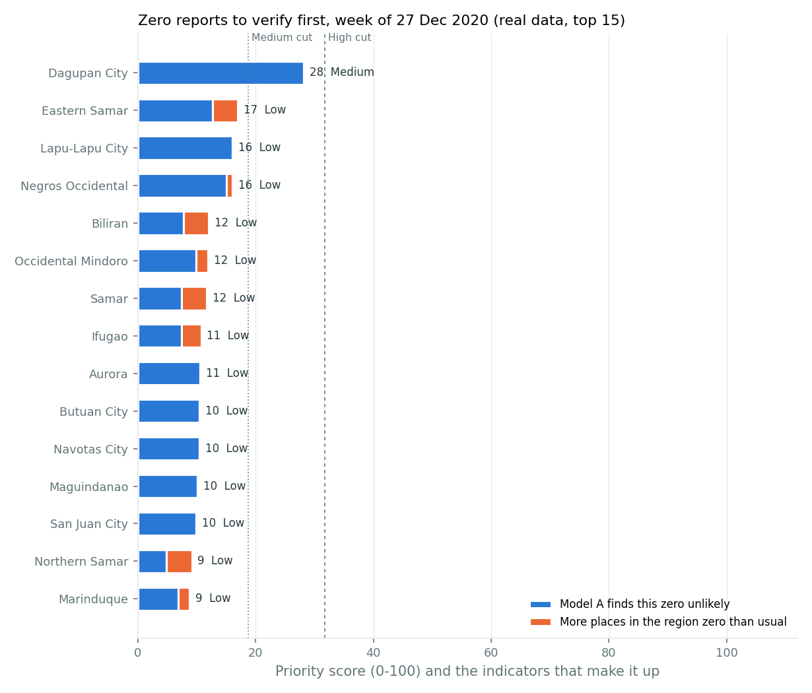
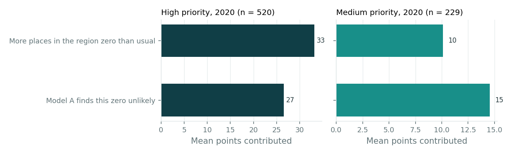
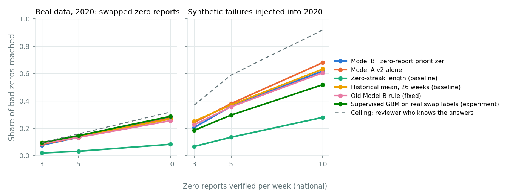
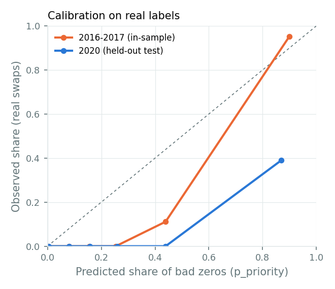
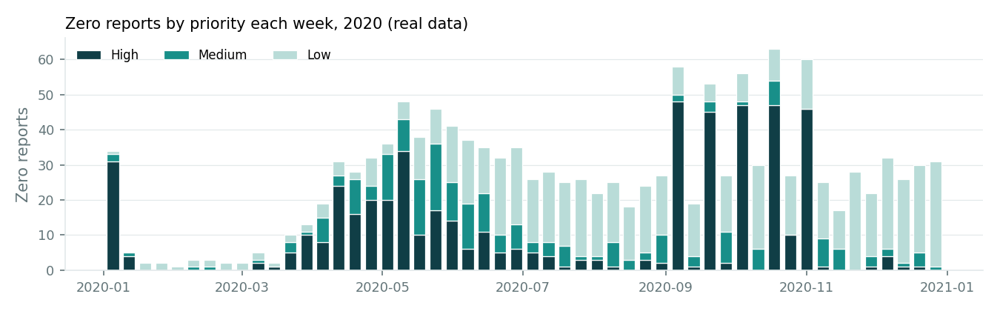

# Model B · zero-report prioritizer (dengue)

Generated by `python -m iris_pipeline zero-priority` · run `20261120T063000Z` · Model A v2 run `20261120T062907Z-688195ce` · runtime 51 s. Real and synthetic results are reported separately throughout.

## In plain words

- **What it does.** Every explicit zero-case dengue report gets a 0-100 priority score, a High / Medium / Low band, a calibrated share of comparable reports expected to be wrong, the indicators behind the ranking, data warnings and verification steps. Missing reports are kept apart: they are certain gaps for the planner, never treated as zeros.
- **What changed in v2.** Two changes, each aimed at a weakness the v1 report found. (1) The regional indicator now asks whether *more* places in the region are at zero than usual for that region in recent weeks, instead of how many are at zero. (2) How the local evidence (Model A, the place's own history) and the regional evidence combine is now a tuned choice among a weighted average (v1's form), the larger of the two, and 'either route' (noisy-OR), so that an isolated failure need not be halved by a quiet region. Tuning on 2016-2019 chose a weighted average of the two routes (best objective by form: max 0.970, mean 0.975, noisy_or 0.970); so change (2) was not adopted, and the other forms are reported as comparisons.
- **v2 against v1.** Average precision on real 2020 swaps 0.540 vs 0.479; on isolated synthetic failures in 2020 0.325 vs 0.294; on the regional gap entered as zero 0.182 vs 0.150. High-band false alerts on real 2020 normal zeros: 30.0% vs 46.9%. Every combination option, and v1's raw regional share under v2's combination, are in the tables below.
- **2020 is no longer a clean test for v2.** v2 was designed after v1's 2020 results had been read, so its 2020 numbers are a second look, not an independent test. Every v2 choice (indicators, weights, windows, bands) was made on 2016-2019 data only, with the same pre-registered selection rule as v1, and v1's results stay published next to v2's. A truly independent test needs newer data (2021 onward) or the reviews recorded in the IRIS app.
- **What it learned to use.** Tuning chose *Model A finds this zero unlikely* on the local route, and the regional route (*More places in the region zero than usual*, against the region's median of the previous 13 weeks). Among 16,062 near-equivalent settings the simplest was kept (pre-registered rule).
- **Real data, 2020.** Among 1,367 zero reports, 157 are known swapped reports. Model B's average precision is 0.540, higher than the best simple baseline (Model A v2 alone, 0.170). Checking the top 5 zero reports a week reaches 13.4% of the swaps (best baseline 13.4%). The High band catches 100.0% (95% CI 100.0%–100.0%) while flagging 30.0% of normal zeros.
- **Bands in a changing year.** During COVID-19, other places in the same region were also zero for 36.0% of normal zeros on average (3.1% in 2019). The High cut lets through 4.9% of 2019's normal zeros and 30.0% of 2020's (v1: 46.9% in 2020), because the regional indicator now compares a region with its own recent weeks. Bands that follow recent weeks were tried and rejected on 2016-2019 data (design log in config.py): they missed most bad zeros after the first bad week. The within-week rank is still the safest order to work through.
- **A weekly budget hits a ceiling on these labels.** All 157 real 2020 swaps fall in 5 weeks (up to 34 in one week), so verifying 5 zero reports a week can reach at most 15.9% of them even with perfect knowledge; most methods reach close to that, which is why they tie.
- **Trade-off.** On isolated synthetic failures Model A v2 alone ranks better (0.506 vs 0.325): the regional indicator helps with region-wide errors (swaps, regional gaps) and hurts with isolated ones. Show both: Model B's rank for zero reports, and Model A's p_low for single-place drops.
- **'Normal' is not 'verified correct'.** A zero counts as normal when it is not a known swap. Some 2020 'false alerts' may be real problems nobody labelled (late 2020 has weeks where half the country reported zero).
- **Synthetic failures injected into 2020.** Average precision 0.325 vs 0.506 for the best baseline (Model A v2 alone); High-band recall 57.9%. Regional gaps entered as zero: High-band recall 100.0%.
- **Calibration.** On real 2020 zeros the model predicts 33.9% bad zeros on average; 11.5% were swaps (Brier 0.154). The probability assumes the 2016-2018 share of swapped zeros (23.8%); it is an estimate under that assumption, not a guarantee.
- **Every alert is a lead to verify.** The data has no testing, timeliness or submission records, so IRIS cannot say why a zero happened; a high score means 'check this first', not 'this is a reporting failure'.

## Approach and why it fits the data

- **Data.** HDX/DOH dengue, 126 provinces and cities, weekly 2016-01-10 to 2021-01-10, read through the pipeline's clean table (`dengue/clean/dengue_province_weekly.csv`, checked against the cleaning plan's expected counts). Fields: location, region, week, cases, report status. Explicit zeros and missing weeks are distinct. No testing volume, timeliness, submission status or real neighbour data exists; deaths are not an input.
- **Labels.** There are no verified labels of reporting failures. The only real labels for zero reports are the cleaning plan's swapped cases/deaths rows (2016: 196, 2017: 174 zeros; 2018-2019: none; 2020: 157). They mark one source error, so they are used for tuning and testing, not as a general definition of failure. Synthetic failures come from the pipeline's injection file.
- **Model.** A transparent score, not a black box: a weighted average of the two routes, where the local route is a weighted mean of Model A and the place's own-history indicators and the regional route is how far the region's share of zeros is above its recent level. No supervised model is deployed, because the available labels cover one error type and the tuning year has none. A gradient-boosting model trained on the real swaps is reported as an experiment.
- **Indicators** (past weeks only, except same-week regional context): Model A finds this zero unlikely, Cases that may be missing, Zeros are unusual for this place, Zeros in a row, Cases in recent weeks, Switching between zero and non-zero, Other places in the region also zero, More places in the region zero than usual. Each is mapped to 0-1 with fixed, documented anchors (config.ZERO_PRIORITY).
- **Tuning (2016-2019 data only).** Grid of 131,202 settings (history window, minimum history, streak criterion, local weights 0/1/2, regional route on/off, the region's baseline window, how the routes combine). Objective: mean average precision on synthetic 2019 (284 injected zeros vs 142 real normal zeros) and real 2016-2017 (370 swaps vs 922 normal zeros). Chosen objective 0.971 (best 0.975; equal weights 0.964). Weights: Model A finds this zero unlikely 1, Cases that may be missing 0, Zeros are unusual for this place 0, Zeros in a row 0, Cases in recent weeks 0, Switching between zero and non-zero 0, More places in the region zero than usual 1.
  The history window, minimum history, streak criterion only affect indicators with weight 0, so their chosen values (26 weeks, 8 reports, 2 zeros) have no effect on scores.
- **Bands.** High: score above 31.7; Medium: above 18.8. Set so that at most 5% / 25% of real 2019 normal zero reports (142) fall in High / at least Medium. Every compared method gets its own threshold by the same rule.
- **Probability (`p_priority`).** Isotonic regression of the score on the 2019 tuning rows, prior-shifted from the tuning share (66.7%) to the real 2016-2018 share of swapped zeros (23.8%); 200 bootstrap refits give the 90% interval.

## Results

Thresholds were set on 2019. 95% intervals: cluster bootstrap over locations. 'weeks to detect' counts from the first week of an episode (real swaps: location-year; synthetic: injected event). v2's 2020 rows are a second look at 2020, not an independent test (see above).

### Real data · 2020 held-out test · swapped zero reports

1,367 zero reports · 157 positives · 1210 normal · positive share 11.5%. COVID-19 year: genuine drops and reporting interruptions both occurred.

| method | AUC | average precision | recall (High) | precision (High) | false alerts (High) | weeks to detect | recall, top 5/week | precision, top 5/week |
|---|---|---|---|---|---|---|---|---|
| Model B · zero-report prioritizer | 0.940 | 0.540 | 100.0% | 30.2% | 30.0% | 0.00 | 13.4% | 8.9% |
| Model B v1 (published) | 0.920 | 0.479 | 100.0% | 21.7% | 46.9% | 0.00 | 13.4% | 8.9% |
| Routes averaged (relative regional share) | 0.940 | 0.540 | 100.0% | 30.2% | 30.0% | 0.00 | 13.4% | 8.9% |
| Larger of the two routes | 0.934 | 0.498 | 100.0% | 33.0% | 26.4% | 0.00 | 4.5% | 3.0% |
| Either route (noisy-OR) | 0.935 | 0.499 | 100.0% | 32.7% | 26.7% | 0.00 | 4.5% | 3.0% |
| v1's raw regional share, v2's combination | 0.920 | 0.479 | 100.0% | 21.7% | 46.9% | 0.00 | 13.4% | 8.9% |
| Model A v2 alone | 0.656 | 0.170 | 38.9% | 23.1% | 16.8% | 0.00 | 13.4% | 8.9% |
| Zero-streak length (baseline) | 0.296 | 0.101 | 3.8% | 2.5% | 19.0% | 1.60 | 3.2% | 2.1% |
| Historical mean, 26 weeks (baseline) | 0.436 | 0.095 | 0.0% | 0.0% | 5.0% | — | 14.0% | 9.3% |
| Old Model B rule (fixed) | 0.390 | 0.087 | 0.0% | 0.0% | 4.2% | — | 13.4% | 8.9% |
| Equal weights (untuned reference) | 0.820 | 0.321 | 65.6% | 30.7% | 19.2% | 0.97 | 13.4% | 8.9% |
| Supervised GBM on real swap labels (experiment) | 0.800 | 0.340 | 94.9% | 26.5% | 34.1% | 0.20 | 14.6% | 9.7% |

### Synthetic · 2020 held-out test · failures injected as zeros

1,710 zero reports · 297 positives · 1210 normal · positive share 19.7%. Injected into real 2020 data; the truth is known exactly.

| method | AUC | average precision | recall (High) | precision (High) | false alerts (High) | weeks to detect | recall, top 5/week | precision, top 5/week |
|---|---|---|---|---|---|---|---|---|
| Model B · zero-report prioritizer | 0.701 | 0.325 | 57.9% | 32.5% | 29.6% | 0.02 | 36.0% | 45.5% |
| Model B v1 (published) | 0.637 | 0.294 | 68.0% | 25.1% | 49.8% | 0.01 | 33.7% | 42.6% |
| Routes averaged (relative regional share) | 0.701 | 0.325 | 57.9% | 32.5% | 29.6% | 0.02 | 36.0% | 45.5% |
| Larger of the two routes | 0.731 | 0.352 | 56.9% | 34.3% | 26.7% | 0.01 | 36.0% | 43.1% |
| Either route (noisy-OR) | 0.720 | 0.343 | 56.6% | 34.4% | 26.5% | 0.02 | 37.0% | 44.4% |
| v1's raw regional share, v2's combination | 0.637 | 0.294 | 68.0% | 25.1% | 49.8% | 0.01 | 33.7% | 42.6% |
| Model A v2 alone | 0.808 | 0.506 | 51.2% | 48.7% | 13.2% | 0.01 | 38.0% | 48.1% |
| Zero-streak length (baseline) | 0.284 | 0.165 | 0.7% | 0.7% | 22.4% | 0.00 | 13.5% | 16.0% |
| Historical mean, 26 weeks (baseline) | 0.796 | 0.492 | 25.6% | 59.4% | 4.3% | 0.00 | 37.0% | 47.2% |
| Old Model B rule (fixed) | 0.766 | 0.420 | 16.2% | 48.5% | 4.2% | 0.34 | 35.7% | 45.3% |
| Equal weights (untuned reference) | 0.713 | 0.367 | 43.8% | 38.6% | 17.1% | 0.15 | 36.7% | 46.6% |
| Supervised GBM on real swap labels (experiment) | 0.583 | 0.267 | 24.2% | 16.2% | 30.7% | 0.02 | 29.6% | 38.3% |

### Synthetic · 2020 held-out test · a missing regional week entered as zero

1,710 zero reports · 46 positives · 1210 normal · positive share 3.7%. The real 15 Nov 2020 regional gap, filled with zeros.

| method | AUC | average precision | recall (High) | precision (High) | false alerts (High) | weeks to detect | recall, top 5/week | precision, top 5/week |
|---|---|---|---|---|---|---|---|---|
| Model B · zero-report prioritizer | 0.920 | 0.182 | 100.0% | 11.4% | 29.6% | 0.00 | 10.9% | 3.8% |
| Model B v1 (published) | 0.898 | 0.150 | 100.0% | 7.1% | 49.8% | 0.00 | 10.9% | 3.6% |
| Routes averaged (relative regional share) | 0.920 | 0.182 | 100.0% | 11.4% | 29.6% | 0.00 | 10.9% | 3.8% |
| Larger of the two routes | 0.945 | 0.256 | 100.0% | 12.5% | 26.7% | 0.00 | 10.9% | 3.4% |
| Either route (noisy-OR) | 0.945 | 0.256 | 100.0% | 12.5% | 26.5% | 0.00 | 10.9% | 3.5% |
| v1's raw regional share, v2's combination | 0.898 | 0.150 | 100.0% | 7.1% | 49.8% | 0.00 | 10.9% | 3.6% |
| Model A v2 alone | 0.432 | 0.033 | 10.9% | 3.0% | 13.2% | 0.00 | 10.9% | 3.9% |
| Zero-streak length (baseline) | 0.362 | 0.035 | 13.0% | 2.2% | 22.4% | 0.00 | 10.9% | 2.3% |
| Historical mean, 26 weeks (baseline) | 0.354 | 0.026 | 0.0% | 0.0% | 4.3% | — | 10.9% | 3.9% |
| Old Model B rule (fixed) | 0.317 | 0.025 | 0.0% | 0.0% | 4.2% | — | 10.9% | 3.8% |
| Equal weights (untuned reference) | 0.681 | 0.070 | 34.8% | 7.2% | 17.1% | 0.00 | 10.9% | 3.8% |
| Supervised GBM on real swap labels (experiment) | 0.770 | 0.088 | 80.4% | 9.0% | 30.7% | 0.00 | 10.9% | 3.4% |

### Real data · 2016-2017 · in-sample (used for tuning)

1,292 zero reports · 370 positives · 922 normal · positive share 28.6%. Not an independent test.

| method | AUC | average precision | recall (High) | precision (High) | false alerts (High) | weeks to detect | recall, top 5/week | precision, top 5/week |
|---|---|---|---|---|---|---|---|---|
| Model B · zero-report prioritizer | 0.998 | 0.994 | 100.0% | 82.0% | 8.8% | 0.00 | 13.5% | 10.1% |
| Model B v1 (published) | 0.997 | 0.992 | 100.0% | 71.8% | 15.7% | 0.00 | 13.5% | 10.1% |
| Routes averaged (relative regional share) | 0.998 | 0.994 | 100.0% | 82.0% | 8.8% | 0.00 | 13.5% | 10.1% |
| Larger of the two routes | 0.993 | 0.973 | 99.5% | 82.1% | 8.7% | 0.05 | 13.2% | 9.9% |
| Either route (noisy-OR) | 0.995 | 0.978 | 100.0% | 84.3% | 7.5% | 0.00 | 13.2% | 9.9% |
| v1's raw regional share, v2's combination | 0.997 | 0.992 | 100.0% | 71.8% | 15.7% | 0.00 | 13.5% | 10.1% |
| Model A v2 alone | 0.932 | 0.865 | 65.7% | 85.0% | 4.7% | 0.10 | 13.2% | 9.9% |
| Zero-streak length (baseline) | 0.243 | 0.277 | 0.0% | 0.0% | 20.5% | — | 4.9% | 3.7% |
| Historical mean, 26 weeks (baseline) | 0.875 | 0.738 | 15.9% | 89.4% | 0.8% | 0.78 | 13.5% | 10.1% |
| Old Model B rule (fixed) | 0.853 | 0.638 | 2.7% | 55.6% | 0.9% | 2.67 | 13.5% | 10.1% |
| Equal weights (untuned reference) | 0.977 | 0.954 | 88.9% | 88.7% | 4.6% | 0.54 | 13.5% | 10.1% |
| Supervised GBM on real swap labels (experiment) | 1.000 | 0.999 | 100.0% | 89.6% | 4.7% | 0.00 | 13.5% | 10.1% |

### Synthetic · 2019 · in-sample (used for tuning)

426 zero reports · 284 positives · 142 normal · positive share 66.7%. Not an independent test.

| method | AUC | average precision | recall (High) | precision (High) | false alerts (High) | weeks to detect | recall, top 5/week | precision, top 5/week |
|---|---|---|---|---|---|---|---|---|
| Model B · zero-report prioritizer | 0.918 | 0.948 | 76.8% | 94.4% | 9.2% | 0.01 | 74.6% | 83.5% |
| Model B v1 (published) | 0.911 | 0.946 | 77.5% | 94.4% | 9.2% | 0.01 | 74.3% | 83.1% |
| Routes averaged (relative regional share) | 0.918 | 0.948 | 76.8% | 94.4% | 9.2% | 0.01 | 74.6% | 83.5% |
| Larger of the two routes | 0.935 | 0.960 | 79.6% | 95.4% | 7.7% | 0.00 | 75.4% | 84.3% |
| Either route (noisy-OR) | 0.929 | 0.957 | 78.2% | 94.1% | 9.9% | 0.00 | 75.0% | 83.9% |
| v1's raw regional share, v2's combination | 0.911 | 0.946 | 77.5% | 94.4% | 9.2% | 0.01 | 74.3% | 83.1% |
| Model A v2 alone | 0.933 | 0.963 | 78.2% | 95.7% | 7.0% | 0.00 | 75.4% | 84.3% |
| Zero-streak length (baseline) | 0.424 | 0.638 | 0.0% | 0.0% | 3.5% | — | 58.1% | 65.0% |
| Historical mean, 26 weeks (baseline) | 0.873 | 0.923 | 48.6% | 95.8% | 4.2% | 0.00 | 74.3% | 83.1% |
| Old Model B rule (fixed) | 0.859 | 0.903 | 30.6% | 93.5% | 4.2% | 0.18 | 73.6% | 82.3% |
| Equal weights (untuned reference) | 0.888 | 0.939 | 71.8% | 95.8% | 6.3% | 0.07 | 72.5% | 81.1% |
| Supervised GBM on real swap labels (experiment) | 0.828 | 0.887 | 16.9% | 81.4% | 7.7% | 0.12 | 72.5% | 81.1% |

### Limited investigation budget (real 2020)

| method | top 3/week: recall / precision | top 5/week: recall / precision | top 10/week: recall / precision |
|---|---|---|---|
| Model B · zero-report prioritizer | 7.6% / 8.1% | 13.4% / 8.9% | 28.0% / 9.8% |
| Model B v1 (published) | 7.6% / 8.1% | 13.4% / 8.9% | 28.0% / 9.8% |
| Routes averaged (relative regional share) | 7.6% / 8.1% | 13.4% / 8.9% | 28.0% / 9.8% |
| Larger of the two routes | 3.8% / 4.0% | 4.5% / 3.0% | 17.2% / 6.0% |
| Either route (noisy-OR) | 3.8% / 4.0% | 4.5% / 3.0% | 17.2% / 6.0% |
| v1's raw regional share, v2's combination | 7.6% / 8.1% | 13.4% / 8.9% | 28.0% / 9.8% |
| Model A v2 alone | 8.3% / 8.7% | 13.4% / 8.9% | 27.4% / 9.6% |
| Zero-streak length (baseline) | 1.9% / 2.0% | 3.2% / 2.1% | 8.3% / 2.9% |
| Historical mean, 26 weeks (baseline) | 9.6% / 10.1% | 14.0% / 9.3% | 26.8% / 9.4% |
| Old Model B rule (fixed) | 8.9% / 9.4% | 13.4% / 8.9% | 25.5% / 8.9% |
| Equal weights (untuned reference) | 7.6% / 8.1% | 13.4% / 8.9% | 28.7% / 10.1% |
| Supervised GBM on real swap labels (experiment) | 9.6% / 10.1% | 14.6% / 9.7% | 28.7% / 10.1% |
| *Ceiling (knows the answers)* | 9.6% / 10.1% | 15.9% / 10.5% | 31.8% / 11.2% |

### Calibration of p_priority on real labels

**Real 2016-2017 (tuning, in-sample): swapped zeros** · Brier 0.026 · mean predicted 32.7% · observed 28.6%

| p_priority bin | zero reports | mean predicted | observed share |
|---|---|---|---|
| 0.00-0.05 | 490 | 0.3% | 0.0% |
| 0.05-0.10 | 149 | 8.0% | 0.0% |
| 0.10-0.20 | 95 | 15.6% | 0.0% |
| 0.20-0.40 | 153 | 25.4% | 0.0% |
| 0.40-0.60 | 18 | 43.9% | 11.1% |
| 0.60-1.00 | 387 | 89.9% | 95.1% |

**Real 2020 (test): swapped zeros** · Brier 0.154 · mean predicted 33.9% · observed 11.5%

| p_priority bin | zero reports | mean predicted | observed share |
|---|---|---|---|
| 0.00-0.05 | 370 | 0.5% | 0.0% |
| 0.05-0.10 | 202 | 8.0% | 0.0% |
| 0.10-0.20 | 113 | 15.8% | 0.0% |
| 0.20-0.40 | 250 | 25.8% | 0.0% |
| 0.40-0.60 | 29 | 43.9% | 0.0% |
| 0.60-1.00 | 403 | 86.9% | 39.0% |

### Supervised experiment (real swap labels only)

Gradient boosting, forward chaining: fit on 2016, hyperparameters chosen on 2017 (average precision 0.995, 48 settings), refit on 2016-2018 (1552 zeros, 370 swaps). Chosen: max_depth 3, learning_rate 0.05, max_iter 100, min_samples_leaf 40, class_weight balanced. It learns the swap pattern only and is not the deployed model; its rows in the tables above are the comparison.

## Sample output for the IRIS dashboard

Week of 2020-12-27 (real data). Full file: `outputs/zero_priority/ranked_alerts_2020.csv` (1,367 zero reports in 2020: High 520, Medium 229, Low 618). Each row also carries data warnings and verification steps.

| rank | location | priority | score | p_priority (90% interval) | data | why |
|---|---|---|---|---|---|---|
| 1 | Dagupan City | Medium | 28.2 | 22.0% (15.8%–35.4%) | Adequate history | Prioritised because Model A: a count this low had probability 0.006 if reporting were normal. |
| 2 | Eastern Samar | Low | 17.0 | 13.5% (6.2%–20.7%) | Adequate history | Prioritised because Model A: a count this low had probability 0.097 if reporting were normal; 43% of other places in the region reported zero this week, against a usual 38% in recent weeks. |
| 3 | Lapu-Lapu City | Low | 16.1 | 8.6% (5.0%–17.0%) | Adequate history | Prioritised because Model A: a count this low had probability 0.052 if reporting were normal. |
| 4 | Negros Occidental | Low | 16.1 | 8.6% (5.0%–17.0%) | Adequate history | Prioritised because Model A: a count this low had probability 0.063 if reporting were normal; 14% of other places in the region reported zero this week, against a usual 12% in recent weeks. |
| 5 | Biliran | Low | 12.1 | 6.7% (2.9%–12.6%) | Adequate history | Prioritised because Model A: a count this low had probability 0.239 if reporting were normal; 43% of other places in the region reported zero this week, against a usual 38% in recent weeks. |
| 6 | Occidental Mindoro | Low | 11.9 | 6.7% (1.9%–11.1%) | Adequate history | Prioritised because Model A: a count this low had probability 0.162 if reporting were normal; 20% of other places in the region reported zero this week, against a usual 17% in recent weeks. |
| 7 | Samar | Low | 11.7 | 6.7% (1.9%–11.1%) | Adequate history | Prioritised because Model A: a count this low had probability 0.255 if reporting were normal; 43% of other places in the region reported zero this week, against a usual 38% in recent weeks. |
| 8 | Ifugao | Low | 10.7 | 6.7% (0.2%–10.1%) | Adequate history | Prioritised because Model A: a count this low had probability 0.256 if reporting were normal; 33% of other places in the region reported zero this week, against a usual 29% in recent weeks. |
| 9 | Aurora | Low | 10.6 | 0.7% (0.2%–5.8%) | Adequate history | Prioritised because Model A: a count this low had probability 0.142 if reporting were normal. |
| 10 | Butuan City | Low | 10.4 | 0.7% (0.2%–4.5%) | Adequate history | Prioritised because Model A: a count this low had probability 0.146 if reporting were normal. |

Verification steps for rank 1: Confirm with the DAGUPAN CITY surveillance officer that zero dengue cases were reported for MW 53 2020, and that the zero is not a blank or late report. | Compare with hospital admissions or laboratory results for the same week. | Check whether consultations genuinely fell (for example during lockdown) before treating this as a reporting problem.

Data warnings for rank 1: No testing, timeliness or submission records in this dataset: the cause of the zero cannot be determined. | COVID-19 period: genuine drops in consultations and reporting interruptions both occurred. | Holiday week: delayed or partial reporting is common.

## Figures

*Ranked zero reports for one week, with each indicator's contribution.*

*Main contributing indicators for High and Medium alerts, 2020.*

*Share of bad zeros reached at each weekly verification budget (real vs synthetic).*

*Calibration of p_priority on real swap labels.*

*Zero reports by priority band each week, 2020.*

## Limitations and assumptions

- No verified labels of reporting failures exist. Swapped cases/deaths rows are real but are one error type; results on them do not show how the model ranks other real failures (for example a facility that stopped reporting but sends zeros).
- The tuning year (2019) has no real bad zeros, so tuning mixes synthetic 2019 failures with real 2016-2017 swaps; 2016-2017 results are in-sample.
- Synthetic failures follow the pipeline's injection design (zero-fill, outage, regional outage); real failures may look different.
- No testing, timeliness or submission metadata: the cause of a zero cannot be determined, and a genuine absence of cases cannot be ruled out.
- Regional context uses region membership only. No real adjacency or reporting-network data exists, so no graph model is used.
- The region's usual level is the median of its previous weeks; a regional problem lasting longer than that window becomes 'usual' and stops lifting the regional route (the local route still applies).
- 2020 is a COVID-19 year: consultations genuinely fell, so more zeros are real and false alerts are expected to be higher.
- p_priority assumes the 2016-2018 share of swapped zeros; if the true share differs, the probabilities shift (the ranking does not).
- Province/city weekly counts only; facility-level problems that do not change a province's total are invisible.

## Integration with Model A and the planner

- **Input contract.** Model B reads Model A v2's `scores_v2.csv` (dengue rows, `report_status`, `cases`, `expected`, `p_low`, `region_id`, `hub_id`) plus the shared calendar and locations. `api.prepare_history()` maps the contract to the indicator frame; `api.rank_alerts()` returns the ranked list.
- **Candidates.** Explicit zeros (`report_status = reported`, `cases = 0`). Missing weeks are returned as 'Missing report (not ranked)'.
- **Order of steps.** Model A scores a week → Model B ranks that week's zero reports → the Model B v2 planner can use `p_priority` for zero rows when choosing `call_location` actions (the planner code is unchanged here).
- **History.** Ranking a week needs that location's previous two years of Model A scores for the full set of indicators.
- **Re-tuning.** Re-run `python -m iris_pipeline zero-priority` after Model A changes; `model.json` holds every learned value as plain JSON.
